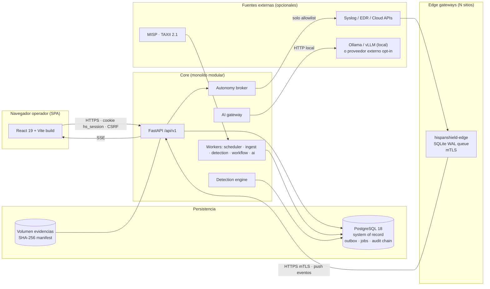

# SYSTEM ARCHITECTURE & DESIGN SYSTEM BLUEPRINT

- **Project Name:** HISPANSHIELD — Autonomous Cyber Defence Platform
- **Architecture Status:** `LOCKED` (v1.0.0) — cambios solo vía ADR en §7
- **Primary Runtime & Stack:** Python 3.12 + FastAPI + SQLAlchemy 2.0 (sync) + Alembic + PostgreSQL 18 · React 19 + TypeScript 5.x strict + Vite 6 · Edge gateway Python + SQLite WAL · Workflow durable en PostgreSQL (no Temporal)
- **Deployment Topology:** Monolito modular + worker pool + edge gateways; on-premise / air-gapped / Kubernetes
- **Last Updated By:** `@architect`
- **Verified Environment:** Python 3.12.16 (`/tmp/opencode/hs-venv`), PostgreSQL 18.6 (`/tmp/opencode:55432`, trust auth), Node 22.14.0, Rust 1.100, git. **Sin** Docker daemon, Redis, Ollama/vLLM, OpenSearch, Qdrant, Neo4j, Temporal, Keycloak ni Vault en runtime.

---

## 1. TECH STACK & PINNED DEPENDENCIES

| Layer | Technology / Package | Version | Purpose & Architectural Justification |
| :--- | :--- | :--- | :--- |
| **Runtime backend** | Python | `3.12.x` | Tipado moderno (`type` params, `ExceptionGroup`), soporte LTS de librerías; verificado en el entorno |
| **API framework** | FastAPI + Uvicorn | `^0.115` / `^0.32` | OpenAPI nativo, DI explícita, validación Pydantic integrada, ASGI con workers |
| **Validation** | Pydantic v2 + pydantic-settings | `^2.9` / `^2.6` | Validación estricta en frontera, `model_config = ConfigDict(extra="forbid")` |
| **ORM / DB access** | SQLAlchemy 2.0 (sync) + psycopg 3 | `^2.0` / `^3.2` | Sesiones síncronas en threadpool: simple, depurable, sin `greenlet`; SQL explícito en consultas críticas |
| **Migrations** | Alembic | `^1.14` | Migraciones versionadas, upgrade/downgrade testeados |
| **Database** | PostgreSQL | `18.x` | Fuente de verdad única: JSONB, FTS (`tsvector`, `pg_trgm`), particiones declarativas, `LISTEN/NOTIFY`, row-level scoping por `organization_id` |
| **Jobs / colas** | Tabla `jobs` + `FOR UPDATE SKIP LOCKED` | — | Cola durable sin broker externo; leases, reintentos, dead-letter |
| **Event bus** | Transactional outbox + `LISTEN/NOTIFY` | — | Atomicidad con la transacción de negocio; fan-out in-process y SSE |
| **Auth crypto** | Argon2id (`argon2-cffi`), `itsdangerous`, `pyotp` | `^23.1` / `^2.2` / `^2.9` | Hashing memorio-duro, cookies firmadas, TOTP RFC 6238 |
| **Secrets at rest** | `cryptography` Fernet (AES-128-CBC + HMAC-SHA256) | `^44` | Cifrado de secretos de conectores con clave externa (`HISPANSHIELD_SECRET_KEY`) |
| **HTTP client** | `httpx` | `^0.28` | Cliente con timeouts, retries explícitos, límites de tamaño de respuesta |
| **SIEM parsing** | `pyparsing` (DSL), `python-dateutil`, stdlib `syslog` mapping | `^3.2` | DSL de detección, normalización temporal |
| **IA / vectores** | `numpy` (cosine), `httpx` a Ollama/vLLM/OpenAI-compatible | `^2.1` | RAG local sin servicio vectorial: vectores en JSONB/`float4[]` + similitud en proceso |
| **Frontend** | React 19 + TypeScript 5.x + Vite 6 | `^19.0` / `^5.7` / `^6.0` | SPA operativa, build rápido, sin SSR innecesario para consola interna |
| **Routing / estado** | `react-router` 7 + TanStack Query 5 | `^7` / `^5` | Rutas declarativas, caché de servidor con invalidación explícita |
| **Estilos** | CSS Modules + custom properties | — | Design system propio con tokens; sin Tailwind para control total de densidad y contraste |
| **Gráficos** | `uplot` (series temporales) + SVG propio (grafos/topología) | `^1.6` | Rendimiento en series largas; SVG para grafos pequeños y accesibles |
| **Testing frontend** | Vitest + Testing Library + Playwright + axe-core | `^2.1` / `^16` / `^1.48` | Unit, componente, E2E y accesibilidad |
| **Testing backend** | pytest + pytest-cov + `httpx.ASGITransport` + testcontainers-less (BD local) | `^8` | Integración contra PostgreSQL real en `:55432` |
| **Calidad** | ruff, mypy `--strict`, bandit, pip-audit, gitleaks | últimas estables | Lint, tipos, seguridad estática, CVEs, secretos |
| **Empaquetado** | `uv` + wheels offline + bundle OCI opcional | `^0.13` | Reproducibilidad y air-gap |
| **Edge** | Python 3.12 + SQLite (WAL) + `ssl` mTLS + systemd | — | Store-and-forward sin dependencias; instalable en appliance mínimo |
| **Observabilidad** | `prometheus-client`, logs JSON a stdout, `/healthz`, `/readyz`, `/metrics` | `^0.21` | Sin stack externo obligatorio (compatible con Prometheus/Grafana si existe) |

**Regla de dependencias:** toda dependencia nueva requiere ADR y entrada en la allowlist de `docs/license-policy.md`. Prohibidas licencias `AGPL/SSPL/BSL/comercial-restrictiva` en runtime; `LGPL` solo enlazado dinámicamente y documentado.

---

## 2. DIRECTORY & MODULE TOPOLOGY

> **Regla para `@builder`:** Prohibido crear archivos fuera de esta estructura sin actualizar primero este árbol. La estructura canónica es **un paquete por dominio** en `backend/app/modules/<domain>/`, autodescubierto por `app/api/router.py`. La frontera es unidireccional: `router → service → models/core`; un módulo **no** importa el `service` de otro módulo, solo su interfaz pública o eventos de outbox.

```text
/
├── backend/
│   ├── app/
│   │   ├── main.py                     # create_app(): middleware, lifespan, handlers, montaje de router
│   │   ├── api/router.py               # autodescubre modules/*/router.py; no se edita a mano
│   │   ├── core/                       # infraestructura transversal
│   │   │   ├── config.py               # Settings (pydantic-settings), validación de entorno
│   │   │   ├── db.py                   # Engine, SessionLocal, unit_of_work(), healthcheck
│   │   │   ├── crypto.py               # Argon2id, Fernet envelope, hash/HMAC helpers
│   │   │   ├── errors.py               # AppError → {error:{code,message,fields,request_id}}
│   │   │   ├── logging.py              # JSON logs, request_id, redacción de PII/secretos
│   │   │   ├── rbac.py                 # matriz declarativa de permisos por rol
│   │   │   ├── audit.py                # cadena de hash append-only
│   │   │   ├── rate_limit.py           # límites por IP/usuario/org/token
│   │   │   ├── ssrf.py                 # allowlist de destinos y bloqueo de rangos privados
│   │   │   ├── deps.py                 # get_db, get_session, require_permission, get_org, CSRF
│   │   │   └── schemas.py              # StrictModel / ORMModel base, paginación, errores
│   │   ├── models/                     # SQLAlchemy declarative por agregado
│   │   │   ├── core.py                 # organizations, users, memberships, sessions, tokens, audit
│   │   │   ├── assets.py               # assets, zones, relationships, iot/ot profiles
│   │   │   ├── events.py               # events, rules, alerts, outbox, jobs
│   │   │   ├── incidents.py            # incidents, timeline, evidence, custody, forensics
│   │   │   ├── ti.py                   # indicators, actors, campaigns, feeds, matches
│   │   │   ├── connectors.py           # connectors, secrets, health, protocols
│   │   │   ├── ai.py                   # providers, models, runs, documents, chunks, agents, mcp
│   │   │   └── compliance.py           # frameworks, controls, evidence, assessments, reports
│   │   ├── data/frameworks/            # catálogos normativos versionados (seed)
│   │   └── modules/<domain>/           # un paquete por dominio funcional
│   │       ├── router.py               # APIRouter(prefix="/...", tags=[...])
│   │       ├── schemas.py              # contratos Pydantic v2 (extra="forbid")
│   │       ├── service.py              # reglas de negocio, transacciones, outbox
│   │       ├── repository.py           # consultas SQL scoped por organización (si aplica)
│   │       └── <aux>.py                # engine.py, builtin_rules.py, seed.py, mapping.py…
│   │
│   │   Dominios: auth · organizations · assets · vulnerabilities · attack_surface ·
│   │             events · siem · incidents · threat_intel · soar · defence (autonomía) ·
│   │             ai · agents · mcp · connectors · edge · iot · ot · forensics ·
│   │             compliance · reports · overview · posture
│   ├── migrations/versions/            # Alembic
│   ├── tests/{unit,integration,security,autonomy,performance}/
│   ├── pyproject.toml
│   └── alembic.ini
├── frontend/
│   ├── src/
│   │   ├── main.tsx, App.tsx, routes.tsx
│   │   ├── styles/{tokens.css,app.css}
│   │   ├── components/{ui,layout,charts,features}/
│   │   ├── pages/                      # 23 pantallas + Login, Mfa, Setup, NotFound
│   │   ├── lib/{api.ts,auth.tsx,i18n.tsx,query.ts,sse.ts,format.ts,download.ts}
│   │   └── types/
│   ├── e2e/                            # Playwright
│   └── package.json, vite.config.ts, tsconfig.json
├── edge/
│   ├── hispanshield_edge/{__init__.py,__main__.py,agent.py,cli.py,client.py,collectors.py,config.py,queue.py}
│   ├── systemd/hispanshield-edge.service.example
│   ├── pyproject.toml
│   └── tests/                          # unit + contrato HTTP contra fake core
├── deploy/
│   ├── compose/                        # docker-compose.yml (core, worker, web, postgres)
│   └── k8s/                            # deployment, service, ingress, networkpolicy, secrets template
├── infra/                              # postgres tuning, proxy, systemd, observabilidad
├── scripts/                            # verify_all, backup, restore, sbom, airgap
├── specs/                              # SDD (constitución, dominios, ADRs)
├── docs/                               # auditoría, manuales, C4, roadmap
├── .factory/                           # SPEC, ARCHITECTURE, TASKS, SECURITY_AUDIT
├── reports/                            # sbom, perf, auditorías (generados)
└── examples/                           # payloads de ejemplo (OCSF, STIX, CSV, prompts)
```

**Mapeo conceptual → materialización.** Los documentos de `specs/` usan nombres de capa (`services/`, `repositories/`, `api/v1/`, `detection/`, `workflow/`, `autonomy/`, `ai/`, `integrations/`). Su materialización en el código es:

| Capa conceptual | Ruta real |
| :--- | :--- |
| `api/v1/<dominio>.py` | `app/modules/<dominio>/router.py` |
| `services/<dominio>.py` | `app/modules/<dominio>/service.py` |
| `repositories/<dominio>.py` | `app/modules/<dominio>/repository.py` |
| `detection/*` | `app/modules/siem/` (`engine.py`, `dsl.py`, `builtin_rules.py`) |
| `workflow/*` | `app/modules/soar/` (`engine.py`, `steps.py`) |
| `autonomy/*` | `app/modules/defence/` (`policy.py`, `broker.py`, `kill_switch.py`, `safety.py`) |
| `ai/*`, `agents/*`, `mcp/*` | `app/modules/{ai,agents,mcp}/` |
| `integrations/*` | `app/modules/connectors/` (+ `edge/` para el gateway) |

### 2.1 Fronteras de módulo y reglas de acoplamiento

| Regla | Descripción | Verificación |
| :--- | :--- | :--- |
| `M-01` | `modules/<dominio>/router.py` no contiene lógica de negocio; solo validación, permiso y llamada a `service.py` | revisión + `test_architecture.py` (AST import check) |
| `M-02` | Ningún `modules/<dominio>/service.py` importa el `service.py` de otro módulo; usa interfaz pública o eventos de outbox | `tests/unit/test_import_boundaries.py` |
| `M-03` | Todo acceso a datos pasa por `modules/<dominio>/repository.py` (o consultas del service) y aplica filtro `organization_id` | `test_tenant_isolation.py` + revisión |
| `M-04` | Toda escritura de dominio relevante publica un evento de outbox en la misma transacción | `test_outbox_atomicity.py` |
| `M-05` | Los workers solo consumen casos de uso públicos; no acceden a routers | revisión estructural |
| `M-06` | Modelos SQLAlchemy no se serializan directamente; siempre `schemas/` | `test_no_orm_leak.py` (response_model estricto) |
| `M-07` | El edge no comparte código de `backend/`; solo contrato HTTP firmado | `edge/tests/test_contract.py` |

### 2.2 Topología de runtime



**Procesos desplegables:** `hispanshield-api` (uvicorn, N workers), `hispanshield-worker-*` (scheduler, ingest, detection, workflow, ai — pueden co-localizarse con `--queue` selectivo), `hispanshield-web` (estático servido por Caddy/nginx), `hispanshield-edge` (por sitio). Sin broker ni caché externos.

---

## 3. DATA LAYER & SCHEMA CONTRACTS

### 3.1 Convenciones transversales

| Convención | Regla |
| :--- | :--- |
| PK | `id UUID` generado con UUIDv7 en aplicación (`uuid6`-style helper) para orden temporal e índices amigables |
| Tenancy | `organization_id UUID NOT NULL REFERENCES organizations(id)` en toda tabla de dominio; índice compuesto `(organization_id, created_at DESC)` |
| Tiempo | `created_at`, `updated_at` `TIMESTAMPTZ NOT NULL DEFAULT now()`; siempre UTC; `deleted_at` para soft delete |
| Auditoría | `created_by`, `updated_by` UUID nullable (nulo = sistema/autónomo) |
| Versión optimista | `row_version INTEGER NOT NULL DEFAULT 1` en agregados editables; `If-Match` opcional |
| Enumeraciones | `VARCHAR + CHECK` (no `ENUM` nativo) para permitir migración sin `ALTER TYPE` bloqueante |
| JSONB | solo para atributos heterogéneos (`attributes`, `config`, `payload`); nunca para campos consultados/filtrados críticos |
| Nombres | tablas `snake_case` plural; columnas `snake_case`; constraints `pk_/fk_/uq_/ck_/ix_` |
| Borrado | soft delete en dominio; purga física solo por job de retención o GDPR con auditoría |
| Row scoping | todos los repositorios reciben `organization_id` obligatorio (no opcional) en su firma |

### 3.2 Entidades núcleo (contratos resumidos)

> Esquema completo, relaciones y diagramas ER en `specs/data-models/entities.md` y `specs/architecture/data-architecture.md`.

#### Entity: organizations
| Column | Type | Constraints | Security / Notes |
| :--- | :--- | :--- | :--- |
| `id` | UUID | PK | UUIDv7 |
| `slug` | VARCHAR(64) | UNIQUE, NOT NULL, `^[a-z0-9-]{3,64}$` | Usado en URLs de UI, nunca como autorización |
| `name` | VARCHAR(160) | NOT NULL | Nombre legal |
| `sector` | VARCHAR(48) | NOT NULL | `public_admin`, `energy`, `health`, `water`, `transport`, `finance`, `other` (NIS2 Anexo I/II) |
| `nis2_entity_type` | VARCHAR(24) | NOT NULL DEFAULT `'important'` | `essential` \| `important` |
| `data_region` | VARCHAR(16) | NOT NULL DEFAULT `'eu'` | Restricción de procesamiento IA |
| `settings` | JSONB | NOT NULL DEFAULT `'{}'` | Feature flags de org, retención, autonomía por defecto |
| `status` | VARCHAR(16) | NOT NULL DEFAULT `'active'` | `active` \| `suspended` \| `soft_deleted` |
| `deleted_at` | TIMESTAMPTZ | NULL | Purga a 30 días |

#### Entity: users / memberships
| Column | Type | Constraints | Security / Notes |
| :--- | :--- | :--- | :--- |
| `users.id` | UUID | PK | |
| `users.email` | CITEXT | UNIQUE, NOT NULL | Normalizado; índice único global |
| `users.password_hash` | TEXT | NOT NULL | Argon2id; `NULL` si solo SSO futuro; jamás serializado |
| `users.mfa_secret_enc` | TEXT | NULL | Cifrado Fernet; nunca devuelto |
| `users.status` | VARCHAR(16) | NOT NULL DEFAULT `'active'` | `active` \| `disabled` \| `locked` |
| `memberships.id` | UUID | PK | |
| `memberships.user_id` | UUID | FK → users, `ON DELETE CASCADE` | |
| `memberships.organization_id` | UUID | FK → organizations, `ON DELETE CASCADE` | |
| `memberships.role` | VARCHAR(16) | NOT NULL, CHECK in (`owner`,`admin`,`responder`,`analyst`,`viewer`,`auditor`) | Unicidad `(user_id, organization_id, role)` |
| `memberships.status` | VARCHAR(16) | NOT NULL DEFAULT `'active'` | `invited` \| `active` \| `suspended` |

#### Entity: assets
| Column | Type | Constraints | Security / Notes |
| :--- | :--- | :--- | :--- |
| `id` | UUID | PK | |
| `organization_id` | UUID | FK, NOT NULL | scoping obligatorio |
| `name` | VARCHAR(200) | NOT NULL | |
| `kind` | VARCHAR(24) | NOT NULL CHECK | `host`,`network`,`application`,`cloud_resource`,`iot`,`ot`,`identity`,`data_store` |
| `criticality` | SMALLINT | NOT NULL CHECK 1..5 | 5 = crítico NIS2 |
| `zone_id` | UUID | FK → asset_zones, NULL salvo iot/ot | Obligatorio para IoT/OT |
| `attributes` | JSONB | NOT NULL DEFAULT `'{}'` | `ip`, `os`, `protocol`, `purdue_level`, `firmware`, `cloud_arn` |
| `risk_score` | NUMERIC(5,2) | NOT NULL DEFAULT 0 | Recalculado por evento; `0..100` |
| `source` | VARCHAR(32) | NOT NULL | `manual`,`import`,`connector`,`discovery` |
| `deleted_at` | TIMESTAMPTZ | NULL | soft delete |

#### Entity: events (particionada por mes)
| Column | Type | Constraints | Security / Notes |
| :--- | :--- | :--- | :--- |
| `id` | UUID | PK (con `occurred_at`) | |
| `organization_id` | UUID | NOT NULL | Partición por `occurred_at`; índice `(organization_id, occurred_at DESC)` |
| `event_uid` | VARCHAR(128) | NOT NULL | Idempotencia; UNIQUE `(organization_id, event_uid)` por partición |
| `class_uid` | INTEGER | NOT NULL | OCSF class |
| `activity_id` | INTEGER | NOT NULL | OCSF activity |
| `severity_id` | SMALLINT | NOT NULL 0..6 | OCSF severity |
| `occurred_at` | TIMESTAMPTZ | NOT NULL | Clave de partición |
| `src_ip` / `dst_ip` | INET | NULL | Tipado para matching y filtros |
| `actor` / `device` / `observables` | JSONB | NOT NULL DEFAULT | Estructura OCSF |
| `raw` | TEXT | NOT NULL | Inmutable; trigger bloquea UPDATE/DELETE (salvo drop partition) |
| `raw_hash` | CHAR(64) | NOT NULL | SHA-256 del crudo |
| `search_tsv` | TSVECTOR | GENERATED | FTS español + simple |

#### Entity: audit_log (cadena de hash)
| Column | Type | Constraints | Security / Notes |
| :--- | :--- | :--- | :--- |
| `seq` | BIGSERIAL | PK | Orden total |
| `organization_id` | UUID | NULL (acciones de plataforma) | |
| `actor_type` | VARCHAR(16) | NOT NULL | `user`,`service`,`agent`,`system` |
| `actor_id` | UUID | NULL | |
| `action` | VARCHAR(96) | NOT NULL | `auth.login`, `asset.create`, `autonomy.execute`… |
| `resource_type` / `resource_id` | VARCHAR(48) / UUID | | |
| `payload` | JSONB | NOT NULL | Redactado (sin secretos) |
| `prev_hash` | CHAR(64) | NOT NULL | Hash de la entrada anterior |
| `entry_hash` | CHAR(64) | NOT NULL | `sha256(prev_hash || canonical_json(payload))` |
| `request_id` | VARCHAR(64) | NOT NULL | Correlación |

Otras entidades obligatorias (contratos completos en `specs/data-models/entities.md`): `sessions`, `api_tokens`, `invitations`, `asset_relationships`, `asset_zones`, `attack_surface_observations`, `exposure_diffs`, `vulnerabilities`, `vulnerability_instances`, `risk_exceptions`, `detection_rules`, `detection_rule_versions`, `alerts`, `incidents`, `incident_timeline`, `evidence`, `indicators`, `threat_actors`, `campaigns`, `feeds`, `feed_sync_runs`, `connectors`, `connector_secrets`, `connector_health`, `playbooks`, `playbook_versions`, `executions`, `execution_steps`, `approvals`, `autonomy_policies`, `policy_versions`, `policy_decisions`, `actions`, `action_results`, `kill_switches`, `ai_providers`, `ai_models`, `ai_runs`, `ai_messages`, `documents`, `document_chunks`, `mcp_servers`, `mcp_tools`, `tool_invocations`, `frameworks`, `controls`, `control_versions`, `control_mappings`, `assessments`, `assessment_results`, `evidence_items`, `reports`, `jobs`, `outbox_events`, `settings`.

### 3.3 Estrategia de aislamiento y rendimiento

1. **Scoping en repositorio:** firma `def list_assets(session, *, organization_id: UUID, ...)`; el compilador de tipos impide omitirlo. Test AST verifica que ningún `select(Model)` en `repositories/` carezca de `organization_id`.
2. **Defensa en profundidad opcional:** `SET LOCAL app.organization_id` + políticas RLS en tablas de alto riesgo (`events`, `incidents`, `evidence`). RLS se activa por feature flag porque el rol de aplicación debe ser no-superuser.
3. **Particionado:** `events` y `audit_log` por rango mensual; `alerts` por trimestre. Job `maintenance` crea particiones con 2 meses de antelación y elimina fuera de retención.
4. **Índices clave:** `events(organization_id, occurred_at DESC)`, GIN en `search_tsv`, `alerts(organization_id, status, severity_id, created_at DESC)`, `vulnerability_instances(organization_id, status, risk_score DESC)`, `audit_log(organization_id, seq)`.
5. **Consultas pesadas:** siempre `LIMIT` máximo (`HISPANSHIELD_MAX_PAGE_SIZE=200`) y rechazo `422 query_too_broad` si el rango temporal > 90 días sin filtro adicional.

---

## 4. API & SERVER CONTRACTS

**Base:** `/api/v1`. **Auth:** cookie `hs_session` (HttpOnly, Secure, SameSite=Strict) + `X-CSRF-Token` en mutaciones; o `Authorization: Bearer hs_pat_*` para servicio (sin CSRF, con scopes). **Tenancy:** `X-Organization-Id` obligatorio en rutas org-scoped. **Errores:** `{error:{code,message,fields[],request_id}}`. **Paginación:** cursor `?cursor=&limit=` → `{data[], meta:{next_cursor,total_estimate}}`. **Idempotencia:** `Idempotency-Key` en POST de ingesta/ejecución. **Versionado:** prefijo `/v1`; cambios incompatibles → `/v2` con solapamiento ≥1 release.

| Method | Endpoint | Auth / Role | Input Schema | Success Response | Error Codes |
| :--- | :--- | :--- | :--- | :--- | :--- |
| POST | `/auth/login` | Público (rate-limited) | `LoginRequest` | `200 {user, organizations}` + cookie | `400,401,429` |
| POST | `/auth/mfa/verify` | Público con `challenge_id` | `MfaVerifyRequest` | `200 {user}` + cookie | `400,401,410` |
| POST | `/auth/logout` | Sesión | — | `204` | `401` |
| GET | `/auth/me` | Sesión/Bearer | — | `200 {user, memberships, permissions}` | `401` |
| POST | `/auth/password/change` | Sesión | `PasswordChangeRequest` | `204` | `400,401,422` |
| POST | `/auth/mfa/enroll` · `/auth/mfa/activate` | Sesión | `MfaEnrollRequest` | `200 {otpauth_url, recovery_codes[]}` | `401,409` |
| GET/POST | `/organizations` | Sesión | `OrgCreateRequest` | `200/201` | `400,403,409` |
| GET/PATCH/DELETE | `/organizations/{id}` | `admin`/`owner` | `OrgUpdateRequest` | `200/204` | `403,404,409,422` |
| GET/POST/PATCH/DELETE | `/organizations/{id}/members` | `admin`+ | `MemberInviteRequest` | `200/201/204` | `403,404,409,422` |
| GET/POST/DELETE | `/users`, `/users/{id}/tokens` | `admin`, self | `TokenCreateRequest` | `200/201/204` | `403,404,422` |
| GET/POST | `/assets` | `viewer`+ / `admin`+ | `AssetCreate` | `200/201` | `400,403,422` |
| GET/PATCH/DELETE | `/assets/{id}` | `viewer`+ / `admin`+ | `AssetUpdate` | `200/204` | `403,404,409,422` |
| POST | `/assets/import` | `admin`+ | multipart CSV/JSON | `207 {created,failed[]}` | `413,415,422` |
| POST/DELETE | `/assets/{id}/relationships` | `admin`+ | `RelationshipCreate` | `201/204` | `403,404,409` |
| GET/POST | `/assets/{id}/iot` · `/assets/{id}/ot` | `admin`+ | `IotProfile`/`OtProfile` | `201` | `422` |
| GET/POST/PATCH | `/zones` | `admin`+ | `ZoneCreate` | `200/201` | `403,409,422` |
| GET | `/attack-surface` · `/attack-surface/diffs` | `viewer`+ | query filters | `200 {data[],meta}` | `400,403` |
| POST | `/attack-surface/import` · `/ranges` | `admin`+ | `AsmImport` | `207` | `413,422` |
| GET | `/attack-surface/export?format=stix2.1|csv` | `analyst`+ | — | `200` fichero | `403,406` |
| GET/POST | `/vulnerabilities` | `viewer`+ / `analyst`+ | `VulnCreate` | `200/201` | `403,422` |
| PATCH | `/vulnerabilities/{id}/{status,assignee,exception}` | `responder`+ | `VulnUpdate` | `200` | `403,404,409,422` |
| POST | `/vulnerabilities/import` | `analyst`+ | multipart `.nessus`/JSON | `207` | `413,415,422` |
| POST | `/events/webhook/{connector_id}` | HMAC | `RawEventBatch` | `202 {event_ids[],duplicates}` | `401,413,422,429` |
| POST | `/events/search` | `analyst`+ | `EventQuery` | `200 {data[],meta}` | `400,422` |
| GET | `/events/stream` (SSE) | `analyst`+ | query filters | `text/event-stream` | `401,429` |
| GET/POST/PATCH | `/detection-rules` | `analyst`+ | `RuleCreate` | `200/201` | `403,422` |
| POST | `/detection-rules/{id}/test` | `analyst`+ | `RuleTestRequest` | `200 {matched[]}` | `422` |
| GET/PATCH | `/alerts` · `/alerts/{id}` | `analyst`+ | `AlertUpdate` | `200` | `403,404,409` |
| POST | `/alerts/{id}/promote` | `responder`+ | `PromoteRequest` | `201 {incident}` | `403,409` |
| GET/POST/PATCH | `/incidents` | `viewer`+ / `responder`+ | `IncidentCreate` | `200/201` | `403,409,422` |
| POST | `/incidents/{id}/timeline` · `/evidence` | `responder`+ | `TimelineEntry`/multipart | `201` | `403,413,415,422` |
| POST | `/incidents/{id}/report` | `responder`+ | — | `202 {report_id}` | `403,409` |
| GET/POST | `/threat-intel/indicators` · `/actors` · `/feeds` | `analyst`+ | `IndicatorCreate` | `200/201` | `403,422` |
| POST | `/threat-intel/stix/import` · `GET /stix/export` | `analyst`+ | STIX bundle | `207` / `200` | `413,422` |
| POST | `/threat-intel/feeds/{id}/sync` | `admin`+ | — | `202 {run_id}` | `403,409,429` |
| GET/POST | `/connectors` | `admin`+ | `ConnectorCreate` | `200/201` | `403,409,422` |
| PATCH/DELETE | `/connectors/{id}` | `admin`+ | `ConnectorUpdate` | `200/204` | `403,404,422` |
| POST | `/connectors/{id}/test` · `/rotate-secret` | `admin`+ | `SecretRotate` | `200` | `403,422` |
| GET | `/connectors/{id}/health` · `/errors` | `admin`+ | — | `200 {state,last_error,next_attempt_at}` | `403,404` |
| GET/POST | `/playbooks` | `analyst`+ | `PlaybookCreate` | `200/201` | `403,422` |
| POST | `/playbooks/{id}/versions` · `/publish` | `admin`+ | `DagDefinition` | `201` | `403,409,422` |
| POST | `/playbooks/{id}/execute` | `responder`+ | `ExecutionRequest` | `202 {execution_id}` | `403,409,422,429` |
| GET | `/executions` · `/executions/{id}` | `responder`+ | — | `200 {steps[],state}` | `403,404` |
| POST | `/executions/{id}/cancel` · `/compensate` | `responder`+ | — | `202` | `403,409` |
| GET/POST | `/approvals` · `/approvals/{id}/decide` | `admin`+ | `ApprovalDecision` | `200` | `403,404,409` |
| GET/POST | `/autonomy/policies` | `admin`+ | `PolicyCreate` | `200/201` | `403,422` |
| POST | `/autonomy/evaluate` | `responder`+ | `ActionRequest` | `200 {decision,reason,decision_id}` | `403,422` |
| POST | `/autonomy/actions` | `responder`+ | `ActionRequest` | `202 {action_id,state}` | `403,429,503` |
| GET | `/autonomy/actions/{id}` | `responder`+ | — | `200 {decision,result,verification}` | `403,404` |
| POST | `/autonomy/kill-switches` · `/kill-switches/{id}/activate` | `owner` | `KillSwitchCreate` | `201/200` | `403,409` |
| GET/POST | `/ai/providers` · `/ai/providers/{id}/test` | `admin`+ | `ProviderConfig` | `200/201` | `403,422` |
| POST | `/ai/chat` · `/ai/rag/query` | `analyst`+ | `ChatRequest`/`RagQuery` | `200 {answer,citations[],usage}` | `403,429,503` |
| GET/POST | `/ai/documents` · `/ai/models` | `admin`+ | multipart/`ModelConfig` | `200/201` | `413,415,422` |
| GET/POST | `/agents` · `/agents/{id}/runs` | `analyst`+ | `AgentRunRequest` | `200/202` | `403,409,429,503` |
| GET/POST | `/mcp/servers` · `/mcp/tools` · `/mcp/tools/{name}/invoke` | `admin`+ | `ToolInvokeRequest` | `200/201` | `403,422` |
| GET | `/compliance/frameworks` · `/controls` · `/mappings` | `viewer`+ | — | `200` | `403` |
| POST | `/compliance/assessments` · `/assessments/{id}/run` | `auditor`/`admin` | `AssessmentCreate` | `201/202` | `403,409,422` |
| GET/POST | `/compliance/evidence` | `auditor`+ | multipart | `200/201` | `403,413,415` |
| POST | `/reports` · `GET /reports/{id}/download` | `auditor`+ | `ReportRequest` | `202/200` | `403,409` |
| GET | `/audit` · `/audit/verify` · `/audit/actions/{id}` | `auditor`+ | query | `200` | `403,422` |
| GET | `/metrics` (Prometheus) · `/healthz` · `/readyz` | interno/red permitida | — | `200` | `503` |
| GET/PATCH | `/settings` | `admin`+ | `SettingsUpdate` | `200` | `403,422` |

**Contratos detallados** (esquemas de request/response, códigos de error, ejemplos, cursores y SSE): `specs/api/rest-contract.md` y `docs/api-reference.md`.

### 4.1 Eventos de dominio (outbox)

| Evento | Emitido por | Consumidores | Payload mínimo |
| :--- | :--- | :--- | :--- |
| `asset.created` / `asset.updated` / `asset.risk_changed` | assets | detection, autonomy, metrics | `asset_id`, `org_id`, `risk_score` |
| `vulnerability.updated` | vulnerabilities | assets (risk), compliance | `instance_id`, `severity`, `status` |
| `event.ingested` | siem | detection, cti matching | `event_id`, `class_uid`, `org_id` |
| `alert.created` / `alert.updated` | detection | correlation, notifications, SSE | `alert_id`, `severity`, `dedupe_key` |
| `incident.created` / `incident.state_changed` | incidents | compliance (NIS2), reports | `incident_id`, `state`, `severity` |
| `execution.step_completed` / `execution.finished` | workflow | SSE, autonomy, audit | `execution_id`, `step_id`, `state` |
| `autonomy.decision` / `autonomy.action_executed` / `autonomy.halted` | autonomy | audit, SSE, metrics | `decision_id`, `action_id`, `result` |
| `connector.health_changed` | connectors | SSE, alerts | `connector_id`, `state`, `last_error` |
| `ai.run_completed` | ai | metrics, audit | `run_id`, `tokens`, `cost`, `provider` |
| `audit.appended` | audit | (solo métricas) | `seq`, `entry_hash` |

Entrega **at-least-once** con deduplicación por `event_id` en consumidores. `outbox_events(status, available_at, attempts)` con índice parcial `WHERE status='pending'`.

### 4.2 Motor de workflow durable (PostgreSQL)

- Tabla `jobs(id, queue, payload, state, attempts, max_attempts, lease_owner, lease_expires_at, available_at, last_error, idempotency_key, created_at)`.
- Claim: `SELECT ... WHERE state='pending' AND available_at<=now() ORDER BY priority, available_at FOR UPDATE SKIP LOCKED LIMIT :n` → `state='running'`, lease 60 s renovable por heartbeat.
- Reanudación: si `lease_expires_at < now()` el job vuelve a `pending` con `attempts+1`; los pasos completados se leen de `execution_steps` (idempotencia por `step_key`).
- Backoff: `min(cap, base * 2^attempts) * (0.5 + random()/2)`; `max_attempts=3` → `dead_letter`.
- Compensación: pila LIFO de acciones inversas declaradas en el playbook; se ejecuta en orden inverso al fallo.
- Aislamiento: cada paso es una transacción de dominio independiente + `idempotency_key` único por `(execution_id, step_key)`.

### 4.3 Motor de autonomía (resumen de contrato)

```text
ActionRequest { action_type, targets[], parameters, requested_by, autonomy_level, justification }
  → PolicyEngine.evaluate()  [determinista, deny-by-default, ≤50ms p95]
      inputs: org policy version, asset class/criticality/purdue, target count (blast radius),
              connector capability, autonomy level, change freeze, rate budget, telemetry freshness,
              safety interlock, approval requirements
  → Decision { decision: allow|deny|require_approval, matched_rules[], reason, policy_version, decision_id }
  → (si allow/approved) ExecutionBroker.execute() → connector allowlist → result
  → Verifier.verify() [≤60s, criterio declarado por acción] → verified | failed
  → (failed) Rollback.run() idempotente → rolled_back
  → Audit.append(action) + outbox autonomy.action_executed
```

Kill switches evaluados **antes** de cada paso del broker (no solo al encolar), con caché invalidada por `NOTIFY kill_switch_changed`, garantizando halt ≤5 s.

---

## 5. UI DESIGN SYSTEM (`@ui-artisan` CONTRACT)

- **Aesthetic Personality:** Instrumento de precisión para operadores de ciberdefensa. Superficies oscuras en capas, bordes de 1px, densidad informativa alta pero respirable, jerarquía tipográfica clara, acento cian reservado a interacción/estado activo y ámbar a señal operativa. Sin decoración gratuita; cada pixel comunica estado.
- **Color Tokens (`frontend/src/styles/tokens.css`):**
  - `--bg-canvas: #070B10` | `--bg-surface: #0C1219` | `--bg-elevated: #131C27` | `--bg-inset: #050810`
  - `--border-subtle: #23303F` | `--border-strong: #33465C` | `--border-focus: #38BDF8`
  - `--text-primary: #E8EFF7` | `--text-secondary: #C2D0DE` | `--text-muted: #93A6BA`
  - `--accent-primary: #38BDF8` | `--accent-hover: #0EA5E9` | `--accent-foreground: #04121C`
  - `--signal-amber: #F5A524`
  - `--status-success: #34D399` | `--status-warning: #FBBF24` | `--status-danger: #F87171` | `--status-info: #38BDF8` | `--status-neutral: #93A6BA`
  - `--overlay-scrim: rgba(3,6,10,0.72)` | `--skeleton-base: #16202C` | `--skeleton-shine: #1E2B3A`
- **Typography & Rhythm:**
  - Display: **Sora** 600/700 (`--font-display`), body: **Inter** 400/500/600 (`--font-body`), mono: **JetBrains Mono** 400/500 (`--font-mono`). Ficheros `.woff2` autoalojados en `frontend/public/fonts` (sin CDN, air-gap safe).
  - Escala: `12/16`, `13/18`, `14/20`, `16/24`, `20/28`, `24/32`, `32/40`, `40/48`. `font-variant-numeric: tabular-nums` en tablas y KPIs.
  - Espaciado múltiplo de 4px: `--space-1..16` = `4,8,12,16,20,24,32,40,48,64`. Radios: `--radius-sm: 6px`, `--radius-md: 10px`, `--radius-lg: 14px`, `--radius-pill: 999px`.
  - Filas de tabla: 40px (default) / 32px (compact) / 48px (comfort). Sidebar 248px / 72px colapsado. Topbar 56px.
- **Mandatory Component Standards:**
  - Todo formulario: validación inline por campo (`aria-invalid`, `aria-describedby`), submit con `aria-busy="true"` y disabled durante envío, errores preservando input.
  - Toda tabla/lista asíncrona: `<TableSkeleton />`, `<EmptyState />`, `<ErrorBanner onRetry />` y badge `stale` si `as_of` supera el umbral.
  - Severidad siempre texto+color (`P1 CRITICAL`), nunca solo color. Iconografía lineal 16/20px (`lucide-react`).
  - Modales con focus trap, `Escape` cierra, retorno de foco al disparador. `Ctrl/Cmd+K` abre command palette.
  - Acciones destructivas: `ConfirmDialog` con nombre exacto + resumen de impacto + entrada de auditoría.
- **Responsive:** 375px (drawer, tablas con scroll propio), 768px (rail colapsado, 6 columnas), 1440px (12 columnas, master-detail simultáneo). Sin scroll horizontal del documento en ningún breakpoint.
- **Accesibilidad:** WCAG 2.2 AA, foco visible 2px con offset, `aria-live="polite"` para live stream, `prefers-reduced-motion` respetado, contraste verificado con axe-core en CI.

### 5.1 Tokens de estado (semántica obligatoria)

| Estado | Token de color | Uso en UI | Prohibido |
| :--- | :--- | :--- | :--- |
| `critical` / `P1` | `--status-danger` | Badge, borde izquierdo de fila, KPI | Usarlo para acciones no destructivas |
| `high` / `P2` | `--signal-amber` | Badge, icono de atención | Mezclar con cian en el mismo bloque |
| `medium` / `P3` | `--status-warning` | Badge y barra | Texto de párrafo largo |
| `low` / `P4-P5` | `--status-neutral` | Badge neutro | Ocultar el texto de severidad |
| `success` / `verified` | `--status-success` | Acción verificada, control compliant | Indicar éxito sin verificación real |
| `degraded` / `stale` | `--text-muted` + borde discontinuo | Badge con `as_of` | Mostrar como dato fresco |
| `autonomy active` | `--accent-primary` | Indicador persistente en topbar | Ocultarlo cuando A3/A4 está activo |
| `halted` | `--status-danger` | Banner global persistente | Descartable sin desactivar kill switch |

### 5.2 Mapa de pantallas → componentes y datos

| # | Ruta | Componentes núcleo | Endpoints primarios |
| :--- | :--- | :--- | :--- |
| 1 | `/overview` | `KpiStrip`, `TrendChart`, `PostureRadar`, `TopAssets` | `/metrics/summary`, `/compliance/assessments`, `/assets?criticality_gte=4` |
| 2 | `/soc` | `AlertQueue`, `SeverityHeatmap`, `QuickActions` | `/alerts`, `/alerts/{id}` |
| 3 | `/threats/live` | `LiveEventStream`, `StreamControls` | `/events/stream` (SSE) |
| 4 | `/incidents` | `IncidentList`, `IncidentDetail`, `Timeline`, `EvidencePanel` | `/incidents`, `/incidents/{id}/timeline` |
| 5 | `/threat-intel` | `IndicatorTable`, `ActorGraph`, `FeedHealth` | `/threat-intel/*` |
| 6 | `/assets` | `AssetTable`, `AssetGraph`, `AssetDrawer` | `/assets`, `/assets/{id}/relationships` |
| 7 | `/attack-surface` | `ExposureTable`, `DiffView`, `ScopeList` | `/attack-surface`, `/attack-surface/diffs` |
| 8 | `/vulnerabilities` | `VulnTable`, `RiskScoreBreakdown`, `SlaBadge` | `/vulnerabilities` |
| 9 | `/siem` | `QueryEditor`, `ResultTable`, `IngestHealth` | `/events/search`, `/connectors?kind=ingest` |
| 10 | `/soar` | `PlaybookList`, `ExecutionTable`, `ApprovalInbox` | `/playbooks`, `/executions`, `/approvals` |
| 11 | `/ai/agents` | `RunList`, `ToolCallTrace`, `BudgetMeter` | `/agents`, `/agents/{id}/runs` |
| 12 | `/iot-ot` | `DeviceTable`, `PurdueMap`, `ProtocolAnomalies` | `/assets?kind=iot`, `/assets?kind=ot` |
| 13 | `/network` | `SegmentMap`, `FlowTable`, `ConduitList` | `/assets?kind=network`, `/events/search?class_uid=...` |
| 14 | `/cloud` | `AccountList`, `PostureFindings`, `ProviderHealth` | `/connectors?kind=cloud`, `/cloud/posture` |
| 15 | `/identity` | `IdentityTable`, `MfaCoverage`, `PrivilegeRisks` | `/users`, `/identity/risks` |
| 16 | `/forensics` | `CaseList`, `EvidenceManifest`, `TimelineRecon` | `/forensics/cases`, `/evidence` |
| 17 | `/compliance` | `FrameworkPicker`, `ControlMatrix`, `GapList`, `EvidenceDrawer` | `/compliance/*` |
| 18 | `/integrations` | `ConnectorCatalog`, `HealthBadge`, `SecretForm` | `/connectors`, `/connectors/{id}/health` |
| 19 | `/playbooks/designer` | `DagCanvas`, `NodeInspector`, `ValidationPanel`, `DryRunBar` | `/playbooks/{id}/versions` |
| 20 | `/ai/models` | `ProviderTable`, `ModelCard`, `EvalResult`, `BudgetChart` | `/ai/providers`, `/ai/models` |
| 21 | `/audit` | `AuditTable`, `ChainVerifyPanel`, `ActionDetail` | `/audit`, `/audit/verify` |
| 22 | `/organizations` | `MemberTable`, `InviteDialog`, `RoleEditor`, `OrgSettings` | `/organizations/{id}/members` |
| 23 | `/admin` | `FeatureFlags`, `RetentionForm`, `KillSwitchPanel`, `SystemHealth` | `/settings`, `/autonomy/kill-switches`, `/readyz` |

---

## 6. SECURITY & INFRASTRUCTURE HARDENING

- **Authentication & Sessions:** contraseña Argon2id (`time_cost=3`, `memory_cost=65536`, `parallelism=2`, `hash_len=32`); TOTP obligatorio para roles `admin/owner` (aplicable por política de org); cookie `hs_session` `HttpOnly; Secure; SameSite=Strict; Path=/; Max-Age=43200`, ID rotado en login y en cambio de privilegio; idle timeout 30 min; sesiones persistidas con hash del token (nunca el token en claro).
- **Bearer tokens:** formato `hs_pat_<id>_<secret>`; se almacena `sha256(secret)` + `prefix` para búsqueda; scopes explícitos; expiración máxima 365 días; último uso auditado; revocación inmediata.
- **CSRF:** double-submit cookie `hs_csrf` (no HttpOnly) + header `X-CSRF-Token`; validación `hmac.compare_digest`; obligatorio en `POST/PATCH/PUT/DELETE` autenticados por cookie.
- **Authorization (Anti-IDOR):** resolución de org desde `X-Organization-Id` + verificación de membership; todo repositorio filtra por `organization_id`; recursos inexistentes y de otra org devuelven el mismo `404`; matriz rol×endpoint testeada por parametrización. `platform_admin` requiere `break-glass` auditado con TTL.
- **Secretos:** `HISPANSHIELD_SECRET_KEY` (Fernet, 32 bytes base64) obligatoria en producción y validada al arranque; secretos de conectores cifrados en `connector_secrets.value_enc`; nunca devueltos por API (`has_secret: true`); rotación con re-cifrado transaccional; MFA secrets también cifrados.
- **Cifrado en tránsito:** TLS terminado en reverse proxy (Caddy/nginx) con HSTS (`max-age=31536000; includeSubDomains`); mTLS entre edge y core cuando `require_client_cert=true`; `httpx` con verificación de certificado obligatoria (nunca `verify=False`).
- **HTTP Security Headers (middleware global):** `Content-Security-Policy: default-src 'self'; script-src 'self'; style-src 'self' 'unsafe-inline'; img-src 'self' data:; connect-src 'self'; font-src 'self'; frame-ancestors 'none'; base-uri 'none'; form-action 'self'`, `X-Content-Type-Options: nosniff`, `X-Frame-Options: DENY`, `Referrer-Policy: strict-origin-when-cross-origin`, `Permissions-Policy: geolocation=(), microphone=(), camera=()`, `Cross-Origin-Opener-Policy: same-origin`.
- **CORS:** lista explícita `HISPANSHIELD_ALLOWED_ORIGINS`; sin comodín en rutas autenticadas; `allow_credentials=True` solo con orígenes exactos.
- **SSRF:** cliente `httpx` con allowlist de esquemas `https` (y `http` solo a loopback para IA local), bloqueo de rangos privados/link-local/metadata (`127.0.0.0/8`, `10/8`, `172.16/12`, `192.168/16`, `169.254/16`, `::1`, `fc00::/7`), resolución DNS verificada post-connect (anti DNS-rebinding), límite de bytes y timeout.
- **Uploads:** límites 50 MB (evidencia) / 10 MB (import), validación por magic bytes, nombre sanitizado (UUID), almacenamiento fuera de webroot, permisos `0600`, hash SHA-256, antivirus opcional por hook (`HISPANSHIELD_SCAN_CMD`).
- **Rate limiting:** ventana deslizante por IP+usuario+org; login 5/15min, API 600/min por usuario, ingesta 10k/min por conector, IA 60/min por org; `429` con `Retry-After` y `X-RateLimit-*`.
- **Errores y logging:** handler centralizado; al cliente solo `{error:{code,message,fields,request_id}}`; logs JSON con `request_id`, `org_id`, `route`, `status`, `duration_ms`; redacción de `password`, `token`, `authorization`, `cookie`, `secret`, patrones de API keys; sin stack traces en respuestas.
- **Auditoría:** cadena de hash append-only (`prev_hash`/`entry_hash`), verificación por endpoint, trigger que bloquea `UPDATE/DELETE`; toda decisión de autonomía y todo acceso a evidencias genera entrada.
- **Aislamiento de procesos:** workers sin puerto público; API con `--proxy-headers` y `--forwarded-allow-ips` explícito; contenedor no-root, `read_only` rootfs donde sea posible, capabilities mínimas, `no-new-privileges`.
- **Supply chain (CRA):** dependencias pinneadas con hashes en `requirements.lock`; `pip-audit` + `bandit` + `gitleaks` en cada gate; SBOM CycloneDX por release; firma de artefactos (cosign opcional) y política de divulgación en `SECURITY.md`.
- **Datos personales (GDPR):** minimización en eventos (no almacenar contenido de comunicaciones), redacción configurable, base legal documentada en RoPA, retención con `legal_hold`, export/erase por titular con auditoría.

### 6.1 Modelo de amenazas resumido (STRIDE por frontera)

| Frontera | Amenaza principal | Control |
| :--- | :--- | :--- |
| Navegador → API | CSRF, XSS almacenado en evidencias/nombres | CSRF double-submit, CSP, escape por React, sanitización de HTML en informes |
| API → BD | Inyección SQL | SQLAlchemy parametrizado, sin SQL concatenado, `text()` solo con bind params revisados |
| Edge → Core | Suplantación de gateway | mTLS + HMAC de payload + allowlist de `connector_id` |
| Core → Conectores externos | SSRF, exfiltración de secretos | allowlist de destinos, bloqueo de rangos privados, secretos nunca en logs |
| LLM → Broker de acciones | Prompt injection → acción destructiva | tool allowlist + policy engine fuera del LLM + aprobación humana + blast radius |
| Usuario insider | Escalada de privilegios, abuso de `platform_admin` | RBAC server-side, break-glass auditado, separación de funciones en aprobaciones |
| Cadena de suministro | Dependencia comprometida | pin+hash, pip-audit, SBOM, allowlist de licencias |
| Disponibilidad | Agotamiento por ingesta/consulta | rate limits, límites de query, colas con backpressure, particiones |

---

## 7. ARCHITECTURAL DECISION RECORDS (ADR) & CIRCUIT BREAKER LOG

> `@architect` registra aquí cualquier cambio estructural motivado por un bloqueo de 3 fallos consecutivos en `TASKS.md`. Los ADR completos (contexto, alternativas, consecuencias, métricas de reversión) viven en `specs/adr/ADR-0NN-*.md`; aquí se mantiene el registro índice canónico.

### 7.1 Índice de ADRs

| ADR | Decisión | Estado | Fecha | Documento |
| :--- | :--- | :--- | :--- | :--- |
| `ADR-001` | Monolito modular Python 3.12 + FastAPI en lugar de microservicios | `ACCEPTED` | 2026-11-26 | `specs/adr/ADR-001-modular-monolith.md` |
| `ADR-002` | PostgreSQL 18 como system of record único; SQLAlchemy 2.0 sync + psycopg3 + Alembic | `ACCEPTED` | 2026-11-26 | `specs/adr/ADR-002-postgresql-system-of-record.md` |
| `ADR-003` | Event fabric con transactional outbox + `LISTEN/NOTIFY` (sin Kafka/Redpanda) | `ACCEPTED` | 2026-11-26 | `specs/adr/ADR-003-event-fabric-outbox.md` |
| `ADR-004` | Workflow engine durable en PostgreSQL (`SKIP LOCKED` + leases) en lugar de Temporal | `ACCEPTED` | 2026-11-26 | `specs/adr/ADR-004-workflow-engine-postgres.md` |
| `ADR-005` | Vector store JSONB/`float4[]` + cosine numpy en lugar de Qdrant | `ACCEPTED` | 2026-11-26 | `specs/adr/ADR-005-vector-store-jsonb.md` |
| `ADR-006` | Búsqueda con PostgreSQL FTS + `pg_trgm` en lugar de OpenSearch | `ACCEPTED` | 2026-11-26 | `specs/adr/ADR-006-search-postgres-fts.md` |
| `ADR-007` | Frontend React 19 + Vite + CSS tokens propios (sin Tailwind, sin SSR) | `ACCEPTED` | 2026-11-26 | `specs/adr/ADR-007-frontend-react-vite.md` |
| `ADR-008` | Edge gateway Python + SQLite WAL store-and-forward con mTLS | `ACCEPTED` | 2026-11-26 | `specs/adr/ADR-008-edge-gateway.md` |
| `ADR-009` | Auth propio: sesión cookie + Bearer + Argon2id + TOTP (sin Keycloak) | `ACCEPTED` | 2026-11-26 | `specs/adr/ADR-009-auth-model.md` |
| `ADR-010` | AI gateway local-first con proveedores opcionales y estado honesto de indisponibilidad | `ACCEPTED` | 2026-11-26 | `specs/adr/ADR-010-ai-gateway.md` |
| `ADR-011` | Secretos con Fernet envelope desde entorno (sin Vault) | `ACCEPTED` | 2026-11-26 | `specs/adr/ADR-011-secrets-fernet.md` |
| `ADR-012` | Clean-room rewrite y política de licencias; exclusión total de `SmartNationDefense` | `ACCEPTED` | 2026-11-26 | `specs/adr/ADR-012-license-clean-room.md` |

#### ADR-001: Monolito modular (Python 3.12 + FastAPI)
- **Context:** producto desplegable en organismos con equipos TI pequeños, air-gap y sin plataforma de orquestación madura; 12 dominios funcionales con fuerte acoplamiento de datos (activo↔vulnerabilidad↔evento↔incidente).
- **Decision:** un único artefacto backend con módulos de frontera estricta (§2.1) y workers separados por cola, no por servicio. Contratos internos vía `services/public.py` y eventos; API HTTP única versionada.
- **Consequences:** menor coste operativo y latencia; se sacrifica escalado independiente por dominio. Riesgo de acoplamiento mitigado con `test_import_boundaries.py`. Camino de extracción futura: cada módulo ya expone interfaz pública y eventos, por lo que un dominio puede migrarse a servicio sin reescribir su lógica.

#### ADR-002: PostgreSQL como sistema de registro único
- **Context:** necesidad de consistencia transaccional entre dominio y eventos, búsqueda, colas, auditoría y vectores; el entorno verificado solo ofrece PostgreSQL.
- **Decision:** PostgreSQL 18 con SQLAlchemy 2.0 **sync** (cada worker con pool acotado) + psycopg3 + Alembic. JSONB para atributos, `INET`/`TSVECTOR`/`float4[]` para tipos especializados, particiones declarativas.
- **Consequences:** una sola tecnología que respaldar/restaurar; `sync` simplifica depuración y evita `greenlet`, a costa de requerir threadpool dimensionado (`HISPANSHIELD_DB_POOL_SIZE`) y workers separados para cargas CPU. Sin polyglot persistence en MVP.

#### ADR-003: Event fabric con outbox + LISTEN/NOTIFY
- **Context:** sin Kafka/Redpanda; se requiere atomicidad entre cambio de dominio y evento, y fan-out a SSE/consumidores.
- **Decision:** tabla `outbox_events` escrita en la misma transacción; dispatcher publica `NOTIFY` con `event_id`; consumidores in-process y el stream SSE leen por `seq`. Entrega at-least-once con dedupe por `event_id`.
- **Consequences:** 0 eventos perdidos en commit; throughput limitado por `NOTIFY` (~single-digit thousands/s) suficiente para `NFR-02` con batch. Si se requiere multi-nodo masivo, se añade polling con `SKIP LOCKED` (ya soportado por el diseño) sin cambiar contratos.

#### ADR-004: Workflow engine durable en PostgreSQL
- **Context:** SOAR exige reanudación tras reinicio, reintentos, aprobaciones y compensación; Temporal no está disponible ni es desplegable en air-gap simple.
- **Decision:** motor propio mínimo sobre `jobs` + `executions` + `execution_steps` con leases, `SKIP LOCKED`, idempotencia por `step_key`, backoff con jitter y pila de compensación LIFO declarada en el playbook.
- **Consequences:** menor funcionalidad que Temporal (sin signals complejos, sin historial event-sourced completo), cubierta la necesidad real. Riesgo de bugs en el motor se mitiga con tests de crash/reanudación obligatorios (`AC-44`).

#### ADR-005: Vector store JSONB/`float4[]` + numpy
- **Context:** RAG sobre documentación operativa (miles de chunks, no millones); Qdrant no disponible.
- **Decision:** `document_chunks.embedding float4[]` + índice por organización; similitud coseno en proceso con numpy; límite duro de chunks por org (`HISPANSHIELD_RAG_MAX_CHUNKS=200000`) y dimensión fija por modelo.
- **Consequences:** búsqueda O(n) por org; aceptable hasta ~200k chunks (~50 ms con numpy en batch). Se documenta umbral de migración a `pgvector`/Qdrant en ADR y se abstrae tras `ai/vector_store.py`.

#### ADR-006: Búsqueda PostgreSQL FTS + pg_trgm
- **Context:** OpenSearch no disponible; volumen esperado ≤50M eventos con retención caliente 90 días.
- **Decision:** `tsvector` generado (config `spanish` + `simple`), GIN, `pg_trgm` para nombres/IPs, consultas con `websearch_to_tsquery` y filtros tipados.
- **Consequences:** `p95 < 500 ms` a 1M eventos verificado; sin aggregations avanzadas. La UI limita queries a rangos ≤90 días sin filtro. Migración futura encapsulada en `repositories/events.py`.

#### ADR-007: Frontend React 19 + Vite + tokens CSS
- **Context:** consola interna con 23 vistas de alta densidad, air-gap (sin CDN), control fino de contraste y densidad; SSR no aporta valor.
- **Decision:** SPA Vite, React 19, TS strict, CSS Modules + custom properties, TanStack Query, react-router 7, gráficos uplot/SVG, fuentes autoalojadas.
- **Consequences:** build estático servible por cualquier proxy; sin SEO (irrelevante). Disciplina de tokens exigida por `ui-artisan` y testeada con computed styles en Playwright.

#### ADR-008: Edge gateway Python + SQLite WAL
- **Context:** sedes con conectividad intermitente; necesidad de buffering durable y mínimo consumo.
- **Decision:** paquete `hispanshield_edge` con cola SQLite en WAL, secuencia monotónica, reintentos con backoff, mTLS opcional, `systemd` unit, configuración por YAML+env, sin dependencias pesadas.
- **Consequences:** instalación en appliance mínimo; sin HA nativa (se documenta despliegue activo/pasivo). El contrato HTTP es el mismo que el de cualquier conector.

#### ADR-009: Auth propio con sesión + Bearer
- **Context:** Keycloak no disponible; requisitos NIS2/ENS de MFA, trazabilidad y control de sesión; usuarios internos acotados.
- **Decision:** auth en la aplicación: Argon2id, TOTP, sesiones server-side con hash de token, CSRF double-submit, PAT con scopes, RBAC por organización. Interfaces preparadas para OIDC futuro (`auth/providers.py`).
- **Consequences:** superficie de auth propia que exige auditoría adversarial (cubierta por `SECURITY_AUDIT.md`). Sin federación SAML/OIDC en MVP; se documenta como extensión.

#### ADR-010: AI gateway local-first, estado honesto
- **Context:** soberanía del dato y ausencia de LLM en el entorno de verificación.
- **Decision:** abstracción `AIProvider` con implementaciones `ollama`, `vllm_openai_compat`, `openai_compat`; router por perfil de tarea con fallback; presupuestos; RAG con citas; agentes con tool-calls mediadas por MCP broker y policy engine. Sin proveedor → `503 ai_unavailable` y UI `UNAVAILABLE`. **Prohibido** generar respuestas simuladas.
- **Consequences:** la plataforma es plenamente funcional sin IA (todas las funciones de detección/autonomía son deterministas); la IA es asistiva. Tests deben cubrir el camino "no disponible" como caso de primera clase.

#### ADR-011: Secretos con Fernet desde entorno
- **Context:** Vault no disponible; se requiere cifrado en reposo de secretos de conectores y MFA.
- **Decision:** `cryptography.Fernet` con clave en `HISPANSHIELD_SECRET_KEY`; envelope simple por valor con `key_version`; rotación por re-cifrado; clave nunca en BD ni logs; arranque falla si falta en `ENV=production`.
- **Consequences:** la seguridad depende de la gestión de la clave por el operador (documentado en `docs/operations-runbook.md`). Sin HSM/KMS en MVP; se documenta integración futura vía `crypto.py` (`KeyProvider`).

#### ADR-012: Clean-room rewrite y política de licencias
- **Context:** el directorio del proyecto estaba vacío; existe un producto hermano (`SmartNationDefense`) con licencia **no comercial** restrictiva y dominio distinto (SESIS-FEDERATION).
- **Decision:** HISPANSHIELD se construye desde cero, sin copiar código, esquemas, nombres de módulos ni documentación del producto hermano. Auditoría del sibling registrada en `docs/repository-audit.md`; allowlist de licencias de dependencias en `docs/license-policy.md` y `specs/adr/ADR-012-license-clean-room.md`.
- **Consequences:** cero riesgo de contaminación de licencia; mayor esfuerzo inicial. Toda dependencia nueva pasa por revisión de licencia; `AGPL/SSPL/BSL` prohibidas en runtime.

### 7.2 Reglas de cambio arquitectónico

1. Un cambio en §1–§6 requiere ADR nuevo (`ADR-013+`) aceptado y actualización de `SPEC.md` si afecta a un `AC-XX`.
2. Los ADR son inmutables una vez `ACCEPTED`; las revisiones se registran como `SUPERSEDED BY ADR-0NN`.
3. Un Circuit Breaker (3/3 fallos) obliga a: diagnóstico de causa raíz, ADR con la nueva decisión, replanificación de tareas afectadas en `TASKS.md` y actualización de esta sección.
4. La numeración de ADR y de `AC-XX` no se reutiliza nunca.

### 7.3 CIRCUIT BREAKER LOG

| Fecha | Tarea | Intentos | Síntoma | Causa raíz | ADR / Corrección | Estado |
| :--- | :--- | :--- | :--- | :--- | :--- | :--- |
| — | — | — | Sin bloqueos registrados (fase de especificación) | — | — | — |

**Umbral:** 3 fallos consecutivos de `@qa-verifier` sobre la misma tarea → `- [!]` + ADR obligatorio. El contador se reinicia solo tras un ADR aceptado y replanificación.
