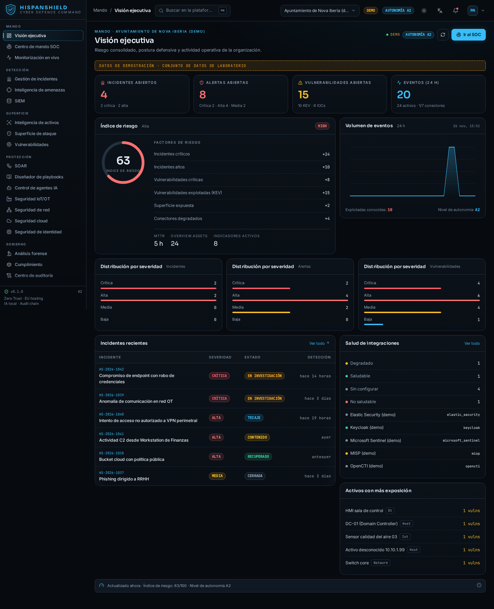
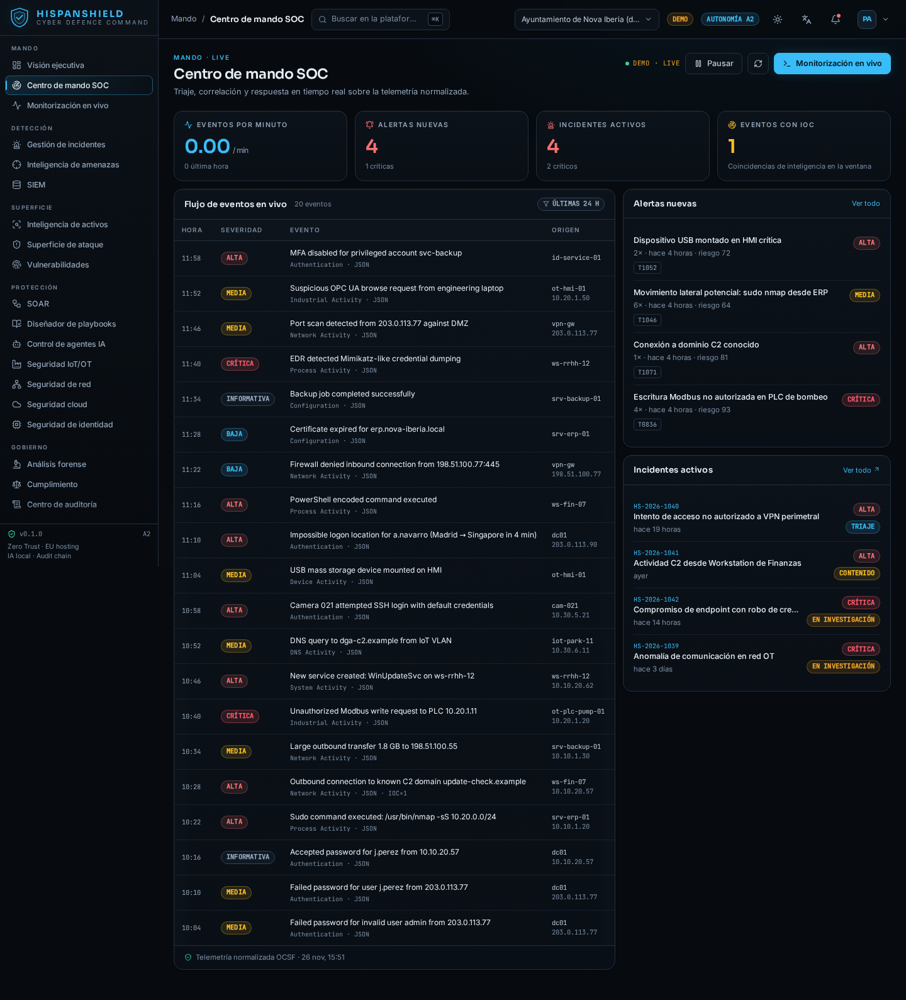
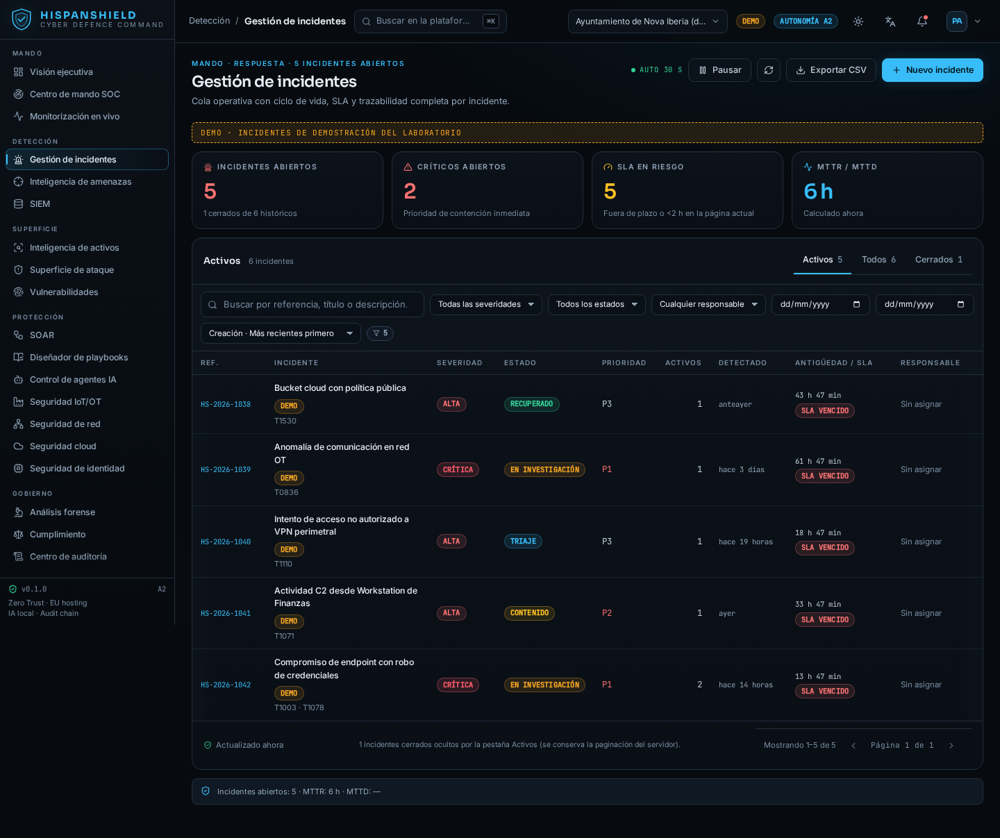
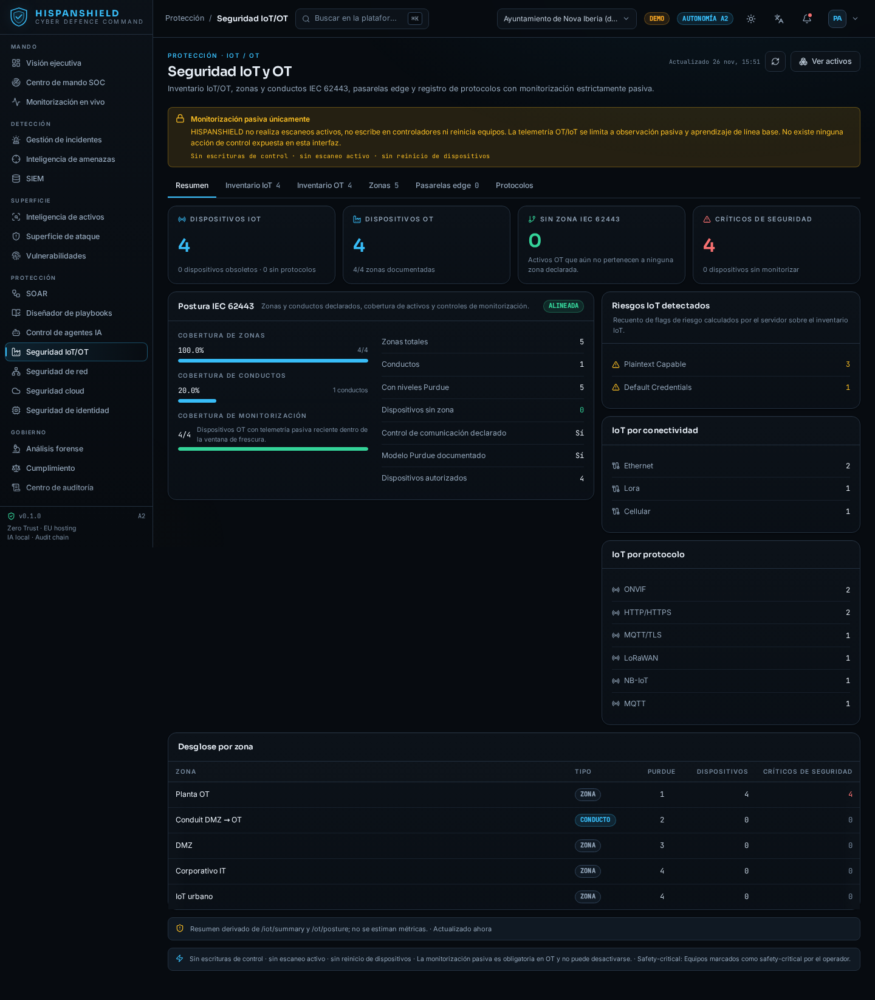
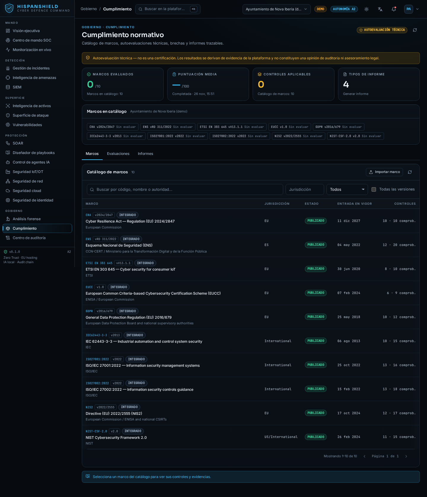
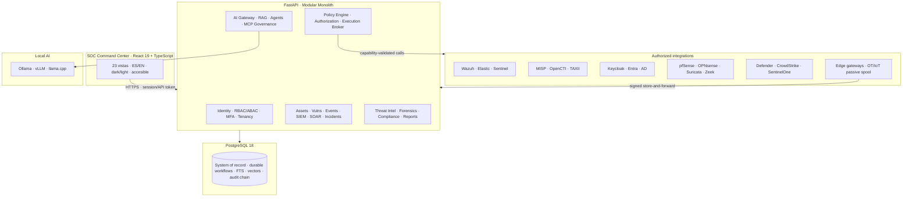

<div align="center">


# HISPANSHIELD

**European Autonomous Cyber Defence Platform**

*Plataforma europea de ciberdefensa autónoma gobernada por políticas, para administraciones públicas, empresas privadas e infraestructuras críticas.*

[](CHANGELOG.md)
[](backend/)
[](frontend/)
[](backend/migrations/)
[](docs/manual-uso-integracion.md#8-integración-de-ia-local-y-modelo-recomendado)
[](SECURITY.md)
[](LICENSE)

[Manual de uso e integración](docs/manual-uso-integracion.md) · [Arquitectura](docs/architecture-c4.md) · [Especificaciones](specs/) · [Seguridad](SECURITY.md) · [Estado](docs/implementation-status.md)

</div>

---

## Vista del producto

<div align="center">
  
  <sub>Executive Overview: riesgo consolidado, KPIs reales, salud de integraciones y superficie expuesta.</sub>
</div>

### Capturas del SOC Command Center

| | |
| :---: | :---: |
| <br><sub>Visión ejecutiva · riesgo, KPIs y salud de integraciones</sub> | <br><sub>Centro de mando SOC · flujo de eventos y alertas en vivo</sub> |
| <br><sub>Gestión de incidentes · cola operativa, SLA y trazabilidad</sub> | <br><sub>Seguridad IoT/OT · postura IEC 62443 y monitorización pasiva</sub> |
| <br><sub>Cumplimiento normativo · catálogo de marcos y autoevaluación técnica</sub> | |

> **Estado honesto:** release candidata `0.1.2`. El producto es funcional y se
> entrega con **650 tests backend**, **92 tests del gateway**, **36 tests frontend**,
> `tsc`/`vite build`/`vitest` verdes y **E2E de las 24 pantallas re-ejecutado
> (10/10)**. Incluye outbox transaccional con leases/DLQ, SSE con
> `Last-Event-ID`, auditoría HMAC v3 con checkpoints firmados, cursor pagination
> e `Idempotency-Key`. **No está certificado** para ningún marco regulatorio y no
> debe operarse en infraestructura crítica real sin evaluación independiente,
> análisis de riesgos y aprobación del CISO. **138/176** tareas están verificadas;
> **37** siguen aplazadas/bloqueadas y **1** en progreso, de forma explícita en
> [`.factory/TASKS.md`](.factory/TASKS.md). El estado real por criterio de
> aceptación está en [`.factory/AC_TRACEABILITY.md`](.factory/AC_TRACEABILITY.md)
> (70 verificados, 32 parciales, 22 no verificados).

---

## Qué es HISPANSHIELD

HISPANSHIELD no es una demo que parece un SOC. Es una plataforma modular que
conecta **inventario, detección, investigación, inteligencia, respuesta y
cumplimiento** en un único plano de control, con IA local y trazabilidad
completa.

| Pilar | Capacidad real |
| :--- | :--- |
| **Superficie de ataque** | CAASM/EASM, activos IT/cloud/identidad/IoT/OT, relaciones, zonas IEC 62443, descubrimiento pasivo y sondeo acotado con autorización |
| **Vulnerabilidades** | CVE · CISA KEV · EPSS · priorización contextual (explotabilidad, exposición, criticidad, inteligencia) — nunca solo CVSS |
| **SIEM** | Ingesta JSON/CEF/LEEF/syslog, normalización OCSF, enriquecimiento IOC, reglas y correlación, alertas deduplicadas |
| **SOAR** | Playbooks durables en PostgreSQL, condiciones, reintentos, timeouts, compensación, simulación, aprobaciones |
| **Incidentes** | Ciclo completo, timeline, evidencias SHA-256, cadena de custodia, MTTR/MTTD |
| **Threat Intelligence** | STIX 2.1, TAXII, MISP, OpenCTI, actores, MITRE ATT&CK, enriquecimiento con veredicto honesto |
| **Respuesta autónoma** | Catálogo cerrado de acciones A0–A3 (A4 reservado, sin acciones), policy engine, broker, aprobaciones con separación de funciones, kill switches, presupuesto/cooldown/freeze/blast radius, verificación y rollback |
| **IA local** | Gateway Ollama/vLLM/llama.cpp, RAG con citas, 16 agentes especializados, MCP gobernado, resistencia a prompt/tool injection |
| **Cumplimiento** | NIS2, CRA, GDPR, ENS, ISO 27001/27002, IEC 62443, ETSI 303 645, NIST CSF 2.0, EUCC — autoevaluación técnica versionada (no certificación) |
| **Operación** | Multi-tenant, RBAC/ABAC, auditoría append-only con HMAC v3 y checkpoints, SSE, observabilidad, backup/restore, Compose y plantilla Kubernetes validada |

### La regla que gobierna todo

```text
LLM propone  →  Policy Engine evalúa  →  Authorization comprueba
             →  Execution Broker ejecuta  →  Audit registra  →  Verification comprueba
```

**Ningún modelo de lenguaje tiene autoridad de ejecución.** Si el motor de
políticas falla, no se ejecuta ninguna acción privilegiada. Si no hay modelo
local, la API devuelve `503 ai_unavailable` y los agentes cambian a un modo
determinista basado en evidencia: nunca inventan una respuesta.

---

## Arquitectura



**Decisiones clave** (detalle en [`specs/adr/`](specs/adr/)):

- Monolito modular con límites de dominio estrictos; servicios separables por
  necesidad demostrable.
- PostgreSQL como sistema de registro, cola durable, motor de workflows,
  búsqueda FTS y almacén vectorial del MVP. Sin Kafka/Redis/OpenSearch/Temporal
  en el despliegue base, reduciendo superficie operativa.
- IA **local-first**; proveedores externos solo por opt-in y auditados.
- Conectores con capacidades explícitas: **lectura ≠ escritura**. Las escrituras
  pasan por el broker defensivo.
- Auditoría encadenada por hashes + trigger append-only en PostgreSQL.

---

## Inicio rápido

### Requisitos

- Python 3.12, Node.js 22, PostgreSQL 16+ (probado con 18).
- Opcional: Ollama / vLLM / llama.cpp para funciones generativas.

### Instalación

```bash
git clone https://github.com/murdok1982/HISPANSHIELD-Autonomous-Cyber-Defense-Platform.git
cd HISPANSHIELD-Autonomous-Cyber-Defense-Platform

cp .env.example .env
python -c "import secrets; print(secrets.token_urlsafe(64))"
python -c "from cryptography.fernet import Fernet; print(Fernet.generate_key().decode())"
# Edita .env con HS_DATABASE_URL, HS_SECRET_KEY, HS_ENCRYPTION_KEY, orígenes y admin.

python -m venv .venv && source .venv/bin/activate
pip install -e "./backend[dev]" -e "./edge"
cd frontend && npm ci && npm run build && cd ..

createdb hispanshield
(cd backend && alembic upgrade head)
(cd backend && python scripts/seed_reference_data.py)   # marcos, agentes, reglas
python scripts/bootstrap_admin.py

cd backend && uvicorn app.main:app --host 127.0.0.1 --port 8080
```

Abre **http://127.0.0.1:8080**. API docs: **http://127.0.0.1:8080/api/docs** (no
en producción).

### Demo en un minuto

```bash
HS_SEED_DEMO=true python scripts/seed_demo.py
```

Organización ficticia **Ayuntamiento de Nova Iberia (demo)**, con activos IT/OT/IoT,
eventos, alertas, incidentes, vulnerabilidades, IOC y playbooks. Todos los
registros están marcados `is_demo=true`; la UI muestra **DEMO**.

```text
analista.demo@nova-iberia.example
Demo-Str0ng-Pass!2026
```

### Docker Compose

```bash
cp .env.example .env   # define POSTGRES_PASSWORD y secretos
docker compose -f deploy/compose/docker-compose.yml up -d --build
# IA local opcional:
docker compose -f deploy/compose/docker-compose.yml --profile ai up -d
```

### Verificación

```bash
make test          # backend (pytest) + frontend (vitest)
make lint          # ruff + mypy + TypeScript
make test-e2e      # Playwright
make audit         # pip-audit + bandit
make sbom
```

---

## Las 23 pantallas del SOC

| Mando | Detección | Exposición | Protección | Gobierno |
| :--- | :--- | :--- | :--- | :--- |
| Executive Overview | Incident Management | Asset Intelligence | SOAR | Forensics |
| SOC Command Center | Threat Intelligence | Attack Surface | Playbook Designer | Compliance |
| Live Threat Monitoring | SIEM | Vulnerability Management | AI Agent Control | Audit Center |
| | | | IoT/OT Security | Integrations |
| | | | Network Security | Model Management |
| | | | Cloud Security | Organization Management |
| | | | Identity Security | System Administration |

Cada vista con datos implementa **skeleton de carga**, **estado vacío con CTA** y
**error recuperable con reintento**; el diseño es responsive (375/768/1440), con
contraste WCAG AA, navegación por teclado y tema oscuro/claro. La interfaz está
internacionalizada en **español e inglés** y autoaloja sus fuentes para operar
air-gapped.

---

## IA local y modelo recomendado

HISPANSHIELD es **local-first**. Proveedores soportados: **Ollama**, **vLLM** y
**llama.cpp** (OpenAI-compatible), con routing por tarea, límites de
concurrencia/tokens, timeouts, evaluación y observabilidad.

### Modelo recomendado (alto rendimiento, laboratorio y análisis)

[**`huihui-ai/Huihui-Qwen3.8-27B-abliterated-GGUF`**](https://huggingface.co/huihui-ai/Huihui-Qwen3.8-27B-abliterated-GGUF)
— Qwen3.8-27B, GGUF, Apache-2.0, contexto hasta 262 144 tokens. Buen razonamiento
técnico y soporte de herramientas, ejecutable en local/offline.

```bash
huggingface-cli download huihui-ai/Huihui-Qwen3.8-27B-abliterated-GGUF \
  Huihui-Qwen3.8-27B-abliterated-Q4_K_M.gguf --local-dir ./models

cat > Modelfile <<'EOF'
FROM ./models/Huihui-Qwen3.8-27B-abliterated-Q4_K_M.gguf
PARAMETER num_ctx 32768
PARAMETER temperature 0.2
SYSTEM "Eres un analista SOC. Distingue evidencia de inferencia. Cita fuentes. No ejecutes acciones."
EOF
ollama create hispanshield-qwen27b -f Modelfile
```

Después, regístralo en **Model Management → Providers → Ollama** y ejecuta
**Evaluate** antes de asignarlo a una tarea.

> **Advertencia de seguridad.** Es una variante *abliterated* (sin alineación de
> seguridad). Úsala solo como motor de razonamiento aislado, con herramientas de
> solo lectura, validación de esquemas y revisión humana; nunca le concedas
> permisos de escritura ni acceso a secretos. Si tu política exige un modelo
> alineado, mantén el modelo alineado por defecto. Instrucciones completas,
> hardware, evaluación y salvaguardas en el
> [manual](docs/manual-uso-integracion.md#8-integración-de-ia-local-y-modelo-recomendado).

---

## Integraciones

| Familia | Integraciones de referencia |
| :--- | :--- |
| **SIEM (adaptadores reales)** | Wazuh, Elastic Security, Microsoft Sentinel |
| **Threat Intel (adaptadores reales)** | MISP, OpenCTI, STIX 2.1 / TAXII |
| **Identidad (adaptador real)** | Keycloak (el resto vía conector genérico gobernado) |
| **Red (adaptadores reales)** | pfSense, OPNsense, Suricata (fichero), Zeek (fichero) |
| **EDR (adaptador real)** | Microsoft Defender (CrowdStrike/SentinelOne/Elastic Defend: roadmap, no soportados) |
| **Cloud** | **No CSPM**: la vista `/cloud` deriva postura de activos y hallazgos existentes. AWS/Azure/GCP/OpenStack no están soportados como cuentas cloud. |
| **Industrial** | Monitorización pasiva y parseo de los protocolos implementados; Modbus/DNP3/OPC UA/BACnet/S7/EtherNet/IP/IEC 104/61850/MQTT aparecen en la matriz con su estado real (`SUPPORTED`, `EXPERIMENTAL`, `PASSIVE_ONLY`, `UNSUPPORTED`). |

**Contrato de capacidades:** cada conector declara lectura y escritura por
separado. Las llamadas de escritura se ejecutan únicamente a través del
[Execution Broker](backend/app/services/broker.py), con política, aprobación,
verificación y rollback cuando es técnicamente viable.

### Formatos de ingesta

```bash
# Webhook con token de fuente en cabecera (evita el token en logs de proxy)
curl -X POST https://shield.example.eu/api/v1/ingest \
  -H "Authorization: Bearer $SOURCE_TOKEN" \
  -H "Content-Type: application/json" \
  -d '{"host":"dc01","user":"j.perez","src_ip":"203.0.113.77","message":"Failed password","severity":"high"}'
```

La ruta antigua `/api/v1/ingest/{token}` sigue disponible marcada como obsoleta;
los logs de la aplicación redactan el segmento del token.

Syslog RFC5424/3164, CEF, LEEF, JSON y OpenTelemetry. El evento original se
conserva junto al normalizado OCSF.

---

## Seguridad y autonomía

| Control | Implementación |
| :--- | :--- |
| Identidad | Argon2id, MFA TOTP con códigos de recuperación de un solo uso (hash Argon2id), sesiones opacas `HttpOnly` + SameSite, listado/revocación de sesiones, CSRF double-submit, rotación/revocación |
| Autorización | 10 roles RBAC, comprobaciones ABAC, aislamiento multi-tenant verificado (`404` cross-tenant); break-glass con doble aprobador cuando existe un segundo `platform_admin` |
| Secretos | Cifrado Fernet en reposo; nunca se devuelven al cliente; rotación; tokens de ingesta fuera de la URL por defecto |
| Red | SSRF con DNS pinning en la conexión (no solo pre-validación); metadata cloud siempre bloqueada; TLS verificado; sin redirecciones; allowlist de CIDR para inferencia local |
| HTTP | CSP, HSTS (producción), frame denial, nosniff, referrer/permissions policy, CORS explícito; límite de cuerpo real también para `chunked` |
| Resiliencia | Rate limiting en PostgreSQL, lockout distribuido (un solo origen no bloquea la cuenta), límites de cuerpo, request IDs, manejo de errores sin stack traces |
| Auditoría | Cadena de hashes por organización + trigger append-only; el hash cubre también IP, user-agent y `request_id` |
| Autonomía | Catálogo cerrado A0–A3 (A4 reservado, sin acciones), kill switches global/org/conector/autonomía, aprobación humana ligada a parámetros, presupuestos/cooldown/freeze/blast radius, fail-closed |
| Operación | Worker durable desplegado en Compose/K8s para playbooks y sincronización de conectores; `/readyz` verifica migraciones y cola |
| OT/IoT | Monitorización pasiva por defecto; clases de acción peligrosas **prohibidas en código** |
| Supply chain | Dependencias pinneadas, `pip-audit` limpio, bandit, SBOM, CI con escaneo de imagen |

**Acciones defensivas permitidas** (según conector y autorización): revocar
sesiones, aislar endpoint, bloquear IP, deshabilitar identidad, restaurar
configuración validada, aplicar parche autorizado, abrir incidente, activar
playbook, recolectar evidencia. **Nunca** operaciones ofensivas, escritura en
controladores, reinicios OT o cambios de firmware.

---

## Cumplimiento europeo

Motor versionado con marcos **NIS2, CRA, GDPR, ENS, ISO/IEC 27001:2022,
ISO/IEC 27002 (mapeo), IEC 62443, ETSI EN 303 645, NIST CSF 2.0 y EUCC**.
Los controles se evalúan contra datos reales del sistema (MFA, auditoría, TLS de
conectores, retención, inventario, segmentación, OT pasivo, revisión de accesos,
etc.), se vinculan a evidencias y generan informes ejecutivos, técnicos y
regulatorios reproducibles.

> HISPANSHIELD genera **autoevaluaciones técnicas**. No certifica a ninguna
> organización ni sustituye auditorías, notificaciones o DPIA.

---

## Estructura del repositorio

```text
backend/        FastAPI · dominios · servicios · migraciones · 650 tests
frontend/       React 19 + TS + Vite · design system propio · 23 vistas
edge/           Gateway offline-first con cola SQLite durable y HMAC/mTLS
specs/          Constitución · producto · arquitectura · 15 dominios · ADR
docs/           Manual de uso/integración · C4 · runbooks · auditoría · estado
deploy/         Docker Compose · Kubernetes (HA, probes, NetworkPolicy)
scripts/        Bootstrap · seed · workers · backup/restore · SBOM · smoke API
.factory/       Estado de la software factory (SPEC/ARCH/TASKS/AUDIT)
tests/          Escenarios de aceptación y laboratorio de autonomía
```

### Documentación esencial

- [Manual de uso e integración](docs/manual-uso-integracion.md) — instalación, operación, conectores, IA, API, gateway, troubleshooting.
- [Constitución](specs/constitution.md) — reglas no negociables.
- [Arquitectura del sistema](specs/architecture/system-architecture.md) y [C4](docs/architecture-c4.md).
- [Modelo de amenazas](specs/security/threat-model.md) y [política de autonomía](specs/security/autonomy-policy.md).
- [Contrato de conector](specs/integrations/connector-contract.md) y [matriz de compatibilidad](specs/integrations/compatibility-matrix.md).
- [Runbook de operaciones](docs/operations-runbook.md), [manual SOC](docs/soc-manual.md), [respuesta a incidentes](docs/incident-response-manual.md), [recuperación](docs/recovery-manual.md).
- [Informe de auditoría de seguridad](.factory/SECURITY_AUDIT.md).

---

## Estado y límites

Esta release es **funcional y verificable**, no una promesa:

- Suite backend de integración/seguridad sobre PostgreSQL real, suite frontend,
  Playwright E2E, auditoría de dependencias limpia y escaneo estático.
- Manifiestos Docker/Kubernetes incluidos; **no se validaron en runtime** en el
  entorno de construcción (sin daemon Docker). Valídalos en tu plataforma.
- Sin proveedor de IA, las funciones generativas devuelven un error explícito;
  el análisis determinista sigue operativo.
- La federación SSO OIDC con IdP externo no está habilitada por defecto; el login
  local y el conector administrativo de Keycloak sí están implementados.
- El MVP usa PostgreSQL para búsqueda, colas, workflows y vectores. Los ADR
  documentan los puntos de extensión a OpenSearch/Kafka/Qdrant/Temporal.
- La licencia es propietaria en evaluación y requiere revisión jurídica antes de
  su distribución.

Evidencias completas: [`docs/implementation-status.md`](docs/implementation-status.md).
El backlog post-MVP (44 tareas marcadas `[!]` con motivo) está en
[`.factory/TASKS.md`](.factory/TASKS.md); hoja de ruta y riesgos en
[`docs/roadmap.md`](docs/roadmap.md) y [`docs/risk-matrix.md`](docs/risk-matrix.md).

---

## Licencia y contacto

Software propietario en evaluación — consulta [LICENSE](LICENSE). No se ha
incorporado código de terceros ni del repositorio hermano auditado.

- Seguridad: sigue [SECURITY.md](SECURITY.md). No publiques vulnerabilidades en issues.
- Contribuciones: [CONTRIBUTING.md](CONTRIBUTING.md).
- Cambios: [CHANGELOG.md](CHANGELOG.md).

<div align="center">
  <sub>HISPANSHIELD · Construido con disciplina de ingeniería, seguridad verificable y soberanía del dato.</sub>
</div>
