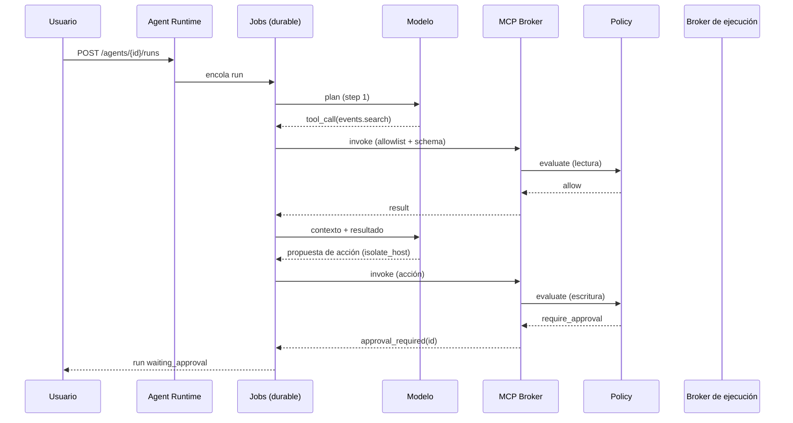

# GUÍA DE AGENTES

- **Documento:** `docs/agents-guide.md`
- **Estado:** `APPROVED` v1.0
- **Contratos:** `specs/domains/ai-agents.md`, `specs/integrations/mcp-contract.md`, `specs/security/autonomy-policy.md`

---

## 1. QUÉ ES UN AGENTE AQUÍ

Un agente es un proceso durable que:
1. Recibe una tarea acotada (`input`) y contexto (`context_refs`).
2. Planifica pasos con un modelo.
3. Puede invocar **tools allowlisted** vía MCP.
4. Registra cada paso y tool-call.
5. **No ejecuta acciones**: las propone al broker de autonomía, que decide.

```text
Agente → propone tool-call → MCP broker → policy engine → (approval) → execution broker → conector
```

---

## 2. DEFINICIÓN

```json
{
  "name": "incident-triage-assistant",
  "description": "Resume un incidente y propone próximos pasos con citas.",
  "system_prompt_version": "v3",
  "allowed_tools": ["incidents.get", "events.search", "assets.get", "vulnerabilities.list"],
  "max_steps": 8,
  "max_tool_calls": 5,
  "budget": {"max_tokens": 40000, "max_cost_usd": 0.20},
  "requires_approval_for": [],
  "output_schema": {"type": "object", "required": ["summary", "next_steps", "citations"]}
}
```

| Campo | Regla |
| :--- | :--- |
| `allowed_tools` | Nombres exactos; sin comodines |
| `max_steps` | ≤12 |
| `max_tool_calls` | ≤8 |
| `budget` | Obligatorio |
| `requires_approval_for` | Tools de riesgo alto/crítico |
| `output_schema` | Validación de salida; si falla, se rechaza el resultado |

---

## 3. CICLO DE EJECUCIÓN



---

## 4. TIPOS DE AGENTE

| Agente | Tareas | Tools | Riesgo |
| :--- | :--- | :--- | :--- |
| `triage` | Resumir alerta/incidente, sugerir severidad | lectura | Bajo |
| `investigator` | Correlacionar activos/eventos/IOC | lectura | Bajo |
| `detection-author` | Proponer DSL de regla y probarla | lectura + test | Medio |
| `report-writer` | Borrador de post-incidente | lectura | Bajo |
| `responder` | Proponer acciones de contención | lectura + acciones (aprobación) | Alto |
| `compliance-mapper` | Sugerir evidencia para control | lectura | Bajo |

**Regla:** el agente `responder` no puede ejecutar; solo proponer. La ejecución pasa por política y aprobación.

---

## 5. PROMPTS Y VERSIONADO

- Cada `system_prompt_version` es inmutable y se referencia en el run.
- Cambiar prompt requiere nueva versión y evaluación (`eval_run`).
- El prompt incluye: rol, límites, formato de salida, prohibición de inventar, obligación de citar y de no revelar instrucciones.
- El contenido no confiable se delimita con etiquetas y se marca como `untrusted`.

---

## 6. SEGURIDAD

| Riesgo | Control |
| :--- | :--- |
| Prompt injection | Delimitación, guardrails, allowlist, sin autoridad |
| Exfiltración | RAG por org; sin secretos en prompt; filtro de salida |
| Tool abuse | Allowlist + esquema + policy + aprobación |
| Bucle | `max_steps`, detección de repetición, timeout |
| Coste | Presupuesto por run/org, `max_tool_calls` |
| Suplantación | El run usa la identidad del usuario que lo lanzó |
| Repudio | `step_log` y auditoría con `run_id` |

**Prohibido:** dar al agente credenciales de conector, acceso directo a BD o capacidad de modificar su propia allowlist.

---

## 7. OBSERVABILIDAD

| Señal | Uso |
| :--- | :--- |
| `hs_agent_runs_total{state}` | Salud |
| `hs_agent_steps` | Complejidad |
| `hs_agent_tool_calls_total{tool,result}` | Uso y errores |
| `hs_ai_tokens_total` | Coste |
| `step_log` | Depuración y auditoría |

Cada run guarda: `state`, `steps[]`, `tool_calls[]`, `tokens`, `cost`, `provider`, `model`, `error`.

---

## 8. DEPURACIÓN

| Síntoma | Causa probable | Acción |
| :--- | :--- | :--- |
| `tool_not_allowed` | Tool fuera de allowlist | Añadir con revisión o cambiar agente |
| `input_schema_violation` | El modelo generó parámetros inválidos | Ajustar prompt/schema; el broker rechazó correctamente |
| `loop_detected` | Pasos repetidos | Reducir `max_steps`, mejorar prompt |
| `budget_exceeded` | Tarea mal acotada | Acotar input; aumentar presupuesto con justificación |
| `eval_required` | Modelo/prompt sin evaluación | Ejecutar `model_eval` |
| Run atascado | Worker caído | Reconciliación por lease; reanudación |

---

## 9. BUENAS PRÁCTICAS

1. Acota la tarea: un agente, un objetivo.
2. Da contexto explícito (`context_refs`) en lugar de esperar que busque.
3. Usa tools de lectura siempre que sea posible.
4. Exige citas y salida estructurada.
5. Revisa el `step_log` de los primeros runs antes de producción.
6. No uses agentes para decisiones que una regla determinista resuelve mejor.

---

## 10. CHECKLIST

- [ ] Definición con allowlist mínima.
- [ ] Prompt versionado y evaluado.
- [ ] Presupuesto y límites configurados.
- [ ] Salida validada por esquema.
- [ ] Tools de escritura requieren aprobación.
- [ ] Probado con corpus de prompt injection.
- [ ] `step_log` revisado.
- [ ] Estado `UNAVAILABLE` probado.
