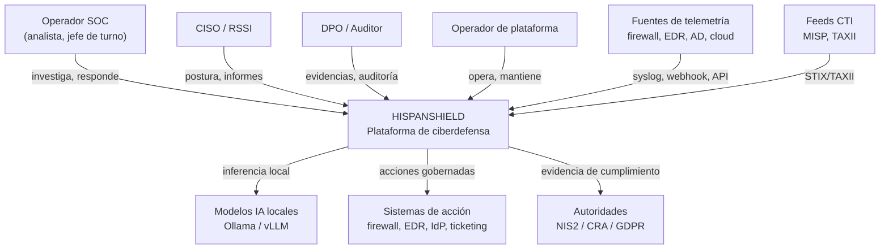
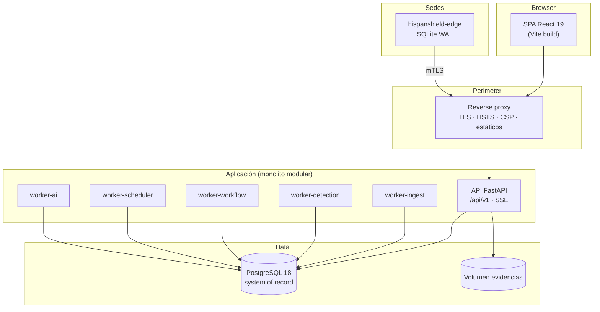
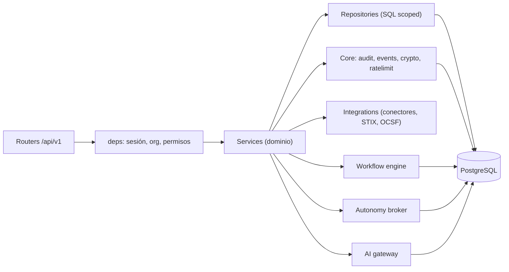
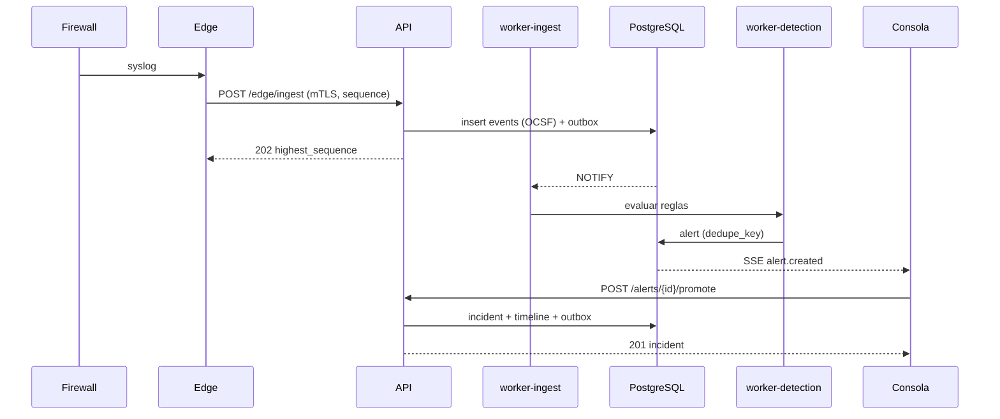
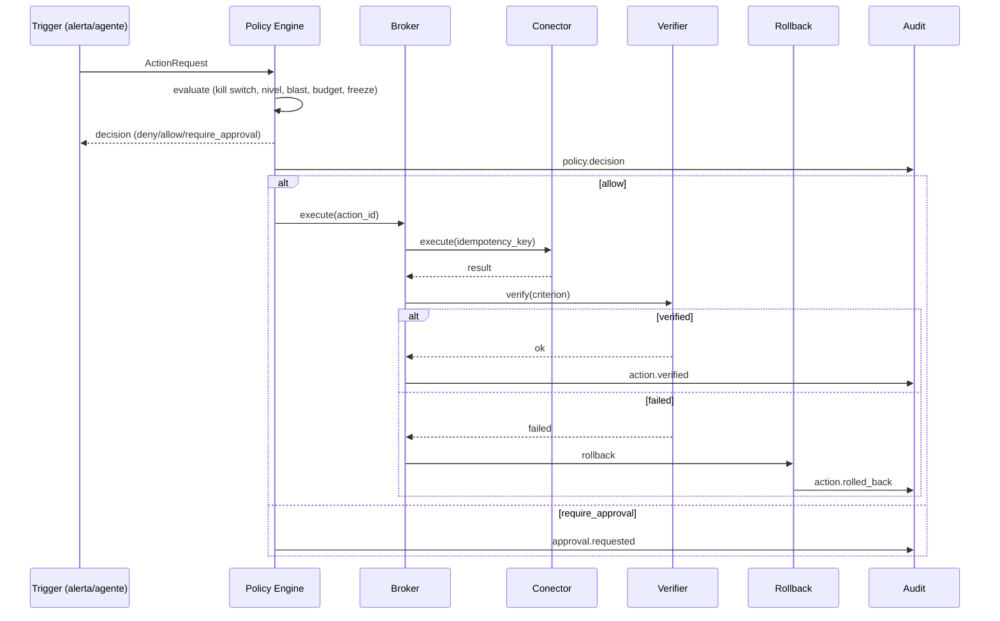
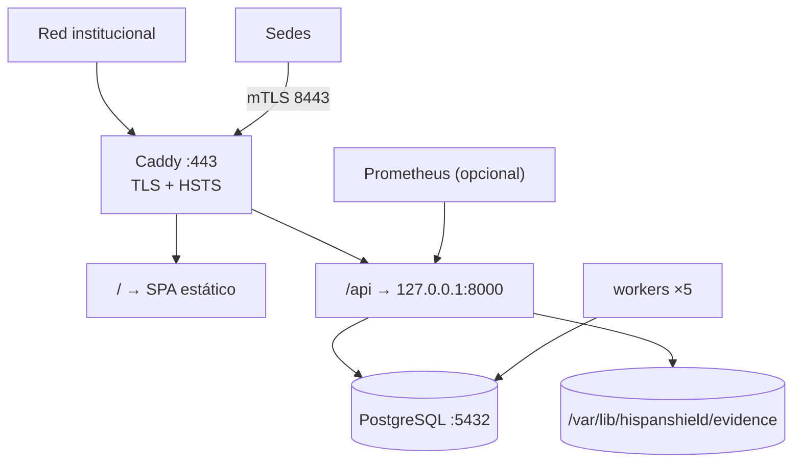
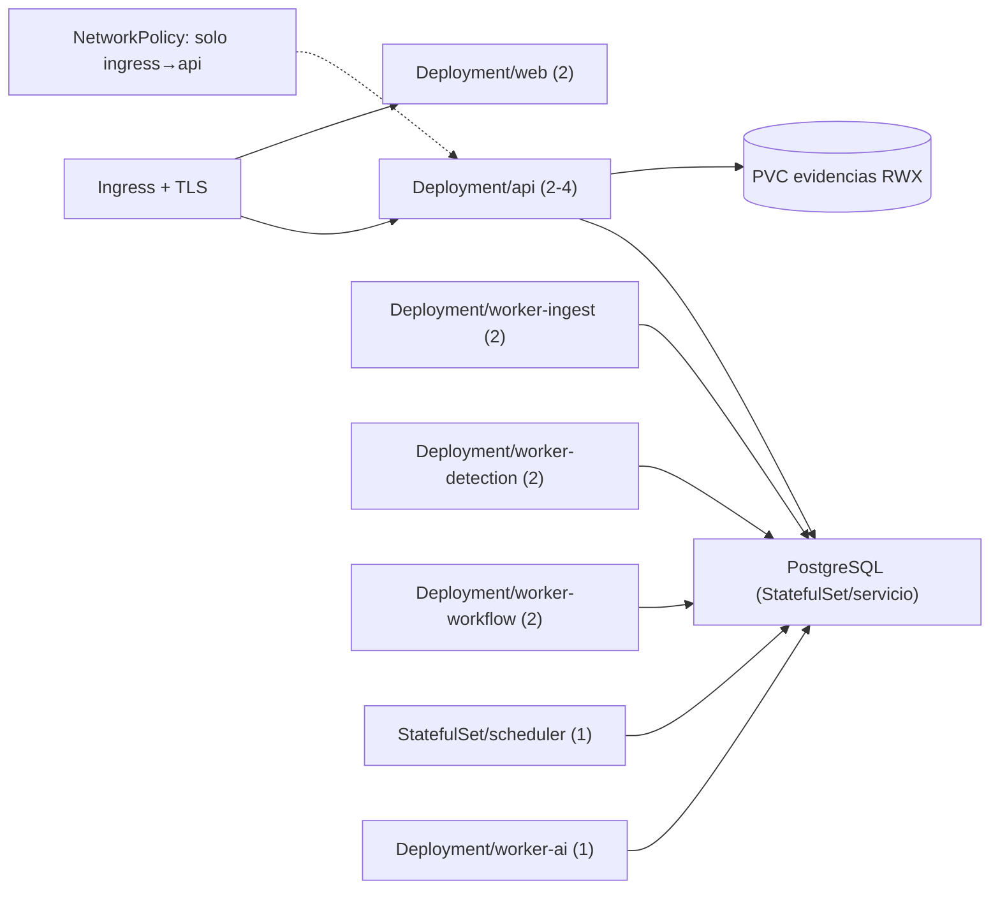

# ARQUITECTURA C4

- **Documento:** `docs/architecture-c4.md`
- **Estado:** `APPROVED` v1.0
- **Notación:** C4 (Contexto, Contenedores, Componentes) + secuencias + despliegue
- **Fuente:** `.factory/ARCHITECTURE.md`, `specs/architecture/*`

---

## 1. C4 NIVEL 1 — CONTEXTO

| Actor/Sistema | Relación | Protocolo |
| :--- | :--- | :--- |
| Operadores | Uso de consola | HTTPS |
| Fuentes de telemetría | Ingesta | Syslog, HTTPS webhook, mTLS edge |
| Feeds CTI | Ingesta | TAXII 2.1, MISP API |
| Modelos IA | Inferencia | HTTP local |
| Sistemas de acción | Respuesta | HTTPS con allowlist |
| Autoridades | Reporting | Informes PDF/JSON con hash |

---

## 2. C4 NIVEL 2 — CONTENEDORES

| Contenedor | Tecnología | Responsabilidad | Escalado |
| :--- | :--- | :--- | :--- |
| SPA | React 19 + Vite | Consola de 23 pantallas | Estático |
| Proxy | Caddy/nginx | TLS, cabeceras, estáticos | 2 |
| API | FastAPI/Uvicorn | Contratos REST/SSE, auth, casos de uso | Horizontal |
| worker-ingest | Python | Syslog/webhook/edge → OCSF | Por cola |
| worker-detection | Python | Reglas y correlación | Por cola |
| worker-workflow | Python | Playbooks y acciones | Por cola |
| worker-scheduler | Python | Jobs periódicos | 1 (advisory lock) |
| worker-ai | Python | Runs de agentes y embeddings | Por cola |
| PostgreSQL | 18 | Dominio, colas, eventos, auditoría, vectores | Vertical + réplica |
| Evidencias | FS | Ficheros con hash | Volumen |
| Edge | Python+SQLite | Buffer y reenvío | 1 por sede |

---

## 3. C4 NIVEL 3 — COMPONENTES DE LA API

| Componente | Responsabilidad | Prohibición |
| :--- | :--- | :--- |
| Routers | Validar, autorizar, delegar | Lógica de negocio |
| deps | Identidad, org, permisos | Acceso a datos de dominio |
| Services | Reglas, transacciones, eventos | SQL directo (usa repos) |
| Repositories | Consultas scoped | Reglas de negocio |
| Core | Auditoría, outbox, crypto, límites | Conocer dominio |
| Integrations | Protocolos y mapeos | Autorizar |
| Workflow | Durabilidad y pasos | Ejecutar sin broker |
| Autonomy | Política y ejecución | Parsear protocolos |
| AI | Inferencia y RAG | Ejecutar acciones |

---

## 4. SECUENCIA: INGESTA → ALERTA → INCIDENTE

**Invariantes:** el `202` solo se devuelve tras commit; el edge no borra hasta `202`; la alerta es deduplicada; el incidente conserva `alert_ids`.

---

## 5. SECUENCIA: ACCIÓN AUTÓNOMA GOBERNADA

---

## 6. DESPLIEGUE (SINGLE-NODE)

| Nodo | Rol | Réplicas |
| :--- | :--- | :--- |
| `hs-core-01` | API, workers, PostgreSQL, proxy | 1 |
| `hs-edge-<sede>` | Edge gateway | 1 (activo/pasivo) |
| `hs-backup` | Almacenamiento offline | — |

---

## 7. DESPLIEGUE (KUBERNETES)

---

## 8. LÍMITES Y DECISIONES VISIBLES

| Límite | Implicación |
| :--- | :--- |
| Un PostgreSQL | Punto único; mitigado con backup y réplica |
| Sin broker | Outbox/NOTIFY; techo de throughput |
| Sin servicio vectorial | RAG O(n) acotado |
| Sin IdP externo | Auth propia; sin SSO en 1.0 |
| IA opcional | Producto funcional sin LLM |
| Edge por sede | Sin HA nativa |

---

## 9. MANTENIMIENTO DEL DOCUMENTO

Actualizar al cambiar: contenedores, fronteras, flujo de acción o topología de despliegue. Cada cambio requiere ADR y actualización de `ARCHITECTURE.md §2`.
