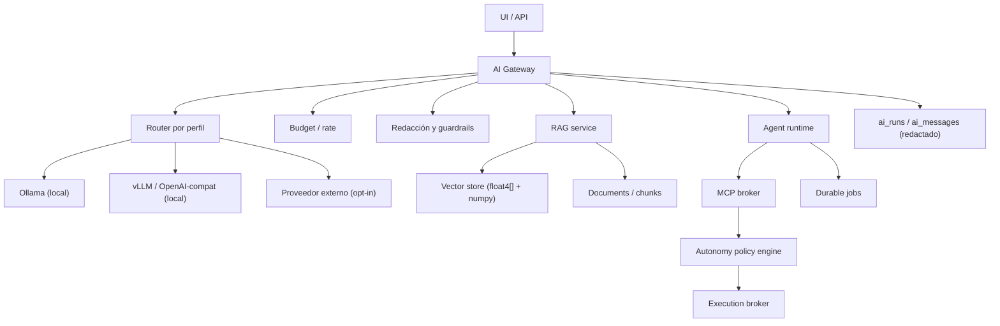

# ARQUITECTURA DE IA

- **Documento:** `specs/architecture/ai-architecture.md`
- **Estado:** `LOCKED` v1.0
- **Decisión base:** `ADR-010` (local-first, estado honesto, sin autoridad de acción)
- **Detalle funcional:** `specs/domains/ai-agents.md`

---

## 1. PRINCIPIOS

1. **Local-first.** Ollama/vLLM en el perímetro; proveedor externo solo con opt-in explícito del `owner` y registro de la decisión.
2. **Sin autoridad.** El modelo propone; el broker de autonomía decide y ejecuta. El LLM no tiene credenciales ni acceso a conectores de acción.
3. **Sin fabricación.** Si no hay proveedor o no hay contexto suficiente, se responde con indisponibilidad o con "no hay evidencia", nunca con contenido inventado.
4. **Citas verificables.** Toda respuesta RAG incluye referencias a chunks/eventos que existen y se pueden abrir.
5. **Coste acotado.** Presupuesto por run y por organización/día; `max_steps` en agentes.
6. **Contenido no confiable delimitado.** Documentos, eventos y resultados de tools se marcan como `untrusted` y no se concatenan al system prompt sin delimitación.

---

## 2. COMPONENTES



| Componente | Responsabilidad |
| :--- | :--- |
| `registry` | Proveedores, modelos, credenciales cifradas, health |
| `router` | Selección por perfil, fallback, timeout, registro de uso |
| `budget` | Contadores por org/día y por run; rechazo `429` |
| `guardrails` | Detección de injection, delimitación, filtro de salida, redacción |
| `documents` | Ingesta, chunking, metadatos, borrado y reindexado |
| `vector_store` | Almacenamiento y búsqueda coseno por org |
| `rag` | Recuperación, construcción de contexto, citas |
| `agents` | Planificación acotada, tool-calls, step log durable |
| `mcp` | Registro, validación de esquema, allowlist, invocación auditada |

---

## 3. CONTRATO DE PROVEEDOR

```python
class AIProvider(Protocol):
    key: str
    async def health(self) -> ProviderHealth: ...
    async def chat(self, messages: list[Message], *, model: str, max_tokens: int,
                   temperature: float, timeout: float) -> ChatResult: ...
    async def embed(self, texts: list[str], *, model: str) -> list[list[float]]: ...
    def capabilities(self) -> ProviderCapabilities: ...  # streaming, tools, json_mode, embeddings
```

`ChatResult` incluye `content`, `usage{prompt,completion}`, `finish_reason`, `provider`, `model`, `latency_ms`. Nunca se devuelve `content` vacío como éxito: si el proveedor no responde, se lanza `ProviderUnavailable`.

---

## 4. PERFILES DE TAREA

| Perfil | Uso | Requisitos | Fallback |
| :--- | :--- | :--- | :--- |
| `fast` | Resumen corto, clasificación, extracción | Baja latencia (≤3 s), contexto ≥8k | `balanced` |
| `balanced` | Triaje, explicación, borradores | Contexto ≥32k, tools | `fast` (sin tools) |
| `deep` | Análisis multi-fuente, informe | Contexto ≥64k, razonamiento | `balanced` |
| `embed` | Embeddings | Dimensión fija declarada | Ninguno (error si no hay) |

Si el fallback no soporta tools y la tarea las requiere, se devuelve `503 capability_unavailable` en lugar de degradar silenciosamente.

---

## 5. RAG

```text
Ingesta: documento → validación MIME/tamaño → extracción de texto → chunking (≈800 tokens, overlap 80)
        → embeddings → document_chunks(embedding, dimension, metadata)
Consulta: pregunta → embedding → coseno top-k (k≤20, filtrado por org) → contexto delimitado
        → prompt con instrucciones de citación → respuesta con citations[]
```

| Regla | Detalle |
| :--- | :--- |
| Aislamiento | `organization_id` obligatorio en toda consulta de chunks |
| Citas | `document_id`, `chunk_id`, `score`, `snippet`; el cliente puede abrir el chunk |
| Umbral | `score < 0.35` → se descarta; si no queda contexto → "no hay evidencia suficiente" |
| Dimensiones | Fijas por modelo; mezclar → `422 embedding_dimension_mismatch` |
| Borrado | Borrar documento elimina chunks y reindexa; auditoría |
| Límite | 200k chunks/org; `413`/`422` con causa |

---

## 6. AGENTES

| Elemento | Regla |
| :--- | :--- |
| Definición | `system_prompt_version`, `allowed_tools[]`, `max_steps ≤12`, `budget`, `requires_approval_for[]` |
| Ejecución | Job durable; cada paso persiste `step_key`, entrada, salida, tool-call y resultado |
| Reanudación | Reclama lease; no repite `step_key` completado |
| Límites | `max_tool_calls ≤8`, timeout global 5 min, presupuesto por run |
| Acciones | Toda tool con efecto pasa por policy engine + broker; el agente nunca ejecuta |
| Parada | Si el modelo entra en bucle (pasos repetidos), se corta y se devuelve `loop_detected` |

---

## 7. GUARDRAILS

| Capa | Control |
| :--- | :--- |
| Entrada | Detección de patrones de override ("ignora las instrucciones", "actúa como", base64/unicode ofuscado), límite de longitud |
| Contexto | Contenido no confiable en bloque delimitado con etiqueta y aviso explícito al modelo |
| System prompt | Inmutable, no revelable; instrucción de no revelar y de no ejecutar acciones |
| Salida | Filtro de secretos (patrones de token/API key), bloqueo de URLs internas, límite de longitud |
| Acción | Allowlist MCP + política + aprobación + blast radius |
| Registro | `prompt_injection_detected` con `run_id`, sin almacenar el payload completo si contiene secretos |

---

## 8. OBSERVABILIDAD Y COSTE

| Métrica | Uso |
| :--- | :--- |
| `hs_ai_requests_total{provider,model,status}` | Salud y uso |
| `hs_ai_tokens_total{org,kind}` | Coste |
| `hs_ai_latency_seconds` | SLO |
| `hs_ai_fallback_total` | Calidad de routing |
| `hs_ai_budget_denied_total` | Presión de coste |
| `hs_prompt_injection_detected_total` | Seguridad |
| `hs_rag_empty_context_total` | Calidad de recuperación |

Cada `ai_run` guarda `provider`, `model`, `tokens`, `cost_usd`, `latency_ms`, `fallback_used`, `citations_count`.

---

## 9. DESPLIEGUE DE MODELOS LOCALES

| Opción | Requisitos | Notas |
| :--- | :--- | :--- |
| Ollama (CPU) | 16 GB RAM para 7-8B Q4 | Latencia aceptable para resumen/triaje |
| Ollama (GPU) | GPU ≥12 GB VRAM | Mejor latencia |
| vLLM (GPU) | GPU ≥24 GB VRAM | Mayor throughput, OpenAI-compatible |
| Sin IA | — | Producto plenamente funcional; estado `UNAVAILABLE` |

Los modelos se descargan **antes** del despliegue air-gapped y se verifican por hash. La plataforma no descarga modelos en runtime sin conectividad explícita.

---

## 10. CRITERIOS DE ACEPTACIÓN

`AC-61..AC-69`, `AC-86`, `AC-124`. Ver `specs/domains/ai-agents.md §10`.

## 11. EVIDENCIA

1. `503 ai_unavailable` sin proveedor.
2. Respuesta RAG con citas verificadas.
3. Corpus de prompt injection con 0 bypass.
4. `step_log` de run reanudado.
5. Métricas de tokens/coste por org.
