# ARQUITECTURA DE DATOS

- **Documento:** `specs/architecture/data-architecture.md`
- **Estado:** `LOCKED` v1.0
- **Motor:** PostgreSQL 18 (16+ compatible)
- **Acceso:** SQLAlchemy 2.0 sync + psycopg3 + Alembic
- **Detalle de tablas:** `specs/data-models/entities.md`

---

## 1. PRINCIPIOS

1. **Un solo sistema de registro.** PostgreSQL contiene dominio, colas, eventos, auditoría, búsqueda y vectores. No hay caché ni broker obligatorio.
2. **Tenancy en la fila.** Toda tabla de dominio lleva `organization_id`; el aislamiento se refuerza en repositorio y, opcionalmente, con RLS.
3. **Tipos especializados.** `INET`, `JSONB`, `TSVECTOR`, `float4[]`, `NUMERIC`, `TIMESTAMPTZ`, `CITEXT`. No se almacena como texto lo que se consulta.
4. **Inmutabilidad donde importa.** Eventos y auditoría son append-only, con trigger que lo impone.
5. **Particiones para el volumen.** `events`, `audit_log`, `alerts` por rango temporal; retención por `DROP PARTITION`.
6. **Migraciones ensayadas.** `upgrade` y `downgrade` probados desde BD vacía en CI.

---

## 2. DIAGRAMA ENTIDAD-RELACIÓN (núcleo)

```mermaid
erDiagram
  ORGANIZATIONS ||--o{ MEMBERSHIPS : has
  USERS ||--o{ MEMBERSHIPS : belongs
  ORGANIZATIONS ||--o{ ASSETS : owns
  ORGANIZATIONS ||--o{ ASSET_ZONES : defines
  ASSET_ZONES ||--o{ ASSETS : contains
  ASSETS ||--o{ ASSET_RELATIONSHIPS : source
  ASSETS ||--o{ VULNERABILITY_INSTANCES : affected_by
  VULNERABILITIES ||--o{ VULNERABILITY_INSTANCES : instantiated_as
  ASSETS ||--o{ ATTACK_SURFACE_OBSERVATIONS : exposed_as
  ORGANIZATIONS ||--o{ EVENTS : produces
  DETECTION_RULES ||--o{ DETECTION_RULE_VERSIONS : versioned_as
  DETECTION_RULE_VERSIONS ||--o{ ALERTS : generates
  ALERTS }o--|| INCIDENTS : promoted_to
  INCIDENTS ||--o{ INCIDENT_TIMELINE : narrates
  INCIDENTS ||--o{ EVIDENCE : supported_by
  ORGANIZATIONS ||--o{ INDICATORS : tracks
  INDICATORS ||--o{ INDICATOR_MATCHES : matches
  EVENTS ||--o{ INDICATOR_MATCHES : matched
  PLAYBOOKS ||--o{ PLAYBOOK_VERSIONS : versioned_as
  PLAYBOOK_VERSIONS ||--o{ EXECUTIONS : executed_as
  EXECUTIONS ||--o{ EXECUTION_STEPS : contains
  EXECUTIONS ||--o{ APPROVALS : requires
  AUTONOMY_POLICIES ||--o{ POLICY_VERSIONS : versioned_as
  POLICY_VERSIONS ||--o{ POLICY_DECISIONS : evaluates
  POLICY_DECISIONS ||--o| ACTIONS : authorizes
  ACTIONS ||--o{ ACTION_RESULTS : produces
  ORGANIZATIONS ||--o{ KILL_SWITCHES : controls
  ORGANIZATIONS ||--o{ AI_RUNS : consumes
  AI_RUNS ||--o{ TOOL_INVOCATIONS : invokes
  MCP_SERVERS ||--o{ MCP_TOOLS : exposes
  FRAMEWORKS ||--o{ CONTROLS : contains
  CONTROLS ||--o{ EVIDENCE_ITEMS : evidenced_by
  FRAMEWORKS ||--o{ ASSESSMENTS : assessed_by
  ASSESSMENTS ||--o{ ASSESSMENT_RESULTS : yields
  ORGANIZATIONS ||--o{ AUDIT_LOG : audited
  ORGANIZATIONS ||--o{ CONNECTORS : configures
  CONNECTORS ||--o{ CONNECTOR_SECRETS : secures
```



---

## 3. CONVENCIONES DE ESQUEMA

| Convención | Regla |
| :--- | :--- |
| PK | `UUID` (UUIDv7 generado en aplicación) |
| Fechas | `TIMESTAMPTZ` UTC; `created_at`, `updated_at`, `deleted_at` |
| Enumeraciones | `VARCHAR(n) + CHECK` |
| JSONB | Solo atributos heterogéneos; nunca campos filtrados críticos |
| Índices | `(organization_id, <sort_key> DESC)` para listados; GIN para JSONB/FTS |
| Constraints | `pk_`, `fk_`, `uq_`, `ck_`, `ix_` con nombre explícito |
| Optimistic locking | `row_version INTEGER` en agregados editables |
| Soft delete | `deleted_at` + índice parcial `WHERE deleted_at IS NULL` |
| Comentarios | `COMMENT ON TABLE/COLUMN` con propósito y clasificación de dato |

---

## 4. TENANCY Y AISLAMIENTO

| Capa | Mecanismo | Verificación |
| :--- | :--- | :--- |
| Firma de repositorio | `organization_id: UUID` obligatorio (keyword-only) | Revisión + test AST |
| Consulta | `WHERE organization_id = :org_id` en cada `SELECT` | `test_tenant_isolation.py` |
| Recurso por ID | Doble filtro `id AND organization_id` → 404 uniforme | Igual |
| Base de datos (opcional) | RLS con `SET LOCAL app.organization_id` | `test_rls.py` (feature flag) |
| Export/SSE | Filtro forzado a la org de la sesión | Tests específicos |
| Auditoría | `organization_id` en cada entrada | `test_audit_chain.py` |

**Prohibición:** `session.get(Model, id)` sin filtro de org. El repositorio expone `get_for_org(id, organization_id)`; el test AST detecta el patrón prohibido.

---

## 5. PARTICIONADO Y RETENCIÓN

| Tabla | Partición | Clave | Retención | Mantenimiento |
| :--- | :--- | :--- | :--- | :--- |
| `events` | Mensual (RANGE) | `occurred_at` | 90 d caliente; 400 d frío opcional | Crear +2 meses; drop fuera de retención |
| `audit_log` | Mensual | `created_at` | 1 año (configurable) | Igual |
| `alerts` | Trimestral | `created_at` | 400 d | Igual |
| `incident_timeline` | No (por volumen bajo) | — | Con incidente | — |
| `execution_steps` | No | — | 1 año | Purga por job |
| `ai_messages` | Mensual | `created_at` | 30 d | Igual |

**Regla:** la purga nunca borra filas individuales de tablas particionadas; elimina particiones completas y registra rango y conteo. `legal_hold` se evalúa a nivel de caso/incidente antes de la purga.

---

## 6. BÚSQUEDA (FTS + TRIGRAM)

| Elemento | Implementación |
| :--- | :--- |
| Columna | `search_tsv TSVECTOR GENERATED ALWAYS AS (to_tsvector('spanish', coalesce(title,'') || ' ' || coalesce(description,'') || ' ' || coalesce(attributes::text,''))) STORED` |
| Índice | `GIN (search_tsv)` |
| Consulta | `websearch_to_tsquery('spanish', :q)` + filtros tipados |
| Fuzzy | `pg_trgm` en `name`, `hostname`, `value_normalized` |
| Límites | `limit ≤ 200` API, `≤1000` interno; rango temporal ≤90 d sin filtro adicional |
| Ranking | `ts_rank_cd` cuando hay `q`; si no, orden por `occurred_at DESC` |

**Por qué no OpenSearch:** se elimina un servicio con estado, se reduce la superficie y se mantiene una sola copia de los datos. Límite documentado: 50M eventos calientes; migración encapsulada en `repositories/events.py` (`ADR-006`).

---

## 7. VECTORES (RAG)

| Elemento | Implementación |
| :--- | :--- |
| Almacenamiento | `document_chunks.embedding float4[]` + `dimension INTEGER` |
| Índice | B-tree por `(organization_id, document_id)`; sin ANN |
| Búsqueda | Coseno en numpy, batch, top-k ≤20, filtrado por org |
| Límite | 200k chunks/org; dimensión fija por modelo |
| Migración futura | `ai/vector_store.py` abstrae; pgvector o Qdrant sin cambiar contratos |

**Trade-off:** O(n) por org. Con 200k chunks y vectores de 768 dims (~600 MB) el cálculo por consulta es aceptable (≤300 ms en batch). Se documenta el umbral y el plan (`ADR-005`).

---

## 8. CADENA DE AUDITORÍA

```text
seq=1  prev_hash=GENESIS   entry_hash=sha256(prev_hash || canonical_json(payload))
seq=2  prev_hash=hash(1)   entry_hash=sha256(hash(1) || canonical_json(payload))
...
```

- `canonical_json`: claves ordenadas, sin espacios, UTF-8, timestamps ISO 8601.
- Trigger `BEFORE UPDATE OR DELETE` → `RAISE EXCEPTION`.
- Verificación: recalcula desde `from` hasta `to` y devuelve el primer `seq` inconsistente.
- Concurrencia: `INSERT` con `pg_advisory_xact_lock` por organización para serializar el encadenado (coste aceptable: las entradas de auditoría no son de alto volumen).

---

## 9. RESPALDO Y RECUPERACIÓN

| Elemento | Estrategia |
| :--- | :--- |
| PostgreSQL | `pg_dump -Fc` diario + WAL archiving si el cliente lo habilita (RPO ≤15 min) |
| Evidencias | Copia incremental del volumen + verificación de hash |
| Claves | `HISPANSHIELD_SECRET_KEY` en gestor del cliente; sin ella el backup de secretos es inútil |
| Restauración | `scripts/restore.sh` en instancia limpia; comparación de conteos |
| Ensayo | `scripts/backup_restore_drill.sh` en CI/staging mensual |
| RPO/RTO | RPO ≤15 min (con WAL) / ≤24 h (solo dump); RTO ≤4 h |

---

## 10. MIGRACIONES

| Regla | Detalle |
| :--- | :--- |
| Versionado | Alembic, una revisión por cambio lógico, `down_revision` explícito |
| Reversibilidad | Toda migración tiene `downgrade` funcional o justificación documentada |
| Datos | Migraciones de datos separadas de DDL, idempotentes y reanudables |
| Bloqueo | `CREATE INDEX CONCURRENTLY` en tablas grandes; evitar `ACCESS EXCLUSIVE` largo |
| Arranque | `HISPANSHIELD_REQUIRE_MIGRATIONS=true` impide arrancar si `current != head` |
| Seed | Frameworks y permisos por migración idempotente |

---

## 11. CRITERIOS DE ACEPTACIÓN

| AC | Criterio |
| :--- | :--- |
| `AC-111` | Upgrade/downgrade limpios |
| `AC-19`, `AC-39` | Rendimiento de búsqueda |
| `AC-41` | Inmutabilidad de eventos |
| `AC-42` | Retención por partición |
| `AC-112` | Verificación de cadena |
| `AC-113` | Backup/restore |
| `AC-122` | Aislamiento |

## 12. EVIDENCIA

1. `alembic upgrade head && alembic downgrade base && alembic upgrade head`.
2. `EXPLAIN (ANALYZE, BUFFERS)` de las 5 consultas más frecuentes.
3. Test de RLS (si habilitado).
4. Drill de backup/restore con conteos.
5. Test de manipulación de auditoría.
