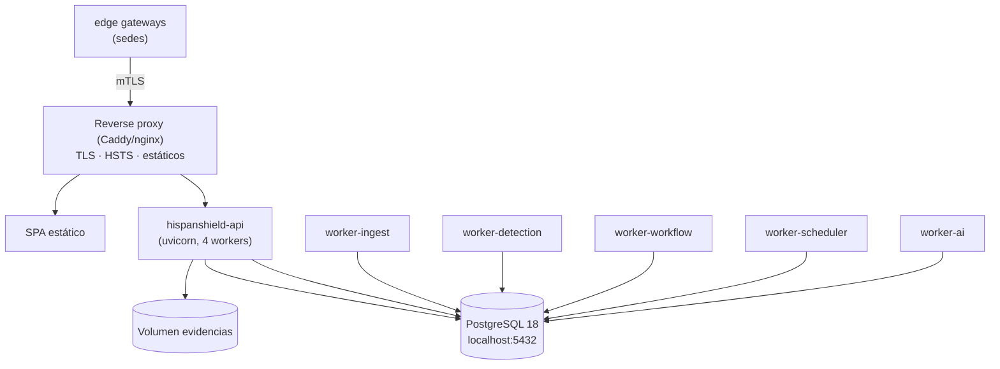

# ARQUITECTURA DE DESPLIEGUE

- **Documento:** `specs/architecture/deployment-architecture.md`
- **Estado:** `LOCKED` v1.0
- **Modos:** single-node (systemd), Docker Compose, Kubernetes, air-gapped
- **Detalle operativo:** `specs/deployment/deployment-modes.md`, `docs/operations-runbook.md`

---

## 1. REQUISITOS DE INFRAESTRUCTURA

| Recurso | Mínimo | Recomendado | Notas |
| :--- | :--- | :--- | :--- |
| CPU | 8 vCPU | 16 vCPU | Detección e ingesta son CPU-bound |
| RAM | 16 GB | 64 GB | IA local: +16-32 GB |
| Disco | 200 GB SSD | 1 TB NVMe | Eventos + evidencias; IOPS importan |
| PostgreSQL | 16+ | 18.x | Mismo host o gestionado |
| Red | 1 Gbps | 10 Gbps | Ingesta sostenida |
| GPU (opcional) | — | ≥12 GB VRAM | Solo IA local |

---

## 2. TOPOLOGÍA DE REFERENCIA (SINGLE-NODE)

| Unidad | Proceso | Puerto | systemd unit |
| :--- | :--- | :--- | :--- |
| API | `uvicorn app.main:app --workers 4` | 8000 (loopback) | `hispanshield-api.service` |
| Worker ingest | `python -m app.workers.ingest` | — | `hispanshield-worker-ingest.service` |
| Worker detection | `python -m app.workers.detection` | — | `hispanshield-worker-detection.service` |
| Worker workflow | `python -m app.workers.workflow` | — | `hispanshield-worker-workflow.service` |
| Worker scheduler | `python -m app.workers.scheduler` | — | `hispanshield-worker-scheduler.service` |
| Worker AI | `python -m app.workers.ai` | — | `hispanshield-worker-ai.service` |
| Proxy | `caddy`/`nginx` | 443 | `caddy.service` |
| Edge | `hispanshield-edge` | 8443 salida | `hispanshield-edge.service` |

**Orden de arranque:** PostgreSQL → migraciones → API → workers → proxy. `ExecStartPre` verifica `alembic current == head`.

---

## 3. KUBERNETES

| Objeto | Réplicas | Notas |
| :--- | :--- | :--- |
| `Deployment/api` | 2-4 | HPA por CPU; readiness `/readyz` |
| `Deployment/web` | 2 | Estático |
| `Deployment/worker-ingest` | 2 | HPA por profundidad de cola (custom metric) |
| `Deployment/worker-detection` | 2 | Sin estado |
| `Deployment/worker-workflow` | 2 | Leases en BD |
| `StatefulSet/scheduler` | 1 | Advisory lock evita duplicados |
| `Deployment/worker-ai` | 1-2 | Opcional |
| `StatefulSet/postgres` (o servicio gestionado) | 1 | Réplica opcional |
| `PersistentVolumeClaim/evidence` | — | `ReadWriteMany` si hay >1 réplica de API |
| `NetworkPolicy` | — | Solo proxy→API; workers sin ingress; edge→proxy |
| `PodDisruptionBudget` | — | api y worker-workflow con minAvailable 1 |
| `Secret` | — | `HISPANSHIELD_SECRET_KEY`, `DATABASE_URL` (sellado por el cliente) |

**Seguridad de pod:** `runAsNonRoot`, `readOnlyRootFilesystem` salvo `/tmp`, `allowPrivilegeEscalation: false`, `capabilities.drop: [ALL]`, `seccompProfile: RuntimeDefault`.

---

## 4. AIR-GAPPED

| Requisito | Implementación |
| :--- | :--- |
| Dependencias Python | Wheels en `vendor/wheels`, `pip install --no-index --find-links` |
| Dependencias Node | `node_modules` empaquetado o `npm ci --offline` con cache |
| Fuentes | `.woff2` en `frontend/public/fonts` |
| Imágenes | `docker save`/`skopeo copy` a registro espejo |
| Modelos IA | Descargados previamente, verificados por hash |
| SBOM | Incluido en el bundle |
| Verificación | `scripts/verify_airgap.sh` bloquea cualquier salida a red |
| Actualizaciones | Bundle firmado, procedimiento de ventana |

---

## 5. VARIABLES DE ENTORNO (contrato)

| Variable | Obligatoria | Default | Descripción |
| :--- | :--- | :--- | :--- |
| `HISPANSHIELD_ENV` | Sí | `production` | `production|staging|test` |
| `HISPANSHIELD_DATABASE_URL` | Sí | — | `postgresql+psycopg://...` |
| `HISPANSHIELD_SECRET_KEY` | Sí (prod) | — | Clave Fernet (32 bytes base64) |
| `HISPANSHIELD_ALLOWED_ORIGINS` | Sí | — | Lista separada por comas |
| `HISPANSHIELD_SESSION_IDLE_MINUTES` | No | `30` | Timeout idle |
| `HISPANSHIELD_SESSION_ABSOLUTE_HOURS` | No | `12` | Timeout absoluto |
| `HISPANSHIELD_DB_POOL_SIZE` | No | `10` | Pool por proceso |
| `HISPANSHIELD_MAX_PAGE_SIZE` | No | `200` | Límite de paginación |
| `HISPANSHIELD_EVENT_RETENTION_DAYS` | No | `90` | Retención caliente |
| `HISPANSHIELD_EVIDENCE_PATH` | Sí | — | Volumen de evidencias |
| `HISPANSHIELD_REQUIRE_MIGRATIONS` | No | `true` | Bloquea arranque si hay pendientes |
| `HISPANSHIELD_EDGE_REQUIRE_MTLS` | No | `false` | Exigir certificado de cliente |
| `HISPANSHIELD_AI_PROVIDER` | No | `none` | `none|ollama|vllm|openai_compat` |
| `HISPANSHIELD_AI_BASE_URL` | No | — | Endpoint local |
| `HISPANSHIELD_AI_DAILY_TOKEN_BUDGET` | No | `0` | 0 = sin límite (no recomendado) |
| `HISPANSHIELD_RAG_MAX_CHUNKS` | No | `200000` | Límite por org |
| `HISPANSHIELD_LOG_LEVEL` | No | `INFO` | Nivel |
| `HISPANSHIELD_TRUSTED_PROXIES` | No | — | IPs de proxy para `X-Forwarded-*` |

**Regla:** una variable obligatoria ausente o inválida impide el arranque con mensaje accionable (sin traza al cliente).

---

## 6. RED Y EXPOSICIÓN

| Puerto | Exposición | Uso |
| :--- | :--- | :--- |
| 443 | Pública (o interna) | UI + API |
| 5514/udp, 5514/tcp | Red de gestión | Syslog |
| 8000 | Loopback | API (detrás de proxy) |
| 5432 | Loopback / red privada | PostgreSQL |
| 8443 | Salida | Edge → core |
| 8790 | Loopback | Métricas (opcional) |

**Prohibido:** exponer PostgreSQL, workers o `/metrics` a Internet. El proxy es el único punto de entrada HTTP.

---

## 7. RESPALDO, ACTUALIZACIÓN Y ROLLBACK

| Operación | Procedimiento | Verificación |
| :--- | :--- | :--- |
| Backup | `scripts/backup.sh` (pg_dump + evidencias + manifiesto) | Conteo y hash |
| Restore | `scripts/restore.sh` en instancia limpia | `backup_restore_drill.sh` |
| Actualización | Backup → drenar → migrar → desplegar → smoke tests | `/readyz` + E2E de humo |
| Rollback de app | Redesplegar versión anterior (migraciones compatibles) | Smoke tests |
| Rollback de migración | `alembic downgrade` solo si la revisión lo soporta | Test en staging |
| Ventana | Fuera de horario operativo; kill switch de autonomía activable | Runbook |

---

## 8. CAPACIDAD Y ESCALADO

| Síntoma | Acción |
| :--- | :--- |
| Cola de ingesta crece | +`worker-ingest`, revisar índices |
| Detección retrasada | +`worker-detection`, reducir ventanas |
| Búsqueda lenta | Revisar índices, reducir rango, archivar particiones |
| API p95 alto | +workers uvicorn, revisar queries N+1 |
| Disco de eventos | Ajustar retención, añadir almacenamiento frío |
| RAG lento | Reducir chunks, migrar a pgvector |
| Presupuesto IA agotado | Ajustar límite o usar modelo local menor |

---

## 9. CRITERIOS DE ACEPTACIÓN

`AC-110` (health), `AC-111` (migraciones), `AC-113` (backup), `AC-114` (air-gap), `AC-116` (shutdown).

## 10. EVIDENCIA

1. `scripts/verify_airgap.sh` exit 0.
2. `scripts/backup_restore_drill.sh` exit 0.
3. Manifiestos validados (`docker compose config -q`, `kustomize build`).
4. `/readyz` tras arranque y tras fallo simulado de BD.
5. Registro de actualización con migración y smoke tests.
