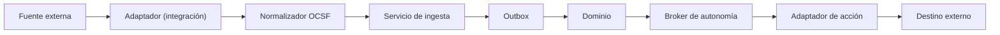

# ARQUITECTURA DE INTEGRACIÓN

- **Documento:** `specs/architecture/integration-architecture.md`
- **Estado:** `LOCKED` v1.0
- **Contratos:** `specs/integrations/{connector-contract,mcp-contract,protocol-registry,compatibility-matrix}.md`

---

## 1. PRINCIPIOS

1. **Adaptador, no acoplamiento.** Cada sistema externo vive en `backend/app/integrations/` detrás de una interfaz; el dominio no conoce vendors.
2. **Capacidad declarada.** Un conector declara qué puede hacer; el broker solo pide lo declarado.
3. **Degradación visible.** Fallo → estado `degraded` con causa y `next_attempt_at`.
4. **Idempotencia.** Toda ingesta y acción usa clave estable.
5. **Seguridad de salida.** Allowlist de destinos, TLS verificado, anti-SSRF, límites de tamaño.
6. **Edge como extensión, no como excepción.** El gateway usa el mismo contrato que cualquier conector.

---

## 2. CAPAS DE INTEGRACIÓN



| Capa | Responsabilidad | No hace |
| :--- | :--- | :--- |
| Adaptador | Transporte, auth, parseo, mapeo de errores | Reglas de negocio, autorización |
| Normalizador | Conversión a OCSF, validación de campos | Persistencia |
| Servicio de ingesta | Validación, dedupe, transacción, outbox | Llamadas externas |
| Broker | Política, límites, ejecución, verificación | Parseo de protocolos |
| Edge | Buffer durable, reenvío, mTLS | Lógica de dominio |

---

## 3. INGESTA: TRES CAMINOS

| Camino | Uso | Latencia | Garantía |
| :--- | :--- | :--- | :--- |
| **Push directo** (webhook) | Sistemas con conectividad y capacidad de firmar | ≤2 s | `202` solo tras commit; idempotente |
| **Syslog** | Dispositivos de red, servidores | ≤2 s | UDP sin garantía de red; TCP con ACK; dedupe por `event_uid` |
| **Edge store-and-forward** | Sedes con red intermitente | Diferida | SQLite WAL + secuencia + reintento ordenado |

**Camino de error:** si el core no puede persistir, responde `5xx`/`503`; el edge **no** borra de su cola hasta `202`. Esto garantiza 0 pérdidas de eventos aceptados (`NFR-04`).

---

## 4. ACCIONES: FLUJO ÚNICO

```text
ExecutionRequest (playbook o autonomía)
  → policy.evaluate()
  → broker.execute()
      → connector.execute(action, params, idempotency_key)
      → verifier.verify(criterion)
      → rollback.run() si falla
  → audit + outbox
```

**Prohibiciones**
- Un endpoint HTTP no puede llamar directamente a un adaptador de acción.
- Un agente de IA no puede llamar a un adaptador; solo al broker MCP → política → broker de ejecución.
- Un conector no puede ejecutar una acción fuera de `capabilities[]`.

---

## 5. CATÁLOGO DE INTEGRACIONES 1.0

| Integración | Tipo | Dirección | Estado | Notas |
| :--- | :--- | :--- | :--- | :--- |
| Syslog genérico | Ingesta | Entrada | `supported` | RFC 5424/3164 |
| Webhook genérico | Ingesta | Entrada | `supported` | HMAC |
| Edge gateway | Ingesta | Entrada | `supported` | mTLS |
| MISP | CTI | Entrada | `supported` | API |
| TAXII 2.1 | CTI | Entrada | `supported` | Polling |
| AWS (read-only) | Cloud | Entrada | `supported` | Rol cross-account |
| Azure (read-only) | Cloud | Entrada | `supported` | Service Principal |
| GCP (read-only) | Cloud | Entrada | `supported` | Service Account |
| EDR genérico | Bidireccional | Ambos | `supported` | Aislar/cuarentena |
| Firewall genérico | Bidireccional | Ambos | `supported` | Bloquear IP |
| IdP genérico | Bidireccional | Ambos | `supported` | Deshabilitar usuario |
| Ticketing genérico | Acción | Salida | `supported` | Crear/actualizar ticket |
| SMTP | Notificación | Salida | `supported` | Solo notificación |
| Ollama/vLLM | IA | Salida | `supported` | Local |
| Proveedor IA externo | IA | Salida | `opt-in` | Requiere habilitación |
| MCP servers | Tools | Ambos | `supported` | Allowlist |
| Kafka/SNMP/NetFlow | Ingesta | — | `unsupported` | Fase 2 |

---

## 6. RESILIENCIA

| Patrón | Implementación |
| :--- | :--- |
| Timeout | Por adaptador (30/60/45 s) con techo duro |
| Retry | Backoff exponencial con jitter, máximo 3 (ingesta) / 3 (acción) |
| Circuit breaker | 5 fallos → `open`; `half_open` tras backoff |
| Bulkhead | Límite de concurrencia por conector |
| Cola | Durable; sin pérdida tras `202` |
| Dedupe | `event_uid` / `idempotency_key` |
| Cuarentena | Edge/conector que viola contrato se deshabilita y alerta |
| Backpressure | `503 ingest_backpressure` con `Retry-After` |

---

## 7. SEGURIDAD DE INTEGRACIÓN

| Control | Regla |
| :--- | :--- |
| Secretos | Fernet, rotación, nunca en logs/respuestas |
| Destinos | Allowlist por conector; bloqueo de rangos privados salvo excepción explícita |
| TLS | Verificación obligatoria; CA personalizada soportada |
| Firma | HMAC-SHA256 + timestamp para webhooks y edge |
| mTLS | Obligatorio si `require_client_cert=true` |
| Límites | 10 MB webhook, 5 MB edge, 64 KB syslog, 50 MB ficheros |
| Auditoría | Alta, cambio, rotación, test, ejecución, error de auth |

---

## 8. VERSIONADO DE INTEGRACIONES

- Cada conector declara `version` (SemVer) y `min_core_version`.
- Un cambio incompatible (mapeo, semántica de acción) incrementa major y requiere nueva entrada en la matriz.
- Los adaptadores antiguos se mantienen ≥2 releases con aviso de deprecación.
- Los mapeos OCSF están versionados (`mapping_v1`) y se testean con muestras fijas.

---

## 9. CRITERIOS DE ACEPTACIÓN

`AC-104` (registro), `AC-105` (edge), `AC-106` (mTLS), `AC-107` (circuit breaker), `AC-108` (MCP), `AC-109` (protocolos), `AC-34` (HMAC), `AC-35` (idempotencia).

## 10. EVIDENCIA

1. `pytest -q backend/tests/integration/test_connector_registry.py tests/integration/test_circuit_breaker.py`.
2. `pytest -q edge/tests/`.
3. Manifiesto de conector validado.
4. Secuencia de estados de salud.
5. Test de store-and-forward con 1.000 eventos y corte de red.
