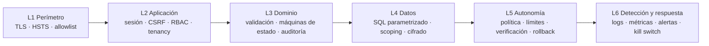

# ARQUITECTURA DE SEGURIDAD

- **Documento:** `specs/architecture/security-architecture.md`
- **Estado:** `LOCKED` v1.0
- **Documentos normativos:** `specs/security/{authorization-model,autonomy-policy,threat-model,safety-requirements,data-protection}.md`
- **Fuente canónica de controles:** `.factory/ARCHITECTURE.md §6` y `.factory/SECURITY_AUDIT.md §2`

---

## 1. ARQUITECTURA DE DEFENSA EN CAPAS



Ninguna capa se considera suficiente. Un fallo en L2 no debe permitir daño en L5 (la política se evalúa de nuevo, con identidad y contexto).

---

## 2. IDENTIDAD Y SESIÓN

| Elemento | Diseño | Verificación |
| :--- | :--- | :--- |
| Password | Argon2id (3/65536/2, 32 bytes) | `test_security_primitives.py` |
| Sesión | Token 256 bits, hash SHA-256 en BD, cookie `HttpOnly; Secure; SameSite=Strict` | `test_auth_login.py` |
| Rotación | En login y cambio de privilegio | `test_session_lifecycle.py` |
| Expiración | Idle 30 min, absoluta 12 h | Igual |
| MFA | TOTP ±1, anti-replay, recovery codes hasheados | `test_auth_mfa.py` |
| PAT | Prefijo público + secreto hasheado, scopes, TTL | `test_api_tokens.py` |
| CSRF | Double-submit, `hmac.compare_digest` | `test_csrf.py` |
| Break-glass | TTL ≤60 min, justificación, banner, auditoría | `test_break_glass.py` |

---

## 3. AUTORIZACIÓN

```text
request → identidad → organización → membership → permisos efectivos → recurso scoped → acción
```

- Matriz declarativa en `permissions.py` (fuente: `authorization-model.md`).
- Guard obligatorio por router; test AST detecta routers sin guard.
- Recurso siempre filtrado por `organization_id`; 404 uniforme.
- Reducción de permisos en modo `auditor`.
- Separación de funciones en aprobaciones y evidencias.

---

## 4. PROTECCIÓN DE DATOS

| Dato | En tránsito | En reposo | En uso |
| :--- | :--- | :--- | :--- |
| Password | TLS | Argon2id (irreversible) | Nunca en claro |
| TOTP secret | TLS | Fernet | Descifrado por request de verificación |
| Secreto de conector | TLS | Fernet + `key_version` | Solo en llamada al conector |
| PAT | TLS | SHA-256 | Comparación en tiempo constante |
| Evidencias | TLS | Volumen cifrado (cliente) + hash | Lectura autorizada y auditada |
| Eventos | TLS / mTLS | Volumen cifrado + append-only | Consultas scoped |
| Auditoría | TLS | Append-only + hash chain | Verificación pública interna |

**Claves:** `HISPANSHIELD_SECRET_KEY` (Fernet) provista por el entorno; rotación con re-cifrado y `key_version`. Sin HSM en 1.0 (riesgo residual `R-02`).

---

## 5. SEGURIDAD DE LA CADENA DE SUMINISTRO

| Control | Implementación | Gate |
| :--- | :--- | :--- |
| Pin + hash | `requirements.lock`, `package-lock.json` | Build |
| CVE | `pip-audit`, `npm audit --audit-level=high` | `AC-120` |
| SAST | `bandit -ll`, `ruff` reglas S | `AC-120` |
| Secretos | `gitleaks` + `.gitignore` | `AC-120` |
| Licencias | `check_licenses.py` con allowlist | `AC-121` |
| SBOM | CycloneDX por release | `AC-121` |
| Firma | checksums + cosign opcional | Release |
| Divulgación | `SECURITY.md` con plazos | Release |

---

## 6. SEGURIDAD DE LA AUTONOMÍA (resumen)

| Control | Implementación |
| :--- | :--- |
| Autoridad única | Broker; ningún otro componente invoca acciones |
| Deny-by-default | Sin política → deny |
| Determinismo | `inputs_digest` + versión; reproducible |
| Límites | Blast radius, budget, cooldown, freeze |
| Aprobaciones | A2/A4, separación de funciones |
| Verificación | Independiente, con criterio declarado |
| Rollback | Idempotente, `before_state` |
| Halt | Kill switch ≤5 s, re-check por paso |
| Auditoría | `decision_id` + resultado + actor |

---

## 7. SEGURIDAD DE LA IA

| Riesgo | Control |
| :--- | :--- |
| Prompt injection | Delimitación, guardrails, sin autoridad de acción |
| Exfiltración | Aislamiento RAG por org, redacción, sin secretos en prompts |
| Tool abuse | Allowlist MCP + política + aprobación |
| Coste | Presupuesto por run/org, `max_steps` |
| Soberanía | Local-first; externo opt-in; bloqueo por región |
| Datos de entrenamiento | No se entrena; no se envía telemetría a terceros sin opt-in |

---

## 8. SEGURIDAD DE LA INGESTA

| Superficie | Control |
| :--- | :--- |
| Syslog | Allowlist de red, límite de tamaño, parser robusto, crudo conservado |
| Webhook | HMAC + timestamp + idempotencia + límite de lote |
| Edge | mTLS + HMAC + secuencia monotónica + cuarentena por org |
| Ficheros (CSV/XML/JSON) | Tamaño, MIME real, parser sin XXE, límites de profundidad |
| STIX/TAXII | Validación de esquema, límite de objetos, allowlist de URL |

---

## 9. OBSERVABILIDAD DE SEGURIDAD

| Señal | Uso |
| :--- | :--- |
| `hs_auth_failures_total` | Detección de fuerza bruta |
| `hs_authz_denied_total{permission}` | Intentos de escalada |
| `hs_tenant_violation_attempts_total` | IDOR |
| `hs_autonomy_denied_total{reason}` | Presión de política |
| `hs_autonomy_halt_latency_seconds` | Eficacia del kill switch |
| `hs_connector_auth_failures_total` | Credenciales de conector |
| `hs_evidence_integrity_failures_total` | Manipulación |
| `hs_prompt_injection_detected_total` | Ataques a IA |
| `hs_audit_chain_invalid_total` | Integridad de auditoría |

Alertas: fuerza bruta sostenida, denegaciones de tenancy, fallo de integridad, kill switch activado, cadena inválida, `rollback_failed`.

---

## 10. RESPUESTA A INCIDENTES DE SEGURIDAD DEL PRODUCTO

1. **Detección:** alerta automática o divulgación externa.
2. **Clasificación:** CVSS + impacto en tenants.
3. **Contención:** parche, configuración, kill switch de funcionalidad si aplica.
4. **Erradicación y recuperación:** despliegue, verificación, restauración si hubo corrupción.
5. **Notificación:** cliente afectado y, si procede, autoridad (NIS2/CRA).
6. **Post-mortem:** ADR si hay cambio arquitectónico; actualización de threat model.

Plazos objetivo: triaje ≤24 h, mitigación de CRITICAL ≤72 h, parche de HIGH ≤14 días.

---

## 11. CRITERIOS DE ACEPTACIÓN

| AC | Criterio |
| :--- | :--- |
| `AC-01..AC-08` | Identidad |
| `AC-10..AC-12` | Tenancy y RBAC |
| `AC-70..AC-78` | Autonomía |
| `AC-120` | Dependencias y SAST |
| `AC-121` | SBOM y licencias |
| `AC-122` | Aislamiento |
| `AC-124` | Prompt injection |

## 12. EVIDENCIA

1. `.factory/SECURITY_AUDIT.md` con 0 CRITICAL/HIGH.
2. Tabla RBAC generada.
3. Test de cabeceras y cookies.
4. Informe de SBOM y licencias.
5. Resultados de tests de autonomía y prompt injection.
