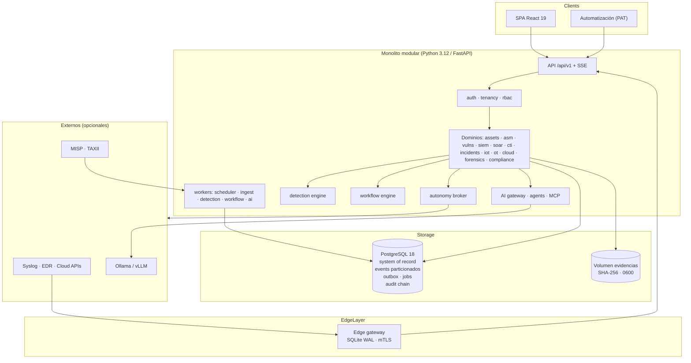
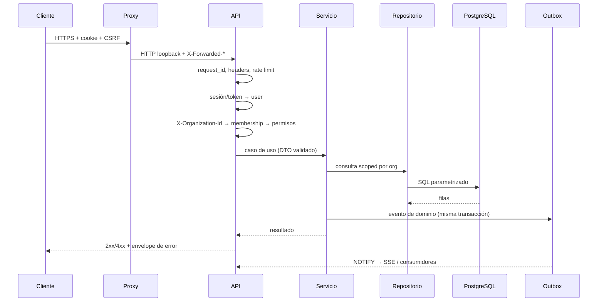

# ARQUITECTURA DEL SISTEMA

- **Documento:** `specs/architecture/system-architecture.md`
- **Estado:** `LOCKED` v1.0 — derivado de `.factory/ARCHITECTURE.md` (que es la fuente canónica)
- **Audiencia:** ingeniería, operaciones, integradores, auditoría técnica

---

## 1. VISIÓN DE COMPONENTES



| Componente | Responsabilidad | Estado | Escalado |
| :--- | :--- | :--- | :--- |
| `api` | HTTP, validación, auth, casos de uso | Stateless | Horizontal tras LB (sticky no requerido) |
| `worker-ingest` | Syslog, webhook, edge ingest, normalización | Stateless por lote | Horizontal por cola |
| `worker-detection` | Evaluación de reglas y correlación | Estado en BD | Horizontal con partición por org |
| `worker-workflow` | Ejecución de playbooks | Estado en BD | Horizontal con leases |
| `worker-scheduler` | Jobs periódicos (retención, SLA, feeds, caducidad) | Singleton lógico (advisory lock) | 1 activo + standby |
| `worker-ai` | Runs de agentes, embeddings | Estado en BD | Horizontal con presupuesto |
| `web` | Estáticos del SPA | Stateless | CDN interno/proxy |
| `edge` | Buffer y reenvío | Estado local SQLite | 1 por sede (activo/pasivo) |
| `postgres` | Estado durable | Stateful | Réplica de lectura opcional |

---

## 2. FLUJO DE UNA PETICIÓN



**Invariantes**
1. La transacción de dominio y el evento de outbox se confirman juntos o no se confirman.
2. Ninguna consulta de dominio se ejecuta sin `organization_id`.
3. Ningún error interno sale al cliente sin `request_id`.
4. Las respuestas son deterministas para el mismo estado y mismos parámetros (salvo campos de medición).

---

## 3. MÓDULOS Y DEPENDENCIAS PERMITIDAS

Cada dominio es un paquete `backend/app/modules/<domain>/` con `router.py` (contrato HTTP), `schemas.py` (Pydantic), `service.py` (reglas y transacciones), `repository.py` (SQL scoped) y módulos auxiliares (`engine.py`, `policy.py`, `seed.py`, `mapping.py`). `app/api/router.py` los autodescubre.

```text
modules/<dominio>/router.py → service.py → repository.py → models/
service.py → core (config, db, crypto, rbac, audit, logging, errors)
service.py → otros módulos: solo interfaz pública o evento de outbox
modules/defence (autonomía) → service público + adaptadores de conector
modules/ai|agents|mcp → lectura de dominio + solicitud al broker de autonomía
```

| Prohibición | Motivo |
| :--- | :--- |
| `service.py` de A importa `service.py` de B | Acoplamiento; usar interfaz pública o eventos |
| `router.py` accede a `models/` o SQL directo | Saltarse reglas de negocio y auditoría |
| `models/` importa módulos o servicios | Inversión de dependencias |
| `connectors/` importa servicios de dominio | El conector no conoce el dominio |
| `frontend` con lógica de autorización | El servidor es la autoridad |
| Editar `app/api/router.py`, `app/main.py` o `core/` desde un módulo | Propiedad del andamiaje; cambios vía arquitectura |

**Mapeo con los documentos de dominio:** cuando `specs/domains/*` dice `services/<x>.py`, `repositories/<x>.py` o `api/v1/<x>.py`, se refiere a `modules/<x>/service.py`, `modules/<x>/repository.py` y `modules/<x>/router.py`. Para `detection/`, `workflow/`, `autonomy/`, `ai/`, `integrations/`, ver la tabla de mapeo de `.factory/ARCHITECTURE.md §2`.

Verificación: `backend/tests/unit/test_import_boundaries.py` analiza el AST y falla si se viola una arista; `app/api/router.py` solo importa `router` de cada paquete.

---

## 4. EVENTOS DE DOMINIO

| Evento | Productor | Consumidores | Garantía |
| :--- | :--- | :--- | :--- |
| `asset.*` | assets | detection, autonomy, metrics | at-least-once |
| `vulnerability.*` | vulnerabilities | assets, compliance | at-least-once |
| `event.ingested` | siem | detection, cti | at-least-once |
| `alert.*` | detection | correlation, SSE, notifications | at-least-once |
| `incident.*` | incidents | compliance, reports, SSE | at-least-once |
| `execution.*` | workflow | SSE, autonomy, audit | at-least-once |
| `autonomy.*` | autonomy | audit, SSE, metrics | at-least-once |
| `connector.*` | connectors | SSE, alerts | at-least-once |
| `ai.run_completed` | ai | metrics, audit | at-least-once |

**Dedupe:** cada consumidor mantiene `processed_events(event_id)` con TTL igual a la retención del outbox (7 días). Un evento puede entregarse dos veces; el efecto debe ser idempotente.

---

## 5. MODOS DE FALLO Y COMPORTAMIENTO

| Fallo | Efecto | Comportamiento |
| :--- | :--- | :--- |
| PostgreSQL no disponible | Todo | `/readyz` 503; API devuelve `503 dependency_unavailable`; workers reintentan con backoff |
| Worker caído | Cola crece | Otro worker reclama por lease; `/metrics` muestra profundidad |
| Disco de evidencias lleno | Subidas fallan | `503 storage_full`; alerta; no se aceptan evidencias parciales |
| Proveedor IA caído | Asistencia | `503 ai_unavailable`; resto funciona |
| Conector caído | Ingesta/acción de ese conector | `degraded`; circuit breaker; datos con `as_of` |
| Edge sin red | Buffer local | SQLite retiene; reenvío ordenado al volver |
| Reloj desviado | TOTP/timeline | Alerta de `clock_skew`; se rechaza TOTP fuera de ventana |
| Outbox atascado | Eventos no entregados | Alerta si `pending > 10k` o `oldest > 5 min`; dispatcher reinicia |
| Migración fallida | Arranque | El servicio no arranca si `alembic current != head` en modo estricto |

---

## 6. LÍMITES Y CAPACIDAD

| Recurso | Límite 1.0 | Punto de escalado |
| :--- | :--- | :--- |
| Eventos/s | 2.000 sostenidos | Particionar por org + más workers |
| Eventos almacenados | 50 M calientes | Retención / almacenamiento frío |
| Activos/org | 200.000 | Índices + cursor |
| Chunks RAG/org | 200.000 | Migrar a pgvector/Qdrant |
| Ejecuciones concurrentes/org | 20 | Cola por org |
| Acciones autónomas/hora | 10 por clase | Política + presupuesto |
| Organizaciones | 50 | Instancias separadas |

---

## 7. DECISIONES CLAVE (referencia)

`ADR-001` monolito modular · `ADR-002` PostgreSQL único · `ADR-003` outbox · `ADR-004` workflow en PG · `ADR-005` vectores JSONB · `ADR-006` FTS · `ADR-007` frontend · `ADR-008` edge · `ADR-009` auth · `ADR-010` IA · `ADR-011` secretos · `ADR-012` licencias.

---

## 8. CRITERIOS DE ACEPTACIÓN RELACIONADOS

`AC-110` health/readyz · `AC-111` migraciones · `AC-112` auditoría · `AC-113` backup · `AC-114` air-gap · `AC-115` logs · `AC-116` shutdown · `AC-117..AC-124` gates.

## 9. EVIDENCIA

1. Diagrama C4 actualizado en `docs/architecture-c4.md`.
2. `pytest -q tests/unit/test_import_boundaries.py`.
3. Salida de `/healthz` y `/readyz` en estado sano y degradado.
4. Test de outbox atómico.
5. Bench de ingesta y de búsqueda.
