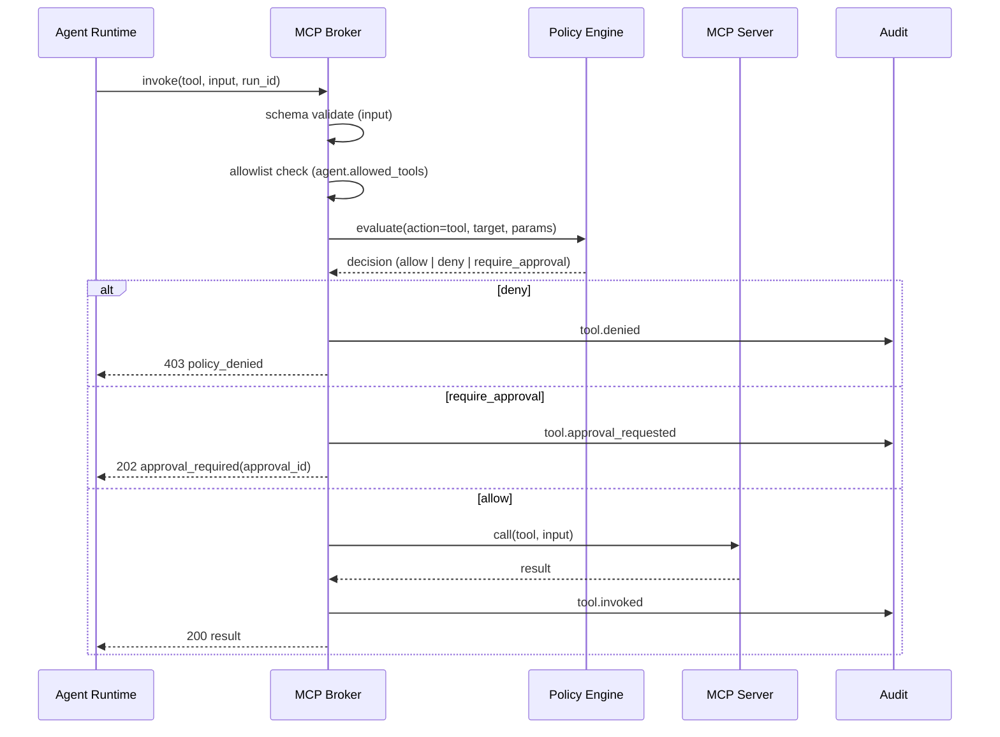

# CONTRATO MCP (MODEL CONTEXT PROTOCOL)

- **Documento:** `specs/integrations/mcp-contract.md`
- **Estado:** `APPROVED` v1.0
- **Ámbito:** registro de servidores MCP, exposición de tools al runtime de agentes, invocación y auditoría.

---

## 1. PRINCIPIO RECTOR

> El modelo **propone**; el broker **valida**; la política **decide**; el conector **ejecuta**.

MCP se usa como mecanismo de descripción e invocación de herramientas, **no** como mecanismo de autorización. Ninguna tool se ejecuta por el hecho de estar expuesta o de que el modelo la solicite. La autorización efectiva reside en el `autonomy` policy engine y en la allowlist por agente.

---

## 2. REGISTRO DE SERVIDORES

```json
{
  "id": "0192a1...",
  "organization_id": "0192a0...",
  "name": "hispanshield-core-tools",
  "transport": "http",
  "endpoint": "https://127.0.0.1:8791/mcp",
  "auth": {"type": "bearer", "secret_ref": "connector_secret:0192..."},
  "enabled": true,
  "health": {"state": "healthy", "checked_at": "2026-11-26T10:00:00Z"},
  "trust_level": "internal"
}
```

| Campo | Regla |
| :--- | :--- |
| `transport` | `http` (streamable) o `stdio` (solo procesos empaquetados y firmados) |
| `endpoint` | HTTPS obligatorio salvo loopback; sujeto a guard anti-SSRF |
| `trust_level` | `internal` (propio), `partner` (verificado), `untrusted` (solo lectura, sin acciones) |
| `enabled` | Deshabilitado = no aparece en `tools` ni puede invocarse |

**`untrusted`** no puede exponer tools con `risk_level >= medium`; el registro lo rechaza.

---

## 3. DESCRIPCIÓN DE TOOLS

Toda tool declara:

```json
{
  "name": "assets.search",
  "server_id": "0192a1...",
  "description": "Busca activos por nombre, IP o etiqueta. Solo lectura.",
  "input_schema": {
    "type": "object",
    "additionalProperties": false,
    "required": ["query"],
    "properties": {
      "query": {"type": "string", "minLength": 1, "maxLength": 200},
      "kind": {"type": "string", "enum": ["host", "network", "application", "cloud_resource", "iot", "ot", "identity", "data_store"]},
      "limit": {"type": "integer", "minimum": 1, "maximum": 100, "default": 20}
    }
  },
  "output_schema": {"type": "object"},
  "risk_level": "low",
  "side_effects": false,
  "requires_approval": false,
  "idempotent": true,
  "timeout_seconds": 15
}
```

| `risk_level` | Ejemplos | Reglas |
| :--- | :--- | :--- |
| `low` | búsqueda, lectura de activo, consulta de estado | Permitido en agentes de solo lectura |
| `medium` | crear ticket, enriquecer activo, etiquetar | Requiere `allowed_tools` explícito |
| `high` | bloquear IP, deshabilitar usuario | Requiere política + aprobación si la política lo indica |
| `critical` | aislar host, acción OT de segmento | Requiere A3/A4, doble aprobación, blast radius |

`side_effects=true` obliga a `idempotent` declarado y a `compensate` registrado en el catálogo de acciones. Sin compensación → `risk_level` mínimo `high` y aprobación obligatoria.

---

## 4. FLUJO DE INVOCACIÓN



**Reglas**
1. Validación de entrada **antes** de cualquier llamada: `additionalProperties: false`, tipos, longitudes, enums.
2. Allowlist por agente: `allowed_tools[]` debe contener el nombre exacto; comodines prohibidos.
3. Policy engine evalúa incluso si `risk_level=low` (deny-by-default global).
4. Límite de llamadas por run (`max_tool_calls`, default 8) y por minuto por org.
5. El resultado se trunca a 64 KB; si excede, se devuelve referencia y el agente debe paginar.
6. Toda invocación registra `run_id`, `tool_name`, `input_hash` (no input completo si contiene secretos), `decision_id`, `duration_ms`, `result_status`.

---

## 5. SEGURIDAD

| Riesgo | Control |
| :--- | :--- |
| Confused deputy | El broker usa la identidad del **usuario que lanzó el run**, no una credencial de servicio genérica |
| Tool poisoning (descripción maliciosa) | Descripciones tratadas como contenido no confiable; no se inyectan en el system prompt sin delimitar |
| Exfiltración | Tools `untrusted` sin acceso a red salvo allowlist; output filtrado por DLP básico (patrones de secreto) |
| SSRF | Guard de red en `endpoint` y en tools que aceptan URL |
| Escalada | `allowed_tools` por agente + política + aprobación; nunca se amplía en runtime |
| Replay | `idempotency_key` por `(run_id, step_index, tool_name)` |
| Prompt injection → tool call | Guardrails + delimitación + allowlist; corpus de test obligatorio |

---

## 6. CONTRATO HTTP DEL BROKER

| Método | Endpoint | Rol | Descripción |
| :--- | :--- | :--- | :--- |
| GET | `/api/v1/mcp/servers` | `admin`+ | Lista servidores con health y `trust_level` |
| POST | `/api/v1/mcp/servers` | `admin`+ | Registra servidor (valida transporte, endpoint, trust) |
| POST | `/api/v1/mcp/servers/{id}/probe` | `admin`+ | Descubre tools; rechaza las incompatibles |
| PATCH | `/api/v1/mcp/servers/{id}` | `admin`+ | Habilita/deshabilita, rota secreto |
| GET | `/api/v1/mcp/tools` | `admin`+ | Catálogo con `risk_level` y esquema |
| POST | `/api/v1/mcp/tools/{name}/invoke` | `admin`+ | Invocación directa (no vía agente), auditada |
| GET | `/api/v1/mcp/invocations` | `auditor`+ | Historial con `run_id`, decisión y resultado |

**Errores:** `403 tool_not_allowed`, `403 policy_denied`, `422 input_schema_violation`, `429 tool_rate_limited`, `502 tool_upstream_error`, `504 tool_timeout`.

---

## 7. CATÁLOGO INICIAL DE TOOLS INTERNAS

| Tool | Risk | Side effects | Descripción |
| :--- | :--- | :--- | :--- |
| `assets.search` | low | No | Búsqueda de activos |
| `assets.get` | low | No | Detalle de activo |
| `vulnerabilities.list` | low | No | Hallazgos por activo/severidad |
| `events.search` | low | No | Búsqueda SIEM acotada |
| `incidents.get` | low | No | Detalle de incidente |
| `incidents.comment` | medium | Sí | Añade comentario al timeline |
| `incidents.create` | medium | Sí | Crea incidente |
| `compliance.status` | low | No | Estado de controles |
| `tickets.create` | medium | Sí | Crea ticket externo |
| `hosts.isolate` | critical | Sí | Aísla host (política + aprobación) |
| `ips.block` | high | Sí | Bloquea IP en firewall |
| `users.disable` | high | Sí | Deshabilita identidad |

---

## 8. CRITERIOS DE ACEPTACIÓN

| AC | Criterio |
| :--- | :--- |
| `AC-108` | Registro con esquema y `risk_level`; input inválido no invoca |
| `AC-66` | Tool no allowlisted → `403 tool_not_allowed` |
| `AC-MCP-03` | `untrusted` no puede exponer `risk_level >= medium` |
| `AC-MCP-04` | Toda invocación con `decision_id` en auditoría |
| `AC-MCP-05` | Límite de llamadas por run aplicado |

## 9. EVIDENCIA

1. `pytest -q backend/tests/integration/test_mcp_registry.py backend/tests/security/test_mcp_allowlist.py`.
2. Catálogo de tools con esquemas y riesgo.
3. Secuencia de invocación denegada por política.
4. Auditoría de una invocación permitida con `run_id` y `decision_id`.
