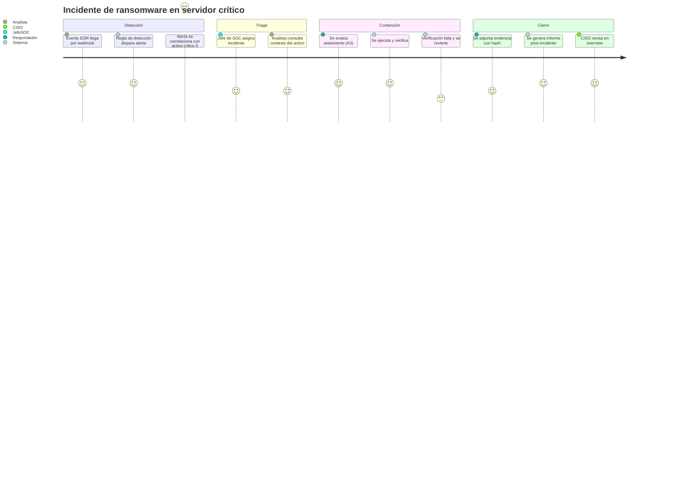

# PERSONAS Y PERFILES DE USO

- **Documento:** `specs/product/personas.md`
- **Estado:** `APPROVED` v1.0
- **Uso:** guiar priorización de pantallas, permisos y flujos. Cada persona mapea a uno o más roles de `SPEC.md §2`.

---

## 1. MAPA DE PERSONAS

| Persona | Rol(es) | Contexto | Frecuencia de uso | Dispositivo principal |
| :--- | :--- | :--- | :--- | :--- |
| `PS-01` CISO / RSSI | `owner`, `auditor` (lectura) | Dirección de seguridad, comité | Diaria (5-20 min) | Desktop 1440 |
| `PS-02` Jefe de SOC | `admin` | Turno, coordinación | Continua | Desktop 1440 + doble pantalla |
| `PS-03` Analista SOC (T1/T2) | `analyst` | Turno 24x7 | Continua | Desktop 1440 |
| `PS-04` Responsable de respuesta | `responder` | Incidente activo | Bajo demanda, alta intensidad | Desktop 1440 |
| `PS-05` Ingeniero de detección | `analyst`/`admin` | Construcción de reglas | Semanal | Desktop |
| `PS-06` Responsable de OT | `admin` (org distinta o etiqueta) | Planta / subestación | Semanal y en incidente | Desktop 768/1440 |
| `PS-07` DPO / Cumplimiento | `auditor` | Auditoría, regulatorio | Semanal/mensual | Desktop |
| `PS-08` Operador de plataforma | `platform_admin` | Infraestructura | Diaria | Terminal + desktop |
| `PS-09` Auditor externo | `auditor` (temporal) | Revisión anual | Puntual | Desktop |
| `PS-10` Integrador / partner | `admin` en laboratorio | Implantación | Proyecto | Desktop + terminal |
| `PS-11` Automatización (servicio) | `service` (PAT) | Integración CI/SOC | Continuo | API |

---

## 2. FICHAS DE PERSONA

### PS-01 — CISO / RSSI

- **Objetivo:** saber si la organización está defendida y puede demostrarlo; decidir inversión y riesgo aceptado.
- **Preguntas que debe responder la consola:** ¿cuál es mi exposición crítica hoy?, ¿qué cambió en 30 días?, ¿qué controles NIS2/ENS están sin evidencia?, ¿cuántas acciones autónomas se ejecutaron y con qué resultado?, ¿qué incidentes incumplieron SLA?
- **Flujo típico:** `/overview` → `/compliance` → `/audit?action=autonomy.*` → exportar informe.
- **Dolores:** dashboards que no cuadran con el informe del auditor; datos sin fecha de actualización; métricas que no se pueden explicar.
- **Requisitos UX:** KPI con definición en tooltip, `as_of` visible, exportación con hash, cero jerga innecesaria.
- **Permisos:** `owner` (o `auditor` si solo consulta). No ejecuta acciones técnicas.
- **Criterio de éxito:** obtiene un informe de postura en <5 minutos sin pedir ayuda.

### PS-02 — Jefe de SOC

- **Objetivo:** priorizar el trabajo del turno, evitar fatiga de alertas y garantizar respuesta en SLA.
- **Preguntas:** ¿qué es lo más grave ahora?, ¿qué está sin asignar?, ¿qué playbook espera aprobación?, ¿qué conector está degradado y qué alertas no llegan?
- **Flujo:** `/soc` → asignar → `/incidents` → aprobar playbook en `/soar` → revisar `/threats/live`.
- **Dolores:** ruido de alertas duplicadas; no saber si un dato está fresco; aprobar sin contexto de blast radius.
- **Requisitos UX:** cola ordenada por riesgo explicable, dedupe visible, aprobaciones con resumen de impacto (activos, severidad, reversibilidad), banner de autonomía.
- **Permisos:** `admin`.
- **Criterio de éxito:** turno sin alertas críticas sin dueño y sin aprobaciones vencidas.

### PS-03 — Analista SOC

- **Objetivo:** investigar rápido, correlacionar activo↔evento↔vulnerabilidad↔IOC y documentar.
- **Preguntas:** ¿qué pasó en este host?, ¿qué activos hablan con esta IP?, ¿esta CVE es explotable aquí?, ¿qué regla disparó?
- **Flujo:** `/siem` (query) → `/assets/{id}` (drawer) → `/threat-intel` (IOC) → comentario en `/incidents`.
- **Dolores:** copiar IPs entre herramientas; queries lentas; no poder guardar una investigación.
- **Requisitos UX:** búsqueda con sintaxis clara y ayuda contextual, resultados con monospace para IP/hash, enlaces cruzados, consultas guardadas, `Ctrl/Cmd+K` para saltar a cualquier entidad.
- **Permisos:** `analyst` (no aprueba A2/A3, no cambia configuración de conectores).
- **Criterio de éxito:** resuelve una investigación de 3 saltos sin salir de la plataforma.

### PS-04 — Responsable de respuesta

- **Objetivo:** contener y erradicar con mínimo impacto, dejando evidencia.
- **Preguntas:** ¿qué acción contiene esto?, ¿qué más se verá afectado?, ¿puedo revertirlo?, ¿quién debe aprobar?
- **Flujo:** `/incidents/{id}` → evaluar acción (`/autonomy/evaluate`) → solicitar aprobación → verificar resultado → timeline.
- **Dolores:** acciones irreversibles sin aviso; no saber si la acción funcionó; perder el hilo del incidente.
- **Requisitos UX:** simulación previa (dry-run), blast radius explícito, estado de verificación (`pending/verified/failed/rolled_back`), timeline inmutable.
- **Permisos:** `responder`.
- **Criterio de éxito:** contiene un incidente de laboratorio en <15 min con rollback probado.

### PS-05 — Ingeniero de detección

- **Objetivo:** escribir reglas precisas, probarlas y desplegarlas sin causar ruido.
- **Preguntas:** ¿cuántos eventos casa esta regla en 7 días?, ¿qué campos existen?, ¿qué versión está activa?
- **Flujo:** `/siem` → crear regla → test con muestra → publicar → medir falsos positivos.
- **Dolores:** DSL críptico; no poder simular antes de activar; reglas que se rompen al cambiar el esquema.
- **Requisitos UX:** editor con validación en vivo y errores por campo, catálogo de campos OCSF, test contra ventana histórica, versionado visible.
- **Permisos:** `analyst` (borradores) / `admin` (publicar).
- **Criterio de éxito:** regla publicada con 0 falsos positivos en la muestra de prueba.

### PS-06 — Responsable de OT

- **Objetivo:** proteger el proceso físico sin provocar paradas ni riesgos de seguridad.
- **Preguntas:** ¿qué dispositivos hay en el nivel 1?, ¿qué escrituras de protocolo son anómalas?, ¿qué zona IEC 62443 incumple?, ¿qué acción podría afectar a una función de seguridad?
- **Flujo:** `/iot-ot` → mapa Purdue → anomalías → `/compliance` (IEC 62443) → solicitar cambio con aprobación.
- **Dolores:** herramientas IT que ignoran PLCs; acciones que no consideran interlocks.
- **Requisitos UX:** Purdue visual, `safety_function` marcado de forma inequívoca, acciones OT bloqueadas con explicación, telemetría con `stale`.
- **Permisos:** `admin` con acceso a activos OT (o rol específico por organización).
- **Criterio de éxito:** ninguna acción OT ejecutada sin interlock satisfecho y doble aprobación.

### PS-07 — DPO / Cumplimiento

- **Objetivo:** demostrar cumplimiento y responder a autoridades en plazo.
- **Preguntas:** ¿qué controles están sin evidencia?, ¿qué evidencia caducó?, ¿qué incidentes son notificables?, ¿qué datos personales tratamos y con qué base legal?
- **Flujo:** `/compliance` → evaluar → adjuntar evidencia → generar informe → tracker NIS2.
- **Dolores:** evidencias dispersas en carpetas; controles marcados "compliant" sin prueba; plazos que se pasan.
- **Requisitos UX:** estado derivado de evidencia, caducidad visible, informes con versión de framework y hash, recordatorios de plazo.
- **Permisos:** `auditor` (aprueba evidencias, no muta dominio).
- **Criterio de éxito:** informe de auditoría generado con evidencia trazable y sin intervención de TI.

### PS-08 — Operador de plataforma

- **Objetivo:** mantener disponibilidad, integridad y recuperabilidad.
- **Preguntas:** ¿está todo sano?, ¿la cola crece?, ¿el backup de anoche terminó?, ¿hay una migración pendiente?, ¿quién activó el kill switch?
- **Flujo:** `/admin` → `/metrics` → logs → runbook → restore drill.
- **Dolores:** fallos silenciosos; backups no probados; dependencias externas.
- **Requisitos UX:** salud con causa, métricas RED, acciones peligrosas con confirmación escrita, auditoría de cambios de configuración.
- **Permisos:** `platform_admin`.
- **Criterio de éxito:** RTO ≤4 h en simulacro, sin acceso a datos de dominio.

### PS-09 — Auditor externo

- **Objetivo:** verificar afirmaciones sin poder alterar el sistema.
- **Preguntas:** ¿la cadena de auditoría es íntegra?, ¿quién aprobó esta acción?, ¿la evidencia corresponde a este control y está vigente?
- **Flujo:** cuenta temporal `auditor` → `/audit` → verificar cadena → `/compliance` → descargar manifiestos.
- **Dolores:** capturas de pantalla como única prueba; imposibilidad de verificar integridad.
- **Requisitos UX:** verificación de cadena con resultado binario y `seq` del fallo, descarga con hash, marcas de tiempo verificables.
- **Permisos:** `auditor` con TTL de cuenta y revocación al finalizar.
- **Criterio de éxito:** valida 20 hallazgos con evidencia en una sesión.

### PS-10 — Integrador / partner

- **Objetivo:** desplegar, conectar fuentes y dejar operativo al cliente.
- **Preguntas:** ¿qué variables de entorno?, ¿cómo pruebo un conector?, ¿qué puertos?, ¿cómo verifico que funciona?
- **Flujo:** `docs/operations-runbook.md` → `scripts/verify_airgap.sh` → `/integrations` → `/admin` → pruebas de humo.
- **Dolores:** documentación desactualizada; configuraciones mágicas; falta de diagnóstico.
- **Requisitos UX:** test de conexión con error accionable, health por conector, logs con `request_id`.
- **Permisos:** `admin` + `platform_admin` en laboratorio.
- **Criterio de éxito:** instalación completa en <2 h siguiendo el runbook.

### PS-11 — Automatización (servicio)

- **Objetivo:** integrar HISPANSHIELD con sistemas del cliente (ticketing, CMDB, CI/CD de reglas).
- **Preguntas:** ¿qué scope necesita este token?, ¿qué endpoint es idempotente?, ¿cómo pagino?
- **Flujo:** PAT con scopes mínimos → `/assets`, `/events/webhook`, `/executions` → auditoría por token.
- **Dolores:** tokens demasiado amplios; APIs sin idempotencia; errores ambiguos.
- **Requisitos UX/API:** scopes granulares, `Idempotency-Key`, errores con `code` estable, rate limit con cabeceras.
- **Permisos:** `service` con scopes explícitos.
- **Criterio de éxito:** integración sin intervención humana y con trazabilidad por token.

---

## 3. JOURNEYS CRÍTICOS (mapeados a tests E2E)

| Journey | Pantallas | Test E2E |
| :--- | :--- | :--- |
| `J-01` Login + MFA + selección de organización | `/login`, `/mfa`, shell | `frontend/e2e/auth.spec.ts` |
| `J-02` Alta de activo e importación con errores | `/assets` | `frontend/e2e/assets.spec.ts` |
| `J-03` Ingesta → alerta → incidente → evidencia | `/siem`, `/soc`, `/incidents` | `frontend/e2e/core-journeys.spec.ts` |
| `J-04` Playbook con aprobación y rollback | `/soar`, `/incidents` | `frontend/e2e/soar-approval.spec.ts` |
| `J-05` Kill switch durante ejecución | `/admin`, `/soar` | `frontend/e2e/kill-switch.spec.ts` |
| `J-06` Evaluación de cumplimiento e informe | `/compliance` | `frontend/e2e/compliance.spec.ts` |
| `J-07` Estados degradados (IA/conector/sensor) | varias | `frontend/e2e/degraded.spec.ts` |

---

## 4. MATRIZ PERSONA × PANTALLA (prioridad de uso)

| Pantalla | PS-01 | PS-02 | PS-03 | PS-04 | PS-05 | PS-06 | PS-07 | PS-08 |
| :--- | :--- | :--- | :--- | :--- | :--- | :--- | :--- | :--- |
| 1 Executive Overview | ●●● | ●● | ● | ● | — | ● | ●● | ● |
| 2 SOC Command Center | ● | ●●● | ●●● | ●● | ● | — | — | — |
| 3 Live Threat Monitoring | — | ●● | ●●● | ● | ● | ● | — | — |
| 4 Incident Management | ●● | ●●● | ●●● | ●●● | ● | ●● | ● | — |
| 5 Threat Intelligence | ● | ●● | ●●● | ●● | ●● | — | — | — |
| 6 Asset Intelligence | ●● | ●● | ●●● | ●● | ● | ●●● | ● | — |
| 7 Attack Surface | ●● | ● | ●● | ● | — | ● | ● | — |
| 8 Vulnerability Management | ●● | ●● | ●● | ●● | ● | ●●● | ● | — |
| 9 SIEM | — | ●● | ●●● | ●● | ●●● | ● | ● | ● |
| 10 SOAR | ● | ●●● | ●● | ●●● | ●● | ● | — | ● |
| 11 AI Agent Control | ● | ●● | ●● | ●● | ●● | — | ● | ● |
| 12 IoT/OT Security | ●● | ●● | ●● | ●● | ● | ●●● | ● | — |
| 13 Network Security | ● | ●● | ●● | ●● | ● | ●●● | — | ● |
| 14 Cloud Security | ●● | ● | ● | ● | — | — | ● | ● |
| 15 Identity Security | ●● | ●● | ●● | ●● | ● | — | ● | ● |
| 16 Forensics | ● | ●● | ●● | ●●● | — | — | ●● | — |
| 17 Compliance | ●●● | ● | ● | ● | — | ●● | ●●● | — |
| 18 Integrations | ● | ●● | ● | ● | ●● | ● | — | ●●● |
| 19 Playbook Designer | — | ●● | ● | ●● | ●● | — | — | ● |
| 20 Model Management | ● | ● | ● | ● | ● | — | ● | ●● |
| 21 Audit Center | ●● | ● | ● | ● | — | ● | ●●● | ●● |
| 22 Organization Management | ●● | ●● | — | — | — | ● | ● | ●● |
| 23 System Administration | ● | ●● | — | — | — | ● | ● | ●●● |

`●●●` uso principal · `●●` uso frecuente · `●` uso ocasional · `—` sin uso previsto.

---

## 5. IMPLICACIONES DE DISEÑO

1. **Densidad configurable:** PS-03/PS-04 trabajan con tablas compactas (32 px); PS-01/PS-07 prefieren 40 px y más aire. Token `--row-density` con preferencia persistida por usuario.
2. **Todo dato con procedencia:** `as_of`, `source`, `rule_version`, `policy_version` visibles en detalle; PS-01 y PS-09 lo exigen.
3. **Acciones peligrosas nunca a un clic:** PS-04 necesita velocidad, PS-06 necesita seguridad; se resuelve con dry-run + confirmación escrita solo en irreversibles.
4. **Modo turno:** PS-02/PS-03 necesitan `Ctrl/Cmd+K`, atajos (`j/k` en listas), y persistencia de filtros por vista.
5. **Lectura sin mutación:** PS-07/PS-09 operan con `auditor`; la UI debe ocultar acciones y explicar el motivo (`required_permission`).
6. **Terminal-friendly:** PS-08/PS-10 usan runbooks con comandos copiables; la UI no debe ser el único camino para operar.
7. **Accesibilidad real:** turnos largos, fatiga visual y daltonismo parcial son la norma, no la excepción.
