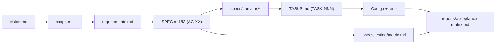

# REQUISITOS DE PRODUCTO

- **Documento:** `specs/product/requirements.md`
- **Estado:** `APPROVED` v1.0
- **Fuente de verdad de aceptación:** `.factory/SPEC.md §3` (los `AC-XX` viven allí; aquí se detallan requisitos y trazabilidad)
- **Regla:** un `REQ-*` sin `AC-*` asociado no es verificable y no puede implementarse.

---

## 1. CONVENCIÓN DE IDENTIFICADORES

| Prefijo | Significado | Ejemplo |
| :--- | :--- | :--- |
| `REQ-<DOM>-NNN` | Requisito funcional de dominio | `REQ-IDN-003` |
| `NFR-NN` | Requisito no funcional global | `NFR-07` |
| `AC-NN` | Criterio de aceptación global (`.factory/SPEC.md`) | `AC-27` |
| `AC-<DOM>-NN` | Criterio de aceptación específico de dominio | `AC-FOR-02` |
| `UIR-NN` | Requisito de interfaz | `UIR-04` |
| `PS-NN` | Persona | `PS-03` |

**Regla de prioridad:** `MUST` (bloqueante release 1.0), `SHOULD` (deseable, puede degradar), `MAY` (futuro). Todo `MUST` tiene AC y test.

---

## 2. REQUISITOS FUNCIONALES POR DOMINIO (resumen normativo)

### 2.1 Identidad y sesión — `specs/domains/identity.md`

| ID | Prioridad | Requisito | AC |
| :--- | :--- | :--- | :--- |
| `REQ-IDN-001` | MUST | Login con email+password verificado con Argon2id; sesión en cookie `hs_session` rotada | `AC-01` |
| `REQ-IDN-002` | MUST | MFA TOTP obligatorio por política de organización para `admin`/`owner` | `AC-02` |
| `REQ-IDN-003` | MUST | Rate limit y bloqueo progresivo sin enumeración de usuarios | `AC-03` |
| `REQ-IDN-004` | MUST | CSRF double-submit en mutaciones autenticadas por cookie | `AC-04` |
| `REQ-IDN-005` | MUST | PAT Bearer con scopes, expiración y revocación | `AC-05` |
| `REQ-IDN-006` | MUST | Expiración por inactividad y absoluta; revocación inmediata | `AC-06` |
| `REQ-IDN-007` | MUST | Política de contraseñas y cambio seguro | `AC-07` |
| `REQ-IDN-008` | MUST | Auditoría de todo evento de autenticación | `AC-08` |

### 2.2 Organizaciones y tenancy — `specs/domains/organizations.md`

| ID | Prioridad | Requisito | AC |
| :--- | :--- | :--- | :--- |
| `REQ-ORG-001` | MUST | Bootstrap `/setup` transaccional y de un solo uso | `AC-09` |
| `REQ-ORG-002` | MUST | Toda entidad scoped por `organization_id`; cross-org → 404 | `AC-10` |
| `REQ-ORG-003` | MUST | Cabecera `X-Organization-Id` obligatoria y membership verificada | `AC-11` |
| `REQ-ORG-004` | MUST | Matriz RBAC exacta, sin permisos extra | `AC-12` |
| `REQ-ORG-005` | MUST | Invitaciones de un solo uso con TTL y rol | `AC-13` |
| `REQ-ORG-006` | MUST | Borrado de organización con confirmación y soft delete 30 días | `AC-14` |

### 2.3 Activos — `specs/domains/assets.md`

| ID | Prioridad | Requisito | AC |
| :--- | :--- | :--- | :--- |
| `REQ-AST-001` | MUST | Modelo de activo con criticidad 1..5, zona, atributos tipados | `AC-15` |
| `REQ-AST-002` | MUST | Grafo de relaciones acíclico con tipos validados | `AC-16` |
| `REQ-AST-003` | MUST | Import CSV/JSON con informe por fila y transacción independiente | `AC-17` |
| `REQ-AST-004` | MUST | Soft delete y restore con integridad referencial | `AC-18` |
| `REQ-AST-005` | MUST | Búsqueda FTS + filtros + paginación cursor p95 < 400 ms | `AC-19` |
| `REQ-AST-006` | MUST | Validación específica IoT/OT en alta de activo | `AC-20` |
| `REQ-AST-007` | MUST | Riesgo de activo recalculado de forma idempotente | `AC-21` |

### 2.4 Superficie de ataque — `specs/domains/attack-surface.md`

| ID | Prioridad | Requisito | AC |
| :--- | :--- | :--- | :--- |
| `REQ-ASM-001` | MUST | Observaciones deduplicadas con estado `new/changed/closed` | `AC-22` |
| `REQ-ASM-002` | MUST | Exposición no autorizada genera hallazgo | `AC-23` |
| `REQ-ASM-003` | MUST | Guard de alcance por CIDR declarado | `AC-24` |
| `REQ-ASM-004` | MUST | Export STIX 2.1/CSV con round-trip | `AC-25` |
| `REQ-ASM-005` | MUST | Jobs idempotentes por `Idempotency-Key` | `AC-26` |

### 2.5 Vulnerabilidades — `specs/domains/vulnerabilities.md`

| ID | Prioridad | Requisito | AC |
| :--- | :--- | :--- | :--- |
| `REQ-VUL-001` | MUST | Scoring determinista explicable con SLA por severidad | `AC-27` |
| `REQ-VUL-002` | MUST | Dedupe por fingerprint multi-fuente | `AC-28` |
| `REQ-VUL-003` | MUST | Máquina de estados con transiciones válidas | `AC-29` |
| `REQ-VUL-004` | MUST | Excepciones de riesgo con justificación y caducidad | `AC-30` |
| `REQ-VUL-005` | MUST | Importadores Nessus/OpenVAS/Trivy | `AC-31` |
| `REQ-VUL-006` | MUST | Falso positivo exige evidencia | `AC-32` |

### 2.6 SIEM — `specs/domains/siem.md`

| ID | Prioridad | Requisito | AC |
| :--- | :--- | :--- | :--- |
| `REQ-SIEM-001` | MUST | Normalización OCSF con campos mínimos y crudo inmutable | `AC-33` |
| `REQ-SIEM-002` | MUST | Webhook firmado HMAC e idempotente | `AC-34`, `AC-35` |
| `REQ-SIEM-003` | MUST | DSL validado con errores por path | `AC-36` |
| `REQ-SIEM-004` | MUST | Evaluación con ventanas, umbral y dedupe | `AC-37` |
| `REQ-SIEM-005` | MUST | Supresión con motivo y ventana | `AC-38` |
| `REQ-SIEM-006` | MUST | Búsqueda p95 < 500 ms a 1M eventos | `AC-39` |
| `REQ-SIEM-007` | MUST | Correlación de alertas a incidente | `AC-40` |
| `REQ-SIEM-008` | MUST | Eventos inmutables por trigger | `AC-41` |
| `REQ-SIEM-009` | MUST | Retención por partición con auditoría | `AC-42` |
| `REQ-SIEM-010` | MUST | Backpressure explícito en ingesta | `AC-48` (incluido en SPEC F-06) |

### 2.7 SOAR — `specs/domains/soar.md`

| ID | Prioridad | Requisito | AC |
| :--- | :--- | :--- | :--- |
| `REQ-SOAR-001` | MUST | Playbook DAG versionado con validación | `AC-43` |
| `REQ-SOAR-002` | MUST | Ejecución durable reanudable tras crash | `AC-44` |
| `REQ-SOAR-003` | MUST | Retry con backoff y dead-letter | `AC-45` |
| `REQ-SOAR-004` | MUST | Aprobaciones con timeout→deny | `AC-46` |
| `REQ-SOAR-005` | MUST | Compensación LIFO idempotente | `AC-47` |
| `REQ-SOAR-006` | MUST | Dry-run sin efectos laterales | `AC-48` |
| `REQ-SOAR-007` | MUST | Límite de concurrencia por organización | `AC-49` |

### 2.8 Autonomía — `specs/security/autonomy-policy.md`

| ID | Prioridad | Requisito | AC |
| :--- | :--- | :--- | :--- |
| `REQ-AUT-001` | MUST | Política determinista deny-by-default con `decision_id` | `AC-70` |
| `REQ-AUT-002` | MUST | Gating de nivel A0..A4 | `AC-71` |
| `REQ-AUT-003` | MUST | Verificación post-acción y rollback | `AC-72` |
| `REQ-AUT-004` | MUST | Blast radius con rechazo total | `AC-73` |
| `REQ-AUT-005` | MUST | Kill switch ≤5 s | `AC-74` |
| `REQ-AUT-006` | MUST | Freeze windows y break-glass | `AC-75` |
| `REQ-AUT-007` | MUST | Presupuesto de acciones por hora | `AC-76` |
| `REQ-AUT-008` | MUST | Auditoría completa de decisión y resultado | `AC-77` |
| `REQ-AUT-009` | MUST | A4 con doble aprobación, time-box e interlock OT | `AC-78` |

### 2.9 Threat intelligence — `specs/domains/threat-intelligence.md`

| ID | Prioridad | Requisito | AC |
| :--- | :--- | :--- | :--- |
| `REQ-CTI-001` | MUST | STIX 2.1 import/export round-trip | `AC-50` |
| `REQ-CTI-002` | MUST | TAXII 2.1 incremental con métricas | `AC-51` |
| `REQ-CTI-003` | MUST | TTL y decaimiento de confianza | `AC-52` |
| `REQ-CTI-004` | MUST | Matching IOC→evento con whitelist | `AC-53` |
| `REQ-CTI-005` | MUST | Salud de feed visible y degradación honesta | `AC-54` |

### 2.10 Incidentes y forense — `specs/domains/incidents.md`, `forensics.md`

| ID | Prioridad | Requisito | AC |
| :--- | :--- | :--- | :--- |
| `REQ-INC-001` | MUST | Severidad P1..P5 derivada con SLA | `AC-55` |
| `REQ-INC-002` | MUST | Máquina de estados con timeline inmutable | `AC-56` |
| `REQ-INC-003` | MUST | Evidencias con hash y control de acceso | `AC-57`, `AC-58` |
| `REQ-INC-004` | MUST | Informe post-incidente con hash | `AC-60` |
| `REQ-INC-005` | MUST | Merge/split de incidentes con preservación de evidencia | `AC-INC-02` |
| `REQ-INC-006` | MUST | Asignación, watchers y detección de SLA | `AC-INC-03` |
| `REQ-FOR-001` | MUST | Caso forense con legal hold | `AC-59` |
| `REQ-FOR-002` | MUST | Manifiesto de integridad y exportación verificable | `AC-FOR-02` |
| `REQ-FOR-003` | MUST | Reconstrucción de timeline desde eventos | `AC-FOR-03` |
| `REQ-FOR-004` | MUST | Acceso a evidencia auditado y restringido por rol | `AC-58` |

### 2.11 IA — `specs/domains/ai-agents.md`

| ID | Prioridad | Requisito | AC |
| :--- | :--- | :--- | :--- |
| `REQ-AIG-001` | MUST | Sin proveedor → `503 ai_unavailable`, nunca datos fabricados | `AC-61` |
| `REQ-AIG-002` | MUST | Routing por perfil con fallback y registro | `AC-62` |
| `REQ-AIG-003` | MUST | RAG con citas verificables | `AC-63` |
| `REQ-AIG-004` | MUST | Dimensión de embedding validada | `AC-64` |
| `REQ-AIG-005` | MUST | Defensa anti prompt-injection | `AC-65` |
| `REQ-AIG-006` | MUST | MCP tool allowlist por agente | `AC-66` |
| `REQ-AIG-007` | MUST | Presupuesto de tokens/coste | `AC-67` |
| `REQ-AIG-008` | MUST | Redacción de secretos en logs de IA | `AC-68` |
| `REQ-AIG-009` | MUST | Runs durables con step log | `AC-69` |

### 2.12 IoT / OT / Cloud

| ID | Prioridad | Requisito | AC |
| :--- | :--- | :--- | :--- |
| `REQ-IOT-001` | MUST | Registro con zona y protocolo; checklist ETSI 13 provisiones | `AC-79` |
| `REQ-IOT-002` | MUST | Firmware→CVE y marca EOL | `AC-80` |
| `REQ-IOT-003` | MUST | Telemetría stale bloquea autonomía | `AC-81` |
| `REQ-IOT-004` | MUST | Aislamiento por zona evaluado en política | `AC-IOT-04` |
| `REQ-OTC-001` | MUST | Modelo Purdue y zona obligatoria | `AC-84` |
| `REQ-OTC-002` | MUST | Safety interlock deniega escritura | `AC-82` |
| `REQ-OTC-003` | MUST | Baseline de protocolo y anomalía de escritura | `AC-83` |
| `REQ-OTC-004` | MUST | Conductos IEC 62443 con `required_sl` | `AC-84` |
| `REQ-CLD-001` | MUST | Credenciales cloud cifradas y nunca expuestas | `AC-85` |
| `REQ-CLD-002` | MUST | CSPM con evidencia y mapeo a control | `AC-86` |
| `REQ-CLD-003` | MUST | Proveedor caído → estado degradado, sin `pass` inventado | `AC-87` |

### 2.13 Cumplimiento — `specs/domains/compliance.md`

| ID | Prioridad | Requisito | AC |
| :--- | :--- | :--- | :--- |
| `REQ-CMP-001` | MUST | 8 frameworks seed con versión y controles | `AC-88` |
| `REQ-CMP-002` | MUST | Estado derivado de evidencia aprobada y vigente | `AC-89`, `AC-91` |
| `REQ-CMP-003` | MUST | Evaluación con score y gaps | `AC-90` |
| `REQ-CMP-004` | MUST | Tracker NIS2 24h/72h/1 mes | `AC-92` |
| `REQ-CMP-005` | MUST | Informe con versión de framework y hash | `AC-93` |
| `REQ-CMP-006` | MUST | RoPA/DPIA con base legal y revisión | `AC-CMP-06` |

### 2.14 Plataforma e integraciones

| ID | Prioridad | Requisito | AC |
| :--- | :--- | :--- | :--- |
| `REQ-PLT-001` | MUST | Health/readyz con causa y migración actual | `AC-110` |
| `REQ-PLT-002` | MUST | Migraciones up/down limpias | `AC-111` |
| `REQ-PLT-003` | MUST | Auditoría verificable y a prueba de manipulación | `AC-112` |
| `REQ-PLT-004` | MUST | Backup/restore ensayado | `AC-113` |
| `REQ-PLT-005` | MUST | Air-gap sin red | `AC-114` |
| `REQ-PLT-006` | MUST | Logs con `request_id` y sin secretos | `AC-115` |
| `REQ-PLT-007` | MUST | Apagado ordenado con drenaje | `AC-116` |
| `REQ-INT-001` | MUST | Contrato de conector con capacidades y config schema | `AC-104` |
| `REQ-INT-002` | MUST | Edge store-and-forward en orden | `AC-105` |
| `REQ-INT-003` | MUST | mTLS exigible | `AC-106` |
| `REQ-INT-004` | MUST | Circuit breaker con backoff | `AC-107` |
| `REQ-INT-005` | MUST | Registro MCP con esquemas y allowlist | `AC-108` |
| `REQ-INT-006` | MUST | Matriz de compatibilidad explícita | `AC-109` |

---

## 3. REQUISITOS DE INTERFAZ (UIR)

| ID | Prioridad | Requisito | Verificación |
| :--- | :--- | :--- | :--- |
| `UIR-01` | MUST | Las 23 pantallas existen en rutas estables y renderizan sin errores de consola | `frontend/e2e/screens.spec.ts` (`AC-94`) |
| `UIR-02` | MUST | Tokens de `ARCHITECTURE.md §5` aplicados; ningún color fuera de token | test de computed styles + `a11y.spec.ts` (`AC-99`) |
| `UIR-03` | MUST | Skeleton estructural con `aria-busy` en toda vista asíncrona | `states.spec.ts` (`AC-95`) |
| `UIR-04` | MUST | Empty state con icono, explicación y CTA primario | `states.spec.ts` (`AC-96`) |
| `UIR-05` | MUST | Error state con causa, `requestId` y reintento funcional | `states.spec.ts` (`AC-97`) |
| `UIR-06` | MUST | Estado degradado con `as_of` y causa; sin ceros ficticios | `degraded.spec.ts` (`AC-97`, `TASK-130`) |
| `UIR-07` | MUST | Sin scroll horizontal a 375/768/1440 | `responsive.spec.ts` (`AC-98`) |
| `UIR-08` | MUST | WCAG 2.2 AA: contraste, foco, teclado, `aria-live` | `a11y.spec.ts` + `keyboard.spec.ts` (`AC-99`, `AC-100`) |
| `UIR-09` | MUST | Command palette y navegación por teclado en consola SOC | `keyboard.spec.ts` |
| `UIR-10` | MUST | Acciones destructivas con confirmación escrita y resumen de impacto | `destructive-confirm.spec.ts` (`AC-102`) |
| `UIR-11` | MUST | Live stream con reconexión, dedupe y control de pausa | `live-stream.spec.ts` (`AC-101`) |
| `UIR-12` | SHOULD | Densidad de tabla configurable y persistida por usuario | test de componente |
| `UIR-13` | MUST | `prefers-reduced-motion` respetado | `reduced-motion.spec.ts` (`AC-103`) |
| `UIR-14` | SHOULD | Formato de fecha ISO 8601 UTC con `title` local | test de `format.ts` |

---

## 4. CATÁLOGO DE PANTALLAS Y REQUISITOS ESPECÍFICOS

| # | Pantalla | Requisitos específicos (además de UIR-01..14) |
| :--- | :--- | :--- |
| 1 | Executive Overview | KPIs con definición y `as_of`; tendencia 30 d; radar de postura; top 10 activos por riesgo; onboarding si no hay datos |
| 2 | SOC Command Center | Cola ordenada por riesgo explicable; dedupe visible; asignación inline; filtros persistidos; atajos `j/k` |
| 3 | Live Threat Monitoring | SSE con pausa/reanudar; límite de buffer; badge `reconnecting`; dedupe por `event_id`; `aria-live` |
| 4 | Incident Management | Master-detail; timeline inmutable; evidencias con hash; SLA visible; transiciones con confirmación |
| 5 | Threat Intelligence | Indicadores con TTL/confianza; grafo actor-campaña; salud de feeds; import STIX |
| 6 | Asset Intelligence | Tabla + grafo; drawer con vulnerabilidades/eventos; import con informe; filtros por criticidad |
| 7 | Attack Surface | Diffs before/after; scope declarado; export; aviso legal de alcance |
| 8 | Vulnerability Management | Score breakdown; SLA countdown; excepciones con caducidad; importadores |
| 9 | SIEM | Editor de consultas con ayuda; consultas guardadas; salud de ingesta; export de resultados |
| 10 | SOAR | Ejecuciones con pasos y estados; aprobaciones con impacto; cancelar/compensar |
| 11 | AI Agent Control | Runs, tool-calls, presupuesto, aprobaciones, estado `UNAVAILABLE` |
| 12 | IoT/OT Security | Purdue map; zonas; anomalías de protocolo; `stale` visible; acciones bloqueadas explicadas |
| 13 | Network Security | Segmentos, conduits, flujos; detecciones de red; relación con activos |
| 14 | Cloud Security | Cuentas, postura, findings, `as_of` y proveedor degradado |
| 15 | Identity Security | Identidades, MFA coverage, privilegios, riesgos; export |
| 16 | Forensics | Casos, legal hold, manifiesto, timeline, export con hash |
| 17 | Compliance | Framework picker, matriz de controles, gaps, evidencias con vigencia, informes |
| 18 | Integrations | Catálogo, config schema dinámico, test de conexión, salud, rotación de secreto |
| 19 | Playbook Designer | Canvas DAG, inspector, validación en vivo, dry-run, versionado/publish |
| 20 | Model Management | Proveedores, modelos, health, evals, presupuesto, cambio con gate |
| 21 | Audit Center | Filtros, verificación de cadena, detalle de acción autónoma |
| 22 | Organization Management | Miembros, roles, invitaciones, settings, guard de último owner |
| 23 | System Administration | Flags, retención, salud, kill switches, backup, acciones peligrosas |

---

## 5. REQUISITOS NO FUNCIONALES (referencia)

Detalle completo y verificación en `.factory/SPEC.md §6`. Resumen: rendimiento (`NFR-01..03`), durabilidad (`NFR-04..05`), autonomía (`NFR-06`), seguridad (`NFR-07`), accesibilidad (`NFR-08`), portabilidad (`NFR-09`), retención (`NFR-10`), observabilidad (`NFR-11`), recuperación (`NFR-12`), compatibilidad (`NFR-13`), localización (`NFR-14`).

---

## 6. MATRIZ DE TRAZABILIDAD PRODUCTO → IMPLEMENTACIÓN

| Capa | Documento | Responsable |
| :--- | :--- | :--- |
| Necesidad | `vision.md`, `personas.md` | Producto |
| Límite | `scope.md` | Producto + Arquitectura |
| Requisito | `requirements.md` | Producto |
| Aceptación | `.factory/SPEC.md §3` | Arquitectura |
| Diseño de dominio | `specs/domains/*` | Arquitectura |
| Ejecución | `.factory/TASKS.md` | Orquestador |
| Evidencia | `reports/acceptance-matrix.md` | QA |

---

## 7. REGLAS DE CAMBIO

1. Un requisito nuevo entra por `requirements.md` con ID, prioridad, AC y test; después se añade la tarea en `TASKS.md`.
2. Un requisito `MUST` no puede degradarse a `SHOULD` sin ADR y aprobación de arquitectura.
3. Los requisitos implementados se marcan en `docs/implementation-status.md` con estado `SPECIFIED`, `IN_PROGRESS`, `IMPLEMENTED`, `VERIFIED`; solo `VERIFIED` cuenta para el Exit Gate.
4. Ningún requisito se declara cumplido por inspección visual; requiere test o comando reproducible.
