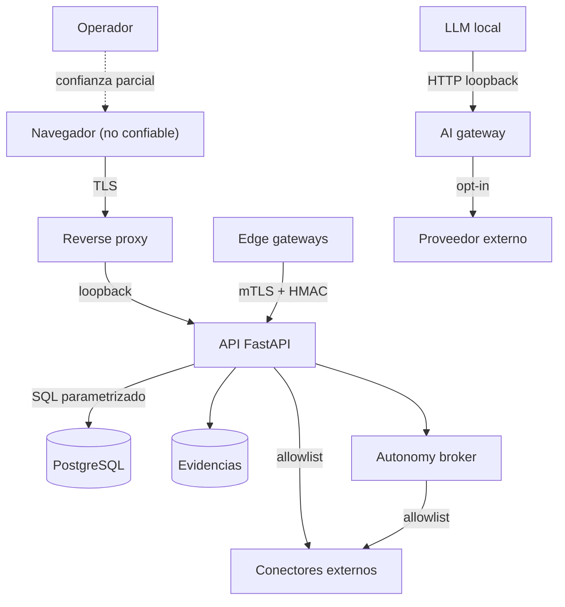

# MODELO DE AMENAZAS

- **Documento:** `specs/security/threat-model.md`
- **Estado:** `APPROVED` v1.0
- **Metodología:** STRIDE por frontera + LINDDUN para privacidad + árboles de ataque para los tres escenarios de mayor impacto
- **Revisión:** obligatoria por release y tras cualquier incidente de seguridad del producto

---

## 1. ACTIVOS A PROTEGER

| ID | Activo | Confidencialidad | Integridad | Disponibilidad | Notas |
| :--- | :--- | :---: | :---: | :---: | :--- |
| `A-01` | Credenciales de usuarios | Alta | Alta | Media | Argon2id |
| `A-02` | Secretos de conectores y MFA | Crítica | Crítica | Media | Fernet |
| `A-03` | Telemetría SIEM (IPs, identidades) | Alta | Crítica | Alta | PII potencial |
| `A-04` | Inventario y topología | Alta | Alta | Media | Revela objetivos |
| `A-05` | Evidencias forenses | Crítica | Crítica | Media | Cadena de custodia |
| `A-06` | Decisiones y acciones autónomas | Media | Crítica | Alta | Repudio/abuso |
| `A-07` | Cadena de auditoría | Media | Crítica | Alta | No repudio |
| `A-08` | Políticas de autonomía | Media | Crítica | Alta | Cambio = poder |
| `A-09` | Informes de cumplimiento | Media | Crítica | Media | Prueba regulatoria |
| `A-10` | Disponibilidad del servicio | — | — | Crítica | Protección en curso |

---

## 2. ACTORES DE AMENAZA

| ID | Actor | Motivación | Capacidad | Vector preferido |
| :--- | :--- | :--- | :--- | :--- |
| `T-01` | Atacante externo oportunista | Acceso, datos | Media | Credenciales filtradas, webhooks, exposición |
| `T-02` | Grupo APT | Persistencia, espionaje, sabotaje | Alta | Supply chain, 0-day, ingeniería social |
| `T-03` | Insider descontento | Represalia, dinero | Alta (acceso legítimo) | Abuso de rol, exfiltración, borrado |
| `T-04` | Administrador negligente | Error | Media | Configuración laxa, aprobaciones sin lectura |
| `T-05` | Proveedor/integrador | Acceso de soporte | Media | Break-glass, credenciales compartidas |
| `T-06` | Atacante físico | Sabotaje | Media | Acceso a appliance, robo de disco |
| `T-07` | Contenido malicioso (LLM) | Inducir acciones | Baja-Media | Prompt injection indirecta |
| `T-08` | Dependencia comprometida | Distribución | Alta | Paquete malicioso en PyPI/npm |

---

## 3. FRONTERAS DE CONFIANZA



| Frontera | Confianza | Control principal |
| :--- | :--- | :--- |
| `F-1` Navegador → Proxy | Ninguna | TLS, CSP, CSRF, validación server-side |
| `F-2` Proxy → API | Alta (red interna) | mTLS opcional, headers confiables solo desde proxy |
| `F-3` API → DB | Alta | Rol mínimo, SQL parametrizado, RLS opcional |
| `F-4` API → Externos | Baja | Allowlist, anti-SSRF, TLS verificado, timeouts |
| `F-5` Edge → API | Media | mTLS + HMAC + secuencia |
| `F-6` LLM → Broker | **Ninguna** | El LLM no tiene credenciales ni capacidad de acción |
| `F-7` Operador → UI | Media | RBAC, MFA, auditoría, separación de funciones |

---

## 4. STRIDE POR COMPONENTE

| Componente | Spoofing | Tampering | Repudiation | Info disclosure | DoS | Elevation |
| :--- | :--- | :--- | :--- | :--- | :--- | :--- |
| Auth | Token robado, MFA bypass | Manipular claims | Negar login | Enumeración | Fuerza bruta | Rol forjado |
| API REST | PAT robado | Mass assignment | Acción sin traza | IDOR, errores verbosos | Rate limit | Guard ausente |
| SIEM ingest | Webhook falsificado | Evento alterado | — | Fuga cross-org | Flood | — |
| Detection | — | Regla maliciosa | — | — | Regla costosa | Publicar sin permiso |
| Workflow | — | DAG alterado | Ejecución negada | — | Bucle | Acción no autorizada |
| Autonomy | Suplantar solicitante | Cambiar política | "No fui yo" | Fuga de políticas | Acción masiva | Salto de nivel |
| AI/RAG | — | Documento envenenado | — | Contexto cross-org | Coste | Tool-call |
| Connectors | Suplantar conector | Config alterada | — | Secreto | Martilleo | Acción no declarada |
| Edge | Gateway falso | Reordenar/replay | — | — | Buffer overflow | — |
| Compliance | — | Evidencia falsa | — | — | — | Autoaprobar |
| Audit | — | Reescritura | — | — | — | — |

---

## 5. ÁRBOLES DE ATAQUE (top 3)

### 5.1 Ejecutar una acción destructiva no autorizada

```text
Objetivo: aislar un host crítico o deshabilitar una cuenta sin autorización
├── A. Robar sesión de un responder
│   ├── A1. XSS en nombre de activo/evidencia → cookie HttpOnly lo impide
│   ├── A2. CSRF → double-submit lo impide
│   └── A3. Malware en puesto → fuera del alcance del producto
├── B. Escalar rol
│   ├── B1. PATCH de membership → RBAC + guard de último owner
│   └── B2. platform_admin sin break-glass → 403
├── C. Saltarse la política
│   ├── C1. Payload con action_type no listado → 403 action_not_supported
│   ├── C2. Manipular autonomy_level en request → el nivel se lee de la config, no del body
│   ├── C3. Ejecutar vía MCP sin allowlist → 403 tool_not_allowed
│   └── C4. Invocar adaptador directamente → no hay endpoint público
└── D. Prompt injection
    ├── D1. Documento RAG con instrucciones → guardrails + sin autoridad
    └── D2. Evento con texto malicioso → delimitado como untrusted
```

**Controles decisivos:** autorización server-side, política independiente del texto, broker único, allowlist MCP, auditoría.

### 5.2 Exfiltrar datos de otra organización

```text
Objetivo: leer activos/eventos/evidencias de otra org
├── A. Cambiar X-Organization-Id → membership verificada
├── B. IDOR por UUID → filtro por org en repositorio + 404 uniforme
├── C. Búsqueda/export sin scope → export scoped y auditado
├── D. SSE con filtro manipulado → filtro forzado a la org de la sesión
├── E. RAG con documentos de otra org → índice particionado por org
└── F. Break-glass sin aprobación → aprobación + TTL + auditoría
```

### 5.3 Comprometer la cadena de suministro

```text
Objetivo: introducir código malicioso en el producto
├── A. Dependencia comprometida → pin + hash + pip-audit + revisión
├── B. Typosquatting → allowlist y revisión de nombres
├── C. Script de build alterado → revisión de `scripts/`, SBOM, checksums
├── D. Imagen/artefacto sustituido → firma (cosign) y verificación
└── E. Licencia incompatible → check_licenses.py en CI
```

---

## 6. LINDDUN (PRIVACIDAD)

| Categoría | Riesgo en HISPANSHIELD | Control |
| :--- | :--- | :--- |
| **L**inking | Correlacionar identidades entre eventos y activos | Minimización, retención, acceso por rol |
| **I**dentifying | IPs/usuarios en telemetría | Seudonimización configurable, redacción en logs |
| **N**on-repudiation | El operador no puede negar una acción | Auditoría con actor e IP |
| **D**etecting | Inferir que un activo está monitorizado | Acceso restringido a inventario |
| **D**isclosure | Fuga de evidencias o informes | Cifrado en tránsito, RBAC, hash |
| **U**nawareness | Titulares sin información | RoPA/DPIA, transparencia en documentación del cliente |
| **N**on-compliance | Retención excesiva o transferencias | Retención configurable, `data_region`, legal hold |

**Datos personales tratados:** identificadores de usuario en eventos, direcciones IP, correos de miembros, nombres en evidencias. Base legal y finalidad se documentan en el RoPA del cliente; la plataforma aporta las herramientas (`REQ-CMP-014`).

---

## 7. RIESGOS RESIDUALES ACEPTADOS (release 1.0)

| ID | Riesgo | Severidad residual | Justificación | Mitigación compensatoria |
| :--- | :--- | :--- | :--- | :--- |
| `R-01` | Sin federación SAML/OIDC | Media | Complejidad y air-gap | Auth local fuerte + MFA; OIDC experimental |
| `R-02` | Sin HSM para `SECRET_KEY` | Media | Disponibilidad | Clave en gestor de secretos del cliente, rotación documentada |
| `R-03` | Búsqueda FTS limitada a 90 días sin filtro | Baja | Coste | Guard explícito; retención caliente configurable |
| `R-04` | RAG O(n) por org | Baja | Volumen acotado | Límite 200k chunks; abstracción para migrar |
| `R-05` | Sin HA automática | Media | Alcance 1.0 | Réplica documentada, RTO/RPO, backups probados |
| `R-06` | IA local depende de hardware del cliente | Baja | Soberanía | Funciona sin IA; estado honesto |
| `R-07` | Sin adquisición forense remota | Baja | Alcance | Exportación de artefactos y manifiestos |
| `R-08` | Docker no validado en este entorno | Baja | Sin daemon | Manifiestos validados estáticamente + runbook |

---

## 8. ESCENARIOS DE ABUSO QUE EL PRODUCTO DEBE RESISTIR (tests)

| ID | Escenario | Test |
| :--- | :--- | :--- |
| `AB-01` | Usuario de org A pide recurso de org B por ID | `test_tenant_isolation.py` |
| `AB-02` | `viewer` intenta aprobar una acción | `test_rbac_matrix.py` |
| `AB-03` | Analista intenta publicar una regla | `test_rbac_matrix.py` |
| `AB-04` | Token de servicio intenta leer auditoría | `test_token_scopes.py` |
| `AB-05` | Prompt injection induce `isolate_host` | `test_prompt_injection.py` |
| `AB-06` | Kill switch activado durante ejecución | `test_kill_switch.py` |
| `AB-07` | Webhook con firma capturada reenviada | `test_webhook_hmac.py` |
| `AB-08` | Evidencia sustituida en disco | `test_evidence_integrity.py` |
| `AB-09` | Conector apunta a `169.254.169.254` | `test_ssrf_guard.py` |
| `AB-10` | Aprobación de excepción por el propio solicitante | `test_separation_of_duties.py` |

---

## 9. REVISIÓN Y ACTUALIZACIÓN

1. Revisión obligatoria al cerrar cada fase con cambios de superficie (auth, ingest, autonomía, IA, conectores).
2. Cualquier `VULN-XXX` `CRITICAL`/`HIGH` actualiza este documento y `SECURITY_AUDIT.md`.
3. Los riesgos residuales se revisan por release; uno aceptado no se hereda automáticamente.
4. El modelo se valida contra el código: todo control listado debe tener test asociado.
